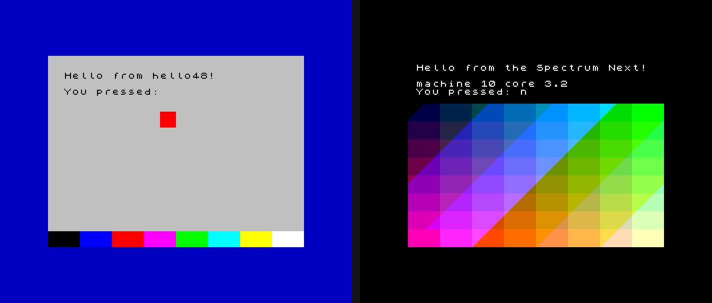
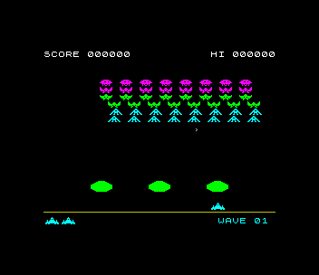
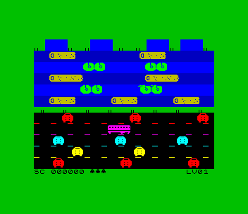
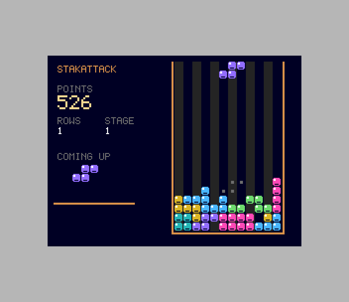
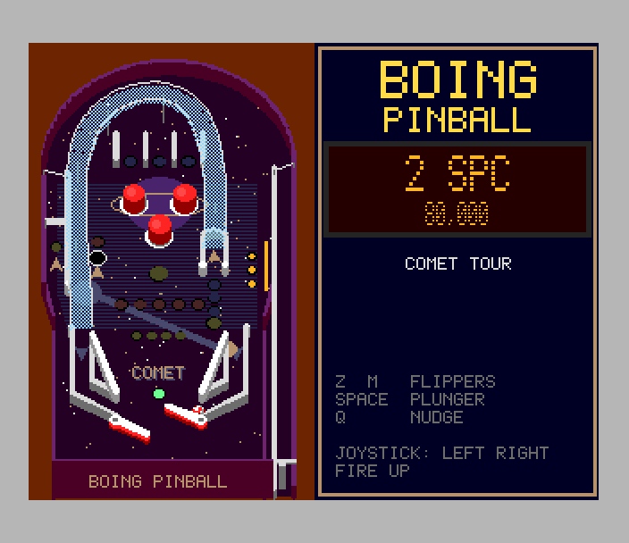
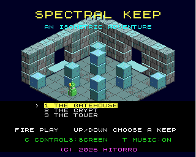
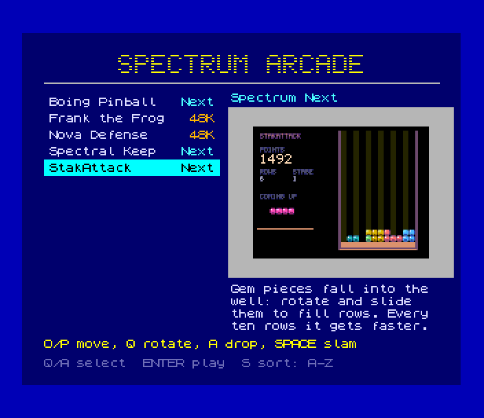

# spectrum-dev — a ZX Spectrum / Spectrum Next dev kit with a scriptable, debuggable emulator

Write software for the **ZX Spectrum 48K/128K** and the **Spectrum Next** on a
modern Mac or Linux machine. One command builds a cross-compile toolchain
(z88dk + sjasmplus, in Docker), a patched [ZEsarUX](https://github.com/chernandezba/zesarux)
emulator that programs, scripts and AI agents can drive deterministically,
and a Python host with a CLI, an MCP server for Claude Code and a web
DevBench. The result is a fast **edit → build → boot → observe → test → debug**
loop.



> Both programs above were built, run headless, driven with key presses and
> screenshotted by `./zx selftest`.

---

## Contents

- [One-line install](#one-line-install)
- [Manual install](#manual-install)
- [First steps](#first-steps)
- [How it works](#how-it-works)
- [Everyday commands](#everyday-commands)
- [Working with Claude Code (MCP)](#working-with-claude-code-mcp)
- [Writing programs](#writing-programs)
- [Games](#games)
- [Arcade](#arcade)
- [Repository layout](#repository-layout)
- [Documentation](#documentation)
- [Licensing and credits](#licensing-and-credits)

---

## One-line install

Once the repo is published:

```sh
curl -fsSL https://raw.githubusercontent.com/geekychris/spectrum-dev/main/scripts/install.sh | bash
```

It checks prerequisites, clones to `~/spectrum-dev`, runs `./setup.sh`
(toolchain image, emulator, Python env, full test suite; a few minutes, most
of it the first Docker pull) and opens hello48 in a window. Knobs are in the
header of [`scripts/install.sh`](scripts/install.sh).

## Manual install

**Prerequisites**

| | macOS | Debian / Ubuntu |
|---|---|---|
| git, make, C compiler | `xcode-select --install` | `sudo apt install git build-essential` |
| SDL2 (emulator window; headless works without) | `brew install sdl2` | `sudo apt install libsdl2-dev` |
| Docker (any engine) | Docker Desktop, Rancher Desktop, OrbStack or colima | `sudo apt install docker.io` (+ `docker` group) |
| Python ≥ 3.10 (or [uv](https://docs.astral.sh/uv/)) | `brew install uv` | `sudo apt install python3 python3-venv` |

```sh
git clone <this repo> spectrum-dev && cd spectrum-dev
./setup.sh             # idempotent; --quick skips the tests
./zx doctor            # checks every piece and says how to fix anything broken
./zx run hello48       # 48K hello in a window
```

## First steps

```sh
./zx run hello48               # window: type on your keyboard, the Spectrum sees it
./zx run hellonext             # Spectrum Next: 28 MHz, Layer 2
./zx new mygame                # 48K project from sdk/template   (--next for a .nex)
$EDITOR projects/mygame/src/main.c
./zx run mygame                # rebuilds, boots, opens a window
./zx test mygame               # headless test (projects/mygame/test.py)
./zx log mygame --frames 300 --press P@200     # what the program logged
./zx shot mygame -o shot.png --until "mygame: ready"
./zx devbench --open           # web UI on http://127.0.0.1:3580/
```

## How it works

```
 your C / asm ──▶ bin/zx-make ──docker──▶ z88dk (zcc +zx / +zxn) or sjasmplus ──▶ build/<p>.tap | .nex | .sna
                                                                                  + .map / .sym symbols
                                                                                        │
 ┌──────────────────── session process (zxdev serve) ─────────────────────────────────▼───────┐
 │  Emulator (Python) ──ZRCP/TCP──▶ ZEsarUX 13.0 + zxh patch (native, SDL2 window or headless) │
 │   ├─ control port (JSON lines)  ◀── ./zx ctl, test.py, MCP server (Claude), DevBench        │
 │   ├─ debug log: guest OUTs to the ZXI port ─▶ captured, run_until("text")                   │
 │   ├─ screen: rendered frame ─▶ PNG       input: keyboard matrix + Kempston/Sinclair         │
 │   └─ debugger: breakpoints, watchpoints, step, regs, memory, symbols, snapshots             │
 └─────────────────────────────────────────────────────────────────────────────────────────────┘
```

1. **Toolchain.** The official [z88dk](https://github.com/z88dk/z88dk) image
   (pinned) plus [sjasmplus](https://github.com/z00m128/sjasmplus), built
   into `zx-dev-toolchain:1`; native on arm64 and amd64. C builds with zsdcc
   and newlib produce a `.tap` (48K, autoloads) or `.nex` (Next) plus a
   `.map`.
2. **Emulator.** ZEsarUX 13.0 at a pinned commit, built natively. It already
   has a remote protocol (ZRCP) with memory, registers, breakpoints,
   snapshots and machine selection; our ~30-line patch plus a 300-line
   extension (`emulator/ext/zxh.c`) adds **deterministic frame stepping** at
   9–44x real time, a **guest debug log** (the program `OUT`s text to
   ZEsarUX's ZXI debug port, a no-op on real hardware), **run until a log
   line**, and fixes for driving it from another thread on macOS. Details:
   [emulator/patches/README.md](emulator/patches/README.md).
3. **Sessions.** The `zxdev` Python package starts ZEsarUX and drives it over
   ZRCP. A session process shares one emulator with any number of clients
   through a JSON control port and a registry in `build/sessions/`.
4. **Agents.** An MCP server (stdio for Claude Code via `.mcp.json`, and
   HTTP at DevBench's `/mcp`) exposes build, boot, run-until, look, press,
   memory, breakpoints, watchpoints, stepping and snapshots.

Paused (headless) sessions are deterministic: two emulators loading the same
program reach the same log line on the same frame with the same registers.

What the harness covers (each item has checks in `./zx selftest`):

| | |
|---|---|
| input | keys and CAPS/SYM combos, timed press/hold/release at given frames, typed text, Kempston / Sinclair 1+2 / Cursor joysticks, the Next's extra keys (matrix + NextReg 0xB0/0xB1); headless and in the window |
| debugging | breakpoints by address, symbol or condition, read/write watchpoints, step, step over, continue with a frame limit, all registers, 128K banks and Next MMU pages, disassembly, stack backtrace, where/why it stopped |
| screens | native PNG of the composited display incl. border; ULA, Layer 2 and sprite layers rendered separately; GIF/MP4 recording |
| restart | soft/hard reset, reload, power cycle, machine switch, reboot a wedged session |
| replay | input log with exact frame/T-state, replay with screen-hash checkpoints, .zsf/.z80/.sna snapshots |
| logging | `zx_log` from the guest, run until a log line (stops on the instruction), frame counting |

## Everyday commands

| | |
|---|---|
| `./zx build <p>` | compile → `projects/<p>/build/<p>.tap` or `.nex` (+ `.map`) |
| `./zx run <p>` | window, free-running; `./zx ctl` and Claude can attach |
| `./zx test <p>` | `projects/<p>/test.py`, else pass on `ZX:DONE` / fail on `ZX:FAIL` in the log |
| `./zx log <p> [--frames N] [--press KEYS@FRAME]` | print the guest log |
| `./zx shot <p> -o x.png [--until TEXT] [--press ...] [--no-border] [--scale 2] [--layer L]` | screenshot (composite or one layer) |
| `./zx video <p> -o x.gif\|x.mp4 [--until TEXT] [--frames N]` | record frames |
| `./zx log <p> --press K@F ... --record r.json` / `./zx replay r.json` | record an input log, replay it with screen-hash checks |
| `./zx serve <p> [--window]` / `./zx sessions` / `./zx ctl <cmd> k=v` | sessions and remote control (`./zx ctl help`) |
| `./zx symbols <p> [regex]` | symbols from the map |
| `./zx new <name> [--next]` | new project from the template |
| `./zx devbench [--open]` | web UI + REST + MCP over HTTP on :3580 |
| `./zx arcade [--no-build]` | every game + a menu on an SD card with NextZXOS, in a window ([Arcade](#arcade)) |
| `./zx selftest` | build and test everything (CI entry point) |
| `./zx doctor` | environment check with fixes |

`<p>` is a project name or a `.tap/.nex/.sna/.z80/.zsf` path, or an `.mmc` SD
image (the Next boots NextZXOS from it).
Remote control and debugging: [docs/emulator-harness.md](docs/emulator-harness.md).

## Working with Claude Code (MCP)

Open the repo with `claude`; `.mcp.json` registers the **zx** MCP server
(`.venv/bin/zxdev-mcp`). The inner loop:

```
build("mygame") → emu_boot("mygame") → emu_run_until("mygame: ready")
  → emu_press("P") / emu_look() / emu_log() / emu_read_mem("score")
  → emu_break("update_player") → emu_continue() → emu_regs() / emu_disasm()
```

`emu_boot(p, window=True)` opens a window the user can watch and play;
`emu_attach()` joins one started with `./zx run`; `arcade_play("stakattack")`
boots the arcade's SD card and starts a game from its menu. All the tools are listed by
`emu_cmd("help")` and in [CLAUDE.md](CLAUDE.md).

## Writing programs

Start from the template (`./zx new mygame`, or `--next`): a 50 Hz main loop
on `HALT`, keyboard (QAOP/SPACE) and Kempston input, text with the ROM font,
and `zx_log` lines that `test.py` waits for. Log state changes so tests and
agents can see them:

```c
#include "zxlog.h"
zx_log("mygame: score=%u lives=%u\n", score, lives);
```

SDK reference: [sdk/README.md](sdk/README.md). Examples: `projects/hello48`
(48K, attributes, keys), `projects/hellonext` (Next registers, 28 MHz,
Layer 2 through an MMU slot), `projects/asm48` (sjasmplus `.sna`).

## Games

Ports of games from `amiga_mcp/examples`, keeping each game's rules, levels,
scoring and feel, with graphics redrawn for the machine. Each one has a
`test.py` in which a bot plays a whole game through the harness (start, score,
lose, game over, high-score entry, title), followed by a replay-determinism check.
They are part of `./zx selftest`.

| | | |
|---|---|---|
| [Nova Defense](projects/nova_defense/README.md) | 48K `.tap` |  |
| [Frank the Frog](projects/frank_the_frog/README.md) | 48K `.tap` |  |
| [StakAttack](projects/stakattack/README.md) | Next `.nex`: Layer 2, hardware sprites, TurboSound music |  |
| [Boing Pinball](projects/boing_pinball/README.md) | Next `.nex`: the original's physics and rules in 16-bit, 320x256 Layer 2, sprites, banked code |  |
| [Spectral Keep](projects/spectral_keep/README.md) | Next `.nex`: isometric rooms on 320x256 Layer 2, sprites masked behind scenery, tilemap HUD, copper, DMA, TurboSound, banked code |  |

How the two machines compare as targets, and what each game uses:
[docs/48k-vs-next.md](docs/48k-vs-next.md).

The shared game layer is in `sdk/include/zxgame.h` (8.8 fixed point, trig,
random numbers, IM 2 frame timer, latched input with Kempston support,
beeper/AY sound and music, 48K sprites/text, high scores and the initials
editor), `fixmath.h` (16-bit fixed point, Z80N MUL), `font5.h`, `modplay.h`
(MOD music), `nextgfx.h` (Layer 2 in both modes, sprites, palettes,
TurboSound, DMA), the Next modules `l2rle.h` (RLE pictures), `nextspr.h`
(sprite groups and masking), `isosort.h`, `nextcopper.h`, `nexttile.h`
(tilemap text), `palfx.h`, `aystream.h` (TurboSound streams), `zxrle.h`, and
the tools in `sdk/tools`; see [sdk/README.md](sdk/README.md).

## Arcade

```sh
./zx arcade
```

builds every game and a menu into an SD card image with NextZXOS
(`build/arcade/arcade.mmc`) and opens it in a window: the Next boots into
the **Spectrum Arcade**, a Layer 2 menu with the list on the left and the
selected game's picture and description on the right (sorted A-Z or by
plays), and starts the game you pick, Next `.nex` or 48K, the way NextZXOS's
own browser would (`.nexload`, or `SPECTRUM` for a 48K snapshot). Reset
brings the menu back.



A game joins by having a `projects/<p>/arcade.json` (title, description,
controls, picture, the log line its title prints); the menu, the list in
[docs/arcade.md](docs/arcade.md), DevBench's page (<http://127.0.0.1:3580/arcade>,
a Play button per game) and the MCP tools (`arcade_games`, `arcade_play(game)`)
all come from those files. How the card, the menu, loading and returning
work: [projects/arcade/README.md](projects/arcade/README.md).

## Repository layout

| | |
|---|---|
| `zx` | the CLI (bash; dispatches to `bin/zx-make` and the Python `zxdev`) |
| `setup.sh`, `scripts/` | setup, doctor, toolchain image, emulator build, Python env, installer; pins in `scripts/lib.sh` |
| `docker/Dockerfile` | toolchain image (z88dk + sjasmplus) |
| `emulator/ext/zxh.{c,h}`, `emulator/patches/` | our ZEsarUX extension and patches |
| `tools/zxdev/` | Python package: `emu.py` (Emulator), `zrcp.py`, `session.py`, `control.py`, `cli.py`, `mcp_server.py`, `devbench.py` + `web/`, `symbols.py`, `keys.py`; `tests/` |
| `sdk/` | `project.mk`, the game layer (`zxgame.h`, `nextgfx.h`), `zx_log`, `zx_print_at`, template |
| `projects/` | games (`nova_defense`, `frank_the_frog`, `stakattack`, `boing_pinball`, `spectral_keep`), the `arcade` menu, examples (`hello48`, `hellonext`, `inputtest`, `asm48`) and SDK tests (`sdktest`, `sdktestnext`, `nextlibtest`), each with a `test.py` |
| `docs/` | harness, DevBench, images |
| `third_party/zesarux/` | fetched by setup, not committed |

## Documentation

- [docs/emulator-harness.md](docs/emulator-harness.md) — sessions, control API, input, log, debugger, Python
- [docs/devbench.md](docs/devbench.md) — web UI, REST, MCP over HTTP
- [docs/48k-vs-next.md](docs/48k-vs-next.md) — the 48K and the Next as targets, what the games use
- [emulator/patches/README.md](emulator/patches/README.md) — what the patch changes and why
- [sdk/README.md](sdk/README.md) — build rules, helpers, z88dk notes
- [CLAUDE.md](CLAUDE.md) — commands and rules learned the hard way
- [PROGRESS.md](PROGRESS.md) — what's done, what's next

## Licensing and credits

The code in this repository (scripts, `tools/`, `sdk/`, projects, docs) is MIT
licensed; `emulator/` (patches and `zxh.c`, compiled into ZEsarUX) is
GPL-3.0-or-later. See [LICENSE](LICENSE). Third-party components keep their
licenses and are fetched at setup, not redistributed here:

- **[ZEsarUX](https://github.com/chernandezba/zesarux)** by César Hernández
  Bañó, GPL-3.0. ROMs and firmware are not in this repo: they come with
  ZEsarUX's source tree, fetched into `third_party/zesarux/src` by setup
  (`48.rom`, `128.rom`, `p3*.rom` etc.; Amstrad allows the Sinclair/Amstrad
  Spectrum ROMs to be redistributed for emulation). For the Next, ZEsarUX
  ships its TBBlue boot ROM (`tbblue_loader.rom`) and an SD image with the
  NextZXOS distribution (`tbblue.mmc`); `.nex` programs load directly without
  it.
- **NextZXOS** (System/Next distribution 1.3.2: NextZXOS 2.06H, firmware 1.29b,
  esxDOS, ROMs, dot commands) by Garry Lancaster, SpecNext Ltd and the
  contributors named in it, under "The Next License" (Phoebus Dokos / SpecNext
  Ltd, CC BY-SA; `LICENSE.md` at the root of the card): free to copy whole,
  never sold, and each part under its own licence. `./zx arcade` builds its SD
  card from ZEsarUX's copy on your machine, at build time, into
  `build/arcade/arcade.mmc`; no part of it is in this repository, and the
  trimmed card it makes is for your own use, not for passing on (share the
  full distribution instead: <https://www.specnext.com/latestdistro/>).
- **[z88dk](https://github.com/z88dk/z88dk)** (Clarified Artistic License) and
  **[sjasmplus](https://github.com/z00m128/sjasmplus)** (BSD-3), in the
  toolchain image.
