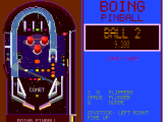
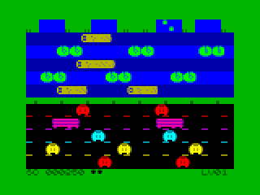
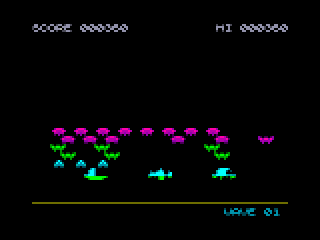
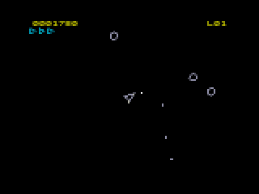
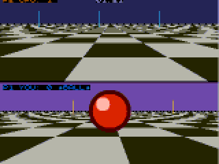
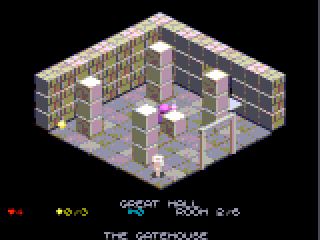
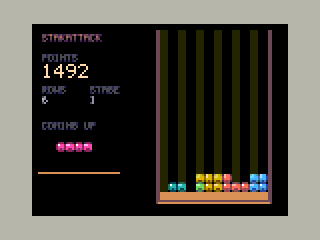

# Arcade games

Generated by `./zx arcade` from each project's `arcade.json`; the menu on the
Next shows the same list (see the Arcade section of the README).

| | Game | Machine | Controls |
|---|---|---|---|
|  | **[Boing Pinball](../projects/boing_pinball/README.md)** The Comet Tour table with the Boing ball: bumpers, drop targets, ramp, orbit, missions, multiball. | Spectrum Next | Z/M flippers, SPACE plunger, Q nudge |
|  | **[Frank the Frog](../projects/frank_the_frog/README.md)** Hop Frank across the traffic and the river's logs and rafts into the four ponds. | 48K | Q/A/O/P hop, SPACE start, Kempston |
|  | **[Nova Defense](../projects/nova_defense/README.md)** Defend the base against a swarm of 48 aliens and the bonus comet, behind crumbling crystal shields. | 48K | O/P move, SPACE fire, Kempston |
|  | **[Rock Blaster](../projects/rock_blaster/README.md)** Vector rock shooter: turn, thrust and blast the drifting rocks before they smash your ship. | 48K | O/P rotate, Q thrust, SPACE fire |
|  | **[Rotoball](../projects/rotoball/README.md)** Split-screen ball sport: carry the ball over the other goal line. 1 player v CPU, or 2. | Spectrum Next | P1 WASD, P2 IJKL, joysticks, SPACE |
|  | **[Spectral Keep](../projects/spectral_keep/README.md)** Isometric adventure: find the relics in three keeps and carry them to the throne. Mind the ghosts. | Spectrum Next | Q/A/O/P walk, SPACE jump, Kempston |
|  | **[StakAttack](../projects/stakattack/README.md)** Gem pieces fall into the well: rotate and slide them to fill rows. Every ten rows it gets faster. | Spectrum Next | O/P move, Q rotate, A drop, SPACE slam |
