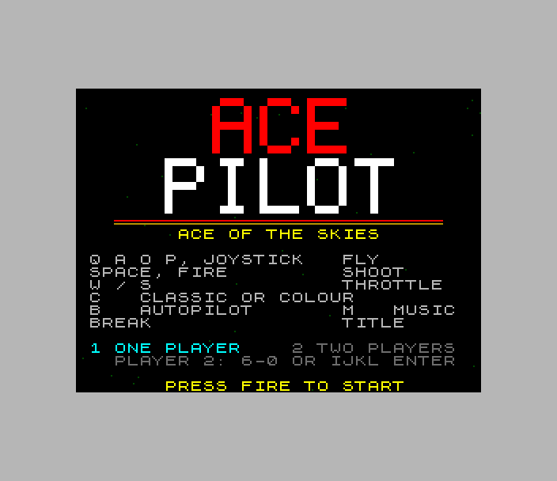
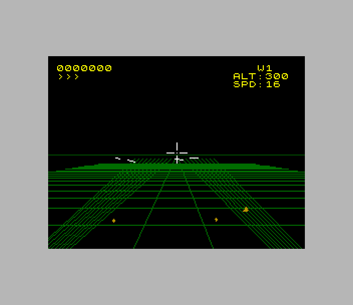
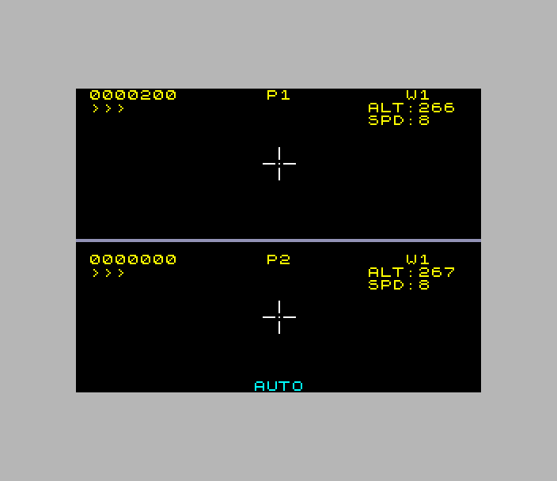
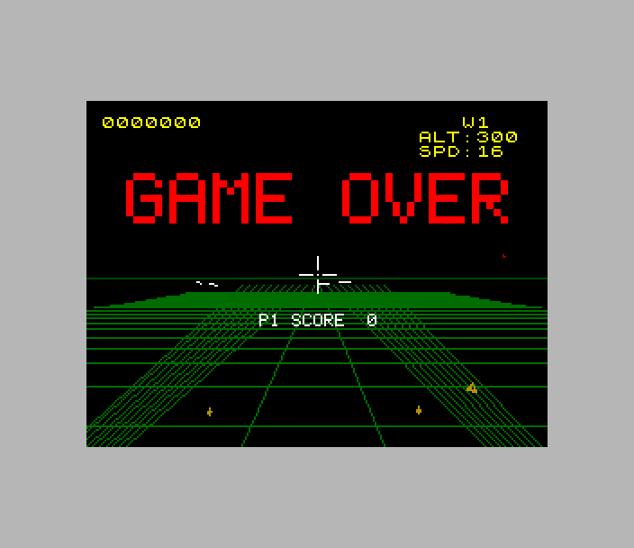
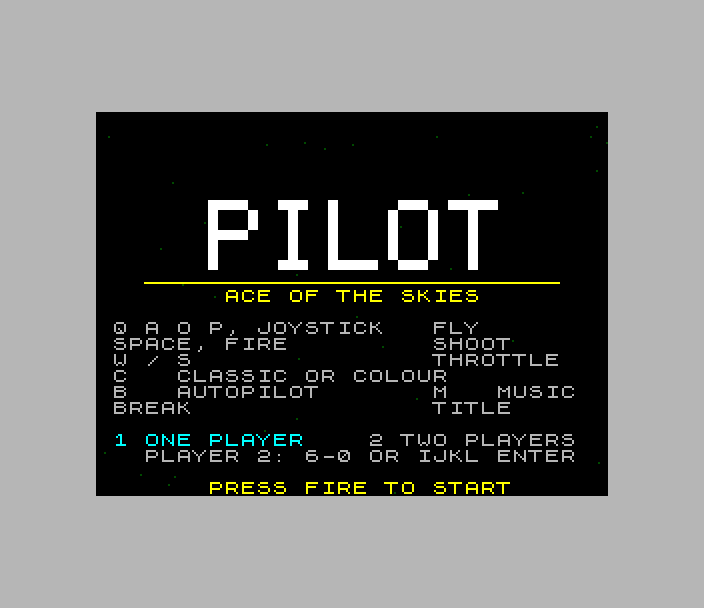

# Ace Pilot (Spectrum Next)

Port of `amiga_mcp/examples/ace_pilot`: a wireframe dogfight over a green
grid. Shoot down the **biplanes** (100 points) and the slow **blimps** (500,
three hits), strafe the **ground targets** (hangars, fuel tanks, pyramids,
trees: 50 to 200). Clear a wave and the next comes faster; the ground
targets come back. Three lives, an extra one every 10,000 points. Two
players share the screen, split in two as in the original. The Blue
Danube plays throughout, as in the original.

 
 



## Controls

| | |
|---|---|
| Q / A (cursor up / down, joystick) | nose up / down (as the original: up raises the nose) |
| O / P (cursor left / right, joystick) | turn |
| SPACE (0, joystick fire) | fire (the wing guns alternate) |
| W / S | throttle up / down (speed 4 to 16) |
| B | autopilot on / off (on the title: a game flown by it) |
| C | classic (all green) or colour display |
| M | music on / off |
| BREAK | back to the title |
| title: 1 / 2 | one or two players; FIRE starts |

Two players: player 1 has Q A O P + SPACE, Sinclair 2 (1-5) and Kempston
1; player 2 has Sinclair 1 (6-9, 0 fires), Kempston 2 or I J K L + ENTER,
throttle U / H. Port: the original flies on the cursor keys or W A S D
with Q / E for the throttle and P for the display mode, F1 / F2 for the
players; on the Spectrum Q A O P are the flying keys, so the throttle went
to W / S, the display mode to C. The autopilot and the music toggle are
new.

```sh
./zx build ace_pilot
./zx run ace_pilot          # a window to play in
./zx test ace_pilot         # the test below
```

## How it's built

**The rules are the original's** (`src/game.c`, `models.c`, `trig.c`):
the planes' AI (patrol, attack, evade), the waves, the ground targets,
bullets, explosions' particles, collisions, lives and score, at the
original's 50 ticks a second, in its 32-bit integer maths. Port changes
(`port:` in the source) keep the results the same:

- `angle_to`, the original's brute-force search for the angle of a vector
  (64 dot products, then 7), finds the same angle from 7 + 7 near an
  `atan2` estimate (checked against the search on 3 million vectors,
  `tools/check_angle.c`); short vectors, whose dot products tie over wide
  ranges, still do the original's whole search, in Z80N asm (`dot.asm`)
- the hit tests' distances and the bullets' and particles' moves are Z80N
  asm (`move.asm`)
- the enemy speed is divided by 10, as its tunable says
  ([ORIGINAL_BUGS.md](ORIGINAL_BUGS.md)); with the original's, nothing can
  be caught

**Checked tick by tick**: `tools/trace.sh` builds the original's `game.c`
(from `amiga_mcp`) and the port's for the host and runs both for 30,000
ticks with random input and with an autopilot, one and two players: every
tick's state is the same. On the Z80, the game logs a hash of its state
every 1000 ticks; `tools/hash_host.c` plays the same autopilot game with
the same files on the host and the test compares the hashes (a zsdcc
miscompile would show there).

**The picture** (`src/render.c`) is the original's: the camera-relative
ground grid and the horizon, the wireframe models, bullets as streaks,
explosions' particles and the gunsight, 256 x 192 on Layer 2 with the
SDK's `l2line` (Z80N asm Bresenham, clipped to the view). Port:

- 0.8 of the original's 320 x 256 (FOV 160 instead of 200)
- each model is turned once (a 3 x 3 matrix from the camera's yaw and
  pitch and its own yaw, 16-bit) instead of each vertex in 16.16
- models wholly behind the camera or outside a cone wider than the view
  are skipped before their vertices are touched (nothing of them would be
  drawn): this took the frame rate from about 6 to 9 fps
- two players: two views of 95 rows, as the original's two halves

**The front end** (`src/front.c`): the HUD (score, lives, wave, altitude,
speed, GET READY) is on the tilemap over Layer 2, written only when a
value changes, so the view never redraws it; the title's big letters and
GAME OVER are drawn on Layer 2 with the SDK's 5 x 7 font, as the original
draws its own. **Sound**: the original's four effects (gunfire, hit,
explosion, death; Paula samples made by its `sound.c`) are AY effects on
TurboSound chip 0, and its MOD (`art/blue_danube.mod`, made by its
`gen_mod.py`) plays on chips 1 and 2 through the SDK's `modplay`
(`tools/make_music.sh` writes `src/music_song.c`). All the sound runs in
the frame interrupt, so the music keeps its tempo however slow the
picture is.

**The autopilot** (`src/bot.c`, new) turns toward the nearest enemy,
climbs or dives to its height and fires when it is close and ahead; in
integers, so the Z80 and the host agree.

## Frame rate

The rules run at the original's 50 ticks a second whatever the picture
does (fixed timestep, catching up to 12 frames). The picture, measured by
the test while the autopilot plays (`ace: perf fps10=` in the log):
**one player 4 to 13 fps, about 9 on average**: fastest with few planes in
view, slowest when planes attack close by (the rules' AI is then the
larger part of the frame). **Two players: 4 to 5 fps** (two views).

## Memory

| | 0x0000-0x3FFF |
|---|---|
| the rules | bank 17: `game.c` (15.4K of 16K) |
| the picture | bank 16: `render.c` (7.9K) |
| otherwise | the ROM (its font, for the tilemap at start-up) |

0x4000-0x5FFF is bank 5 (the tilemap; the ULA is off); 0x6000-0x7FFF
Layer 2's pages while drawing lines; 0x8000-0xEB94 the resident program
(the game state, `main.c`, `front.c`, `bot.c`, `colour.c`, the models,
the trig tables, the asm, the SDK); 0xF000 the IM 2 table and the stack.
Layer 2 is double buffered in banks 9-14.

## Next features used

| feature | used for | why it's needed |
|---|---|---|
| **28 MHz** | everything | a busy tick of the rules is ~140,000 T-states, 50 a second; a 3.5 MHz Z80 has 70,000 a frame |
| **Z80N `MUL`** | the dot products, distances and moves in asm; 16 x 16 products in C | the rules' 32-bit maths |
| **MMU paging** | the rules and the picture in banks over the ROM | 50K of code and data in a 64K address space |
| **Layer 2** (256 x 192, double buffered) | the view | wireframes in the original's colours |
| **tilemap** | the HUD and the title's text | text never redrawn with the view |
| **zxnDMA** | clearing the back buffer (`l2_clear`) | 48K a frame |
| **TurboSound** | effects on chip 0, the music on chips 1 and 2 | three effects and three voices at once |

## Files

| | |
|---|---|
| `src/game.c`, `game.h`, `models.c`, `trig.c`, `engine3d.h`, `types.h` | the original's rules (port changes marked) |
| `src/dot.asm`, `move.asm` | `angle_to`'s searches; hit-test distances, bullet and particle moves |
| `src/render.c` | the view |
| `src/front.c`, `main.c` | the front end, sound, start-up, the frame loop |
| `src/bot.c` | the autopilot and the state hash |
| `src/colour.c` | the tunables and the original's colours (resident: both banks use them) |
| `src/music_song.c`, `art/blue_danube.mod`, `tools/make_music.sh` | the music |
| `tools/trace.c`, `trace.sh`, `orig_shim/` | the rules against the original's, on the host |
| `tools/hash_host.c` | the autopilot game on the host (the test's hashes) |
| `tools/check_angle.c` | `angle_to` against the original's search |
| `tools/profile.py`, `timefn.py` | PC-sampling profile; time a function |
| `tools/make_gif.py` | `docs/images/ace_pilot.gif` |

## Test

`./zx test ace_pilot`: the rules against the original's on the host (12
runs of 30,000 ticks, if `amiga_mcp` is next to this repo); boots, the
music on and off (M), the autopilot (B) plays 6000 ticks and its state
hashes match the host's every 1000 ticks, with the frame rate; BREAK, the
display mode (C), a game by hand (turn both ways, throttle, fire), game
over (lives set to 0) and back to the title; then, from a fresh boot, a
two-player autopilot game whose hashes match the host's.
