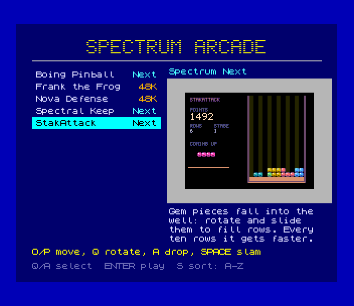
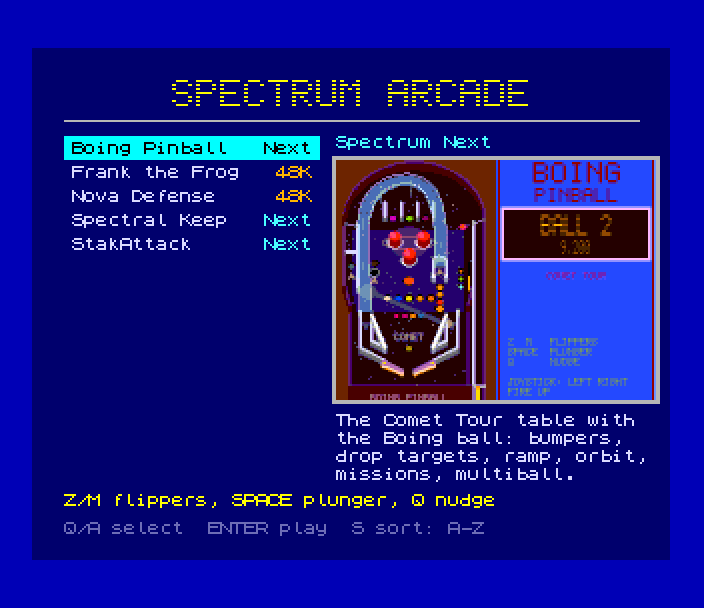
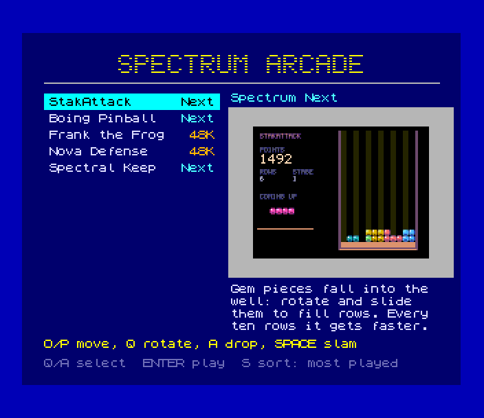

# Spectrum Arcade (Spectrum Next, NextZXOS)

A game menu that runs on the (emulated) Spectrum Next itself: NextZXOS boots
from an SD card, shows every game in the repo on Layer 2 (a list on the
left, the selected game's picture and description on the right) and starts
the one you pick, whether it's a Next `.nex` or a 48K game. Reset brings
the menu back.

```sh
./zx arcade                  # build every game + the menu, make the SD image, open it in a window
./zx arcade --no-build       # use what's built
./zx arcade --image-only     # just build/arcade/arcade.mmc
./zx arcade --list           # the registered games
./zx test arcade             # the test below
```



| | |
|---|---|
|  |  |

## Keys

| | |
|---|---|
| move | Q / A, cursor keys, Sinclair or Kempston up / down (hold to repeat) |
| play | ENTER, SPACE or fire |
| sort | S: A-Z or most played first |
| leave | BREAK (CAPS + SPACE): to NextBASIC |
| back to the menu | reset the Next (`emu_reset`, or ZEsarUX's reset in the window) |

## How it works

```
power on ─▶ TBBlue firmware ─▶ NextZXOS ─▶ c:/nextzxos/autoexec.bas
  10 CLEAR 32766: LOAD "c:/arcade/menu.bin" CODE 32768
  20 RANDOMIZE USR 32768: IF PEEK 32767=255 THEN STOP        ◀── the menu (this project)
  30 GO TO 1000+10*PEEK 32767                                     stores the game's number at 32767
  1000 LAYER CLEAR: SPRITE CLEAR: PALETTE CLEAR: CLS: .nexload /arcade/boingpin.nex
  1010 RUN AT 0: LAYER CLEAR: ...: CLS: SPECTRUM "c:/arcade/frankthe.sna"
  ...
```

- **The card.** `./zx arcade` (`tools/zxdev/src/zxdev/arcade.py`) takes the
  NextZXOS distribution that ships with ZEsarUX (`tbblue.mmc`), drops what
  the arcade doesn't need (demos, docs, sources, CP/M), sets the video mode
  so the firmware doesn't run its mode test, and writes a 32 MB FAT16 image
  with [`sdk/tools/fatimg.py`](../../sdk/tools/fatimg.py) (pure Python: no
  mtools, no Docker). `autoexec.bas` is generated by
  [`sdk/tools/nextbasic.py`](../../sdk/tools/nextbasic.py), which tokenises
  exactly as NextZXOS does (checked against its own `.bas` files).
- **The menu** is plain machine code (`OUTPUT := bin` in the Makefile, a
  +3DOS CODE header added on the host) that BASIC loads at 32768 and calls
  with `USR`. It takes over Layer 2 (320 x 256), the IM 2 frame timer and
  28 MHz, reads the card through esxDOS (`sdfile.h`), and puts everything
  back before it returns: Layer 2 off, clip window, NextRegs 0x07 / 0x12 /
  0x15, IM 1 (`frame_exit()`).
- **Starting a game** is what NextZXOS's own browser does
  (`nextzxos/browser.cfg`): `.nexload` for a `.nex` (dot commands take esxDOS
  paths, `/arcade/x.nex`, not `c:/...`), and NextBASIC's `SPECTRUM "file"`
  for a 48K snapshot. A 48K game's `.tap` is turned into a `.sna` on the
  host: the harness loads the tape and saves a snapshot on the first
  instruction run in RAM, the BASIC loader's `USR` (`arcade.snapshot_48k`).
  `RUN AT 0` first puts the Next at 3.5 MHz.
- **Coming back.** A game owns the machine, so the way back is a reset:
  NextZXOS boots again and runs `autoexec.bas`, and the menu opens on the
  game played last. Plays and the sort order are kept in
  `/arcade/stats.dat` (written with `sd_save`); ZEsarUX writes the card's
  changes back to the image file, and a rebuild keeps them (matched by
  title).

Files on the card, under `/arcade/`: `menu.bin`, `games.dat` (count + one
256-byte record per game: title, machine, controls, description wrapped to
4 x 26 characters), `pic00.l2`... (160 x 120, one byte a pixel RRRGGGBB,
column-major, never the transparent 0xE3), `stats.dat` (32 play counters,
sort, last game) and the games (`<short>.nex` / `<short>.sna`).

## Adding a game

Put an `arcade.json` in its project; `./zx arcade` picks it up, and the
menu, the DevBench page, the MCP tools and [docs/arcade.md](../../docs/arcade.md)
follow from it:

```json
{
  "title": "Nova Defense",
  "description": "Defend the base against a swarm of 48 aliens and the bonus comet, behind crumbling crystal shields.",
  "controls": "O/P move, SPACE fire, Kempston",
  "picture": "screenshots/play.png",
  "ready": "nova: ready"
}
```

| field | |
|---|---|
| `title` | up to 20 characters |
| `description` | about 100 characters (4 lines of 26 in the menu; more is cut with "...") |
| `controls` | one line, up to 40 characters |
| `picture` | a `./zx shot` (352 x 304, or 704 x 608) relative to the project; its middle 320 x 240 is halved to 160 x 120 |
| `ready` | a `zx_log` line the game prints at its title screen; the test waits for it |

The machine and the file come from the project's Makefile (`TARGET := zx`
→ `build/<NAME>.tap`, `zxn` → `build/<NAME>.nex`). Up to 32 games.

## From Claude, DevBench and Python

- MCP: `arcade_games()`, `arcade_picture(game)`, `arcade_build()`,
  `arcade_play(game, window=True)` (boots the card, picks the game in the
  menu, runs to its title; the `emu_*` tools then drive that session).
- DevBench: <http://127.0.0.1:3580/arcade> lists the games with their
  pictures and a Play button each; REST `GET /api/arcade`,
  `POST /api/arcade/play {"game", "window", "scratch"}`, `POST /api/arcade/build`.
- Sessions: `./zx serve build/arcade/arcade.mmc` (any `.mmc` boots NextZXOS
  from it), then `./zx ctl arcade_play game=stakattack`.
- Python: `Emulator(sd="build/arcade/arcade.mmc")`, then
  `arcade.menu_choose(emu, game, count)` (see `test.py`).

## Test

`test.py` builds the image, boots a copy with no plays on it and checks:
NextZXOS runs `autoexec.bas` into the menu; the list follows Q/A and the
joystick and stops at its ends; the picture in Layer 2 is byte for byte the
file on the card (`sd_load_l2w`); S sorts; then **every** game is chosen from
the menu and must reach its title line, and each reset comes back to the
menu on the game just played with its play counted; playing one game twice
puts it first in the most-played order. `--gif` records
`docs/images/arcade.gif`. About 15 seconds; part of `./zx selftest`.

## SDK modules it added

`sdfile.h` (esxDOS `sd_load`, `sd_save`, `sd_load_l2w`), `listui.h`
(scrolling list on Layer 2 320 x 256), `l2w_text` (ROM font on 320 x 256),
`frame_exit()` (back to IM 1 for code that returns to BASIC), project.mk's
`OUTPUT := bin`, and the host tools `fatimg.py` and `nextbasic.py`.

## Limitations

- Back to the menu is a reset: the games don't know about the arcade (a
  real Next's NMI button doesn't help either, its menu has no "back to
  autoexec").
- 48K games run in NextZXOS's 48K mode on the Next (its timing and ROM), as
  the browser would start them; an AY is there, so they use it.
- The card is ZEsarUX's NextZXOS 2.06 distribution (2020), trimmed. For a
  real Next, copy `/arcade/` and `nextzxos/autoexec.bas` onto its card
  (untested on hardware).
- `symbols` in a session on the card are the menu's: once a game runs they
  don't match.
