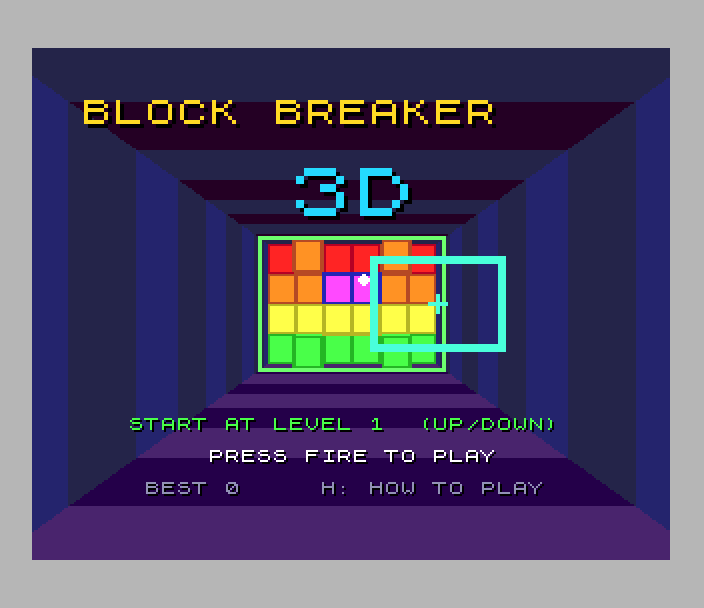
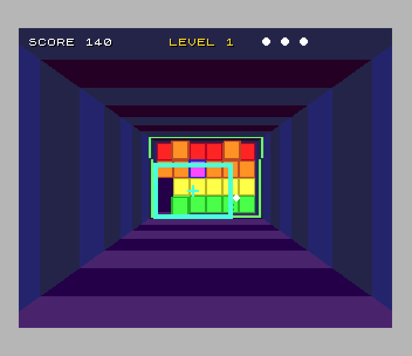
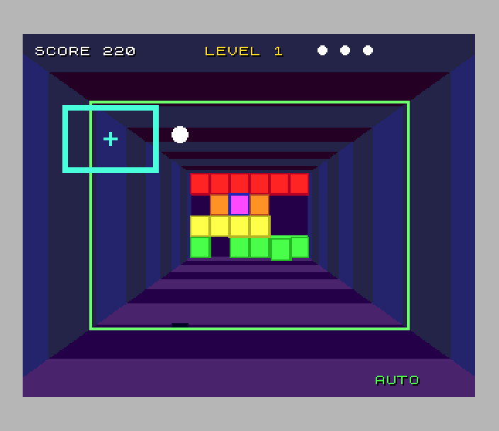

# Block Breaker 3D (Spectrum Next)

Port of `amiga_mcp/examples/block_breaker_3d` (the amiga3d engine's
breakout down a tunnel; the same game runs on the Atari ST and the 3DO).
The paddle is a frame across the tunnel's near opening that moves up, down,
left and right. The ball flies down the tunnel to a block of bricks at the
far end (6 across, 4 high, 3 deep) and back again. Where the ball meets the
paddle steers it. A green ring round the tunnel walls and a shadow on the
floor show how far away the ball is.

 

## Controls

| | |
|---|---|
| move the paddle | Q A O P, cursor keys, Sinclair or Kempston joystick |
| serve | SPACE or fire |
| pause | ENTER |
| autopilot on / off | B |
| how to play (two pages) | H |
| back to the title | BREAK (CAPS SHIFT + SPACE) |
| title | up / down choose the start level, fire plays |

port: the original's P (pause) and Esc are taken by QAOP and missing on the
Spectrum, so they are ENTER and BREAK here.

## What's kept, what changed

Kept from the original:

- **The rules, bit for bit.** `src/bb_core.c` is the original's `bb_core.c`
  (all 8 levels, the ball moving a quarter tick and one axis at a time,
  paddle steering, the speed-up as a rally goes on, tough bricks taking 2 or
  3 hits, steel, capsules W S L P and their timers, scoring, the autopilot).
  zsdcc's `int` is 16 bits, so `BB_FX` is a long and a few fields are
  `int32_t`; the changes are marked `port:`. The original's own tests
  (`tests/test_cases.c`, 42 of them) pass on the host (`tools/host_test.sh`)
  and **inside the game on the Next**, including its 20,000-tick autopilot
  game whose final state hash (`tools/orig/vectors.h`) must be the
  original's: the Next plays exactly the same game as the Amiga.
- The look: the original's camera, focal length and palette, the striped
  tunnel, the bricks with only the faces you can see (the front with its
  rim, and the sides and tops that face the camera with no brick against
  them) in the original's draw order, the ball with its highlight, its
  shadow and the depth ring, the capsules with their letters, the bits of
  broken bricks, the paddle's frame (red flashing while ploughing).
- The title with the autopilot playing behind it, the start level, the
  help pages, the messages (level names, BALL LOST, the capsules, CLEARED!,
  GAME OVER / YOU WIN, PAUSED), the effects (the original's synthesised
  tones and noise, as AY streams).
- The original's timing: 25 ticks a second, fixed timestep.

Changed (marked `port:` in the code):

- **A fixed camera.** The original leans the camera with the paddle (a
  fifth of its offset), which moves every pixel of the tunnel. Here the
  tunnel is a picture drawn once on the host, so the camera stays centred.
- **Drawn at 50 fps.** The logic runs at the original's 25 ticks a second;
  the picture is drawn every frame, halfway between the last two ticks on
  the frame between them, so the ball and paddle move at 50 Hz.
- **The ring is a depth band.** The original draws a 6-unit band at the
  ball's depth. Here the walls are cut into 70 bands of about 2 pixels on
  the screen, and the band the ball is in turns green.
- **Sizes by depth come in steps.** The ball has 12 sizes (radius 2.5 to 8
  pixels; nearer than z = 17 it stays at 8), the shadow 13, the capsules 9,
  the bits 4. Bits are hidden whole when their middle is behind a brick.
- **The ROM font** for text, on 8-pixel rows (the tilemap); the score line
  and the power-ups are one row further in than the original's, inside a
  TV picture. CLEARED! is the font at 3x, the title's 3D at 4x.
- **Music.** The original has none; an original tune in A minor plays on
  two AY chips (the full arrangement on the title, a lighter one in play).
- **A high-score table** (the SDK's) with initials, shown on the title
  every other 5 seconds; the original keeps only the best score.

## Next features used

What it uses beyond a 48K/128K Spectrum, and why:

| feature | used for | why it's needed |
|---|---|---|
| **28 MHz** | the rules (32-bit arithmetic in zsdcc's library calls: a tick moves the ball in 12 steps, each testing up to 8 cells), drawing bricks, building masked sprite patterns | measured: a tick takes about 120K T-states (320K at the most), the scene 110K, the HUD 40K. At 3.5 MHz (70K T-states a frame) one tick alone would fill most of the 40 ms it has, with nothing left to draw |
| **Layer 2, 320 x 256 x 8 bpp** | the tunnel at the original's resolution (the Amiga's 320 x 256), with its exact camera, and the bricks drawn into it | 8-bit colour anywhere: the original's 32 colours plus 210 for the depth bands; the ULA's two colours per cell can't show shaded 3D bricks |
| **palette animation** | the depth ring: each band of the walls has its own palette entries (floor, ceiling, sides), and the ball's band is set green | the ring moves every frame with 6 palette writes and no drawing |
| **hardware sprites, 4-bit patterns** (128 of them, palette offsets) | the ball (12 sizes), its shadow, the capsules (9 sizes, the colour by palette offset), their letters, up to 48 bits of bricks, the paddle's frame (14 or 22 sprites from 5 patterns, mirrored) | nothing that moves is drawn into Layer 2, so nothing has to be restored; palette offsets give one pattern many colours (bits of every brick colour, the red ball and paddle while ploughing) |
| **sprite masking by depth** | Layer 2 keeps a depth plane: every brick pixel's sort key (the original's). A sprite deeper than a brick face over it gets those pixels cut from its pattern (`spl_zmask`, up to 24 masked patterns a frame) | sprites are always over Layer 2; this puts the ball behind the bricks in front of it, as the original's painter's algorithm does |
| **sprite priority** | sprites in the original's depth order: the shadow, the bits, the capsules and the ball far to near, the paddle, a ball that got past the paddle, the letters | depth among moving things with no drawing |
| **zxnDMA** | the clean tunnel copied back where a brick changed, long spans of brick faces, sprite attributes (one transfer a frame) and patterns | ~2 T-states a byte against LDIR's 21 |
| **tilemap** (40 x 32, 4 bpp, over everything) | the score line, messages, title, help and high-score screens, with the original's drop shadow, big letters made from the ROM font at 2-4x | text never touches the tunnel picture |
| **MMU banking** | the rules in bank 40 and the renderer in bank 41, both at 0x0000 in turn; the HUD in page 84 and the self-test in page 85 at 0x6000; the tunnel (banks 20-24), its clean copy (25-29), the depth plane (30-34), sprites (35), sound (36-37) | zsdcc's code is about 45K (the rules alone 15K), against the 28K free at 0x8000 |
| **TurboSound** (3 AY chips) | the music on chips 0 and 1, the effects on chip 2 (`aystream.h`) | music and effects at once |
| **Z80N `MUL`** | projecting everything that moves (`mul16`), `isqrt32` for the ball's speed | fast 16 x 16 multiplies every frame |
| **raster line** (NextReg 0x1E/0x1F) | `lines=` in the log: how long the scene took | profiling |

## How it's built

- **The tunnel** (`tools/gen_gfx.py`): a ray per pixel from the original's
  camera (0, 0, -320), focal length 270, centre (160, 128), into the
  original's tunnel (168 x 120 half-size, z -200 to 800, stripes every 100).
  Each wall pixel gets its band's pen. The six dark stripe colours are
  picked by hand in 9-bit RGB, because rounding merges the original's.
- **The bricks** (`src/render.c`): the screen position of every brick
  corner is worked out on the host (the original's `cam_project`, with C's
  integer division). When a brick changes (broken, or a tough one hit), its
  box on the screen goes back to the clean tunnel and every face there is
  drawn again (`l2wpoly.h`: rectangles and convex quads as vertical spans,
  clipped, writing the depth plane too). A new level redraws the whole
  block. `test.py` compares Layer 2 with the same drawing done on the host.
- **Each frame**: the changed bricks, the ring's palette entries, then the
  sprite list: positions halfway between ticks on the in-between frame,
  sizes and patterns from depth tables, masked patterns for sprites deeper
  than the bricks over them, all sent by DMA.
- **Sound** (`tools/gen_sound.py`): the original's effects
  (`game_sound_init`: tone slides and noise at 11.8 kHz) sampled at 50 Hz
  onto the AY's volume steps; the tune as notes, envelopes and drums.
- **Memory map**: `src/memmap.h`, `src/main.c`.

`sh tools/make_assets.sh` remakes `gfx/`, `sound/`, `src/gfx_data.*`,
`src/sound_data.*` and `src/test_cases.c` (the original's tests,
`tools/orig/test_cases.c`), then runs the original's tests on the port's
rules on the host. Its outputs are checked in.

## Frame rate

In the test's game the picture is drawn at **49.6 frames a second** on
average (lowest 5-second sample 46), with the logic at the original's 25
ticks a second. Per frame the scene takes about 110K T-states (60 raster
lines of 312) and the HUD 40K; every other frame a tick adds about 120K.
A new level's whole-block redraw and plough bursts are the frames that come
late.

## SDK modules this game added

Tested in `projects/nextlibtest`:

- `l2wpoly.h`: convex polygons and rectangles on 320 x 256 column-major
  planes (Layer 2 or copies), vertical spans (DMA for long ones), clipping,
  a depth plane, plane-to-plane copies and fills, any two MMU slots
- `nextsprl.h`: the frame's sprites as one list of 4-bit patterns with
  palette offsets, sent by DMA; `spl_zmask` masks a pattern against the
  depth plane
- `nexttile.h`: `tm_glyphnx`, glyphs at 1-4x with a drop shadow (2x is
  `tm_glyph2x`)

## Test

`./zx test block_breaker_3d` (about 6 minutes):

- 28 MHz, the title with the autopilot's demo, the title music on two chips.
- The original's 42 tests run inside the game, including the 20,000-tick
  hash.
- The help pages; Kempston up and down choose the start level.
- A recorded game: the bot (the original's `bb_bot` in Python, reading the
  `probe` struct) plays with Q A O P and SPACE, then with the Kempston
  joystick, then keys again, until level 1 is cleared. Layer 2 matches the
  host's drawing of the same bricks after breaks and at level 2's start.
  Then it misses on purpose: every life is lost, game over, the high-score
  entry (it types ZXN), the title with ZXN in the table.
- The frame rate while playing.
- The recording replays twice with every frame's hash the same.

On the host: `sh tools/host_test.sh` (the original's tests on the port's
rules).

## Known issues

- The camera doesn't lean with the paddle (see above).
- Bits of bricks are hidden whole behind a brick, not pixel by pixel.
- Capsule letters are over everything, as in the original, even when the
  capsule is behind a brick.
- A new level and a burst of plough breaks can each cost a frame or two
  (the logic keeps its pace).
- One sound effect at a time (a new one replaces the last), as in the
  original's single effects channel.
- zsdcc miscompiled two things (see CLAUDE.md); the workarounds are in
  `bb_pop_event` and the generated `src/test_cases.c` (`tools/port_tests.py`).
