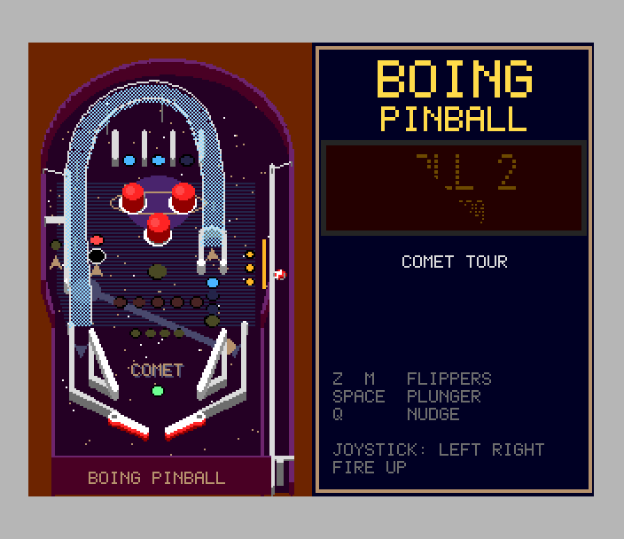
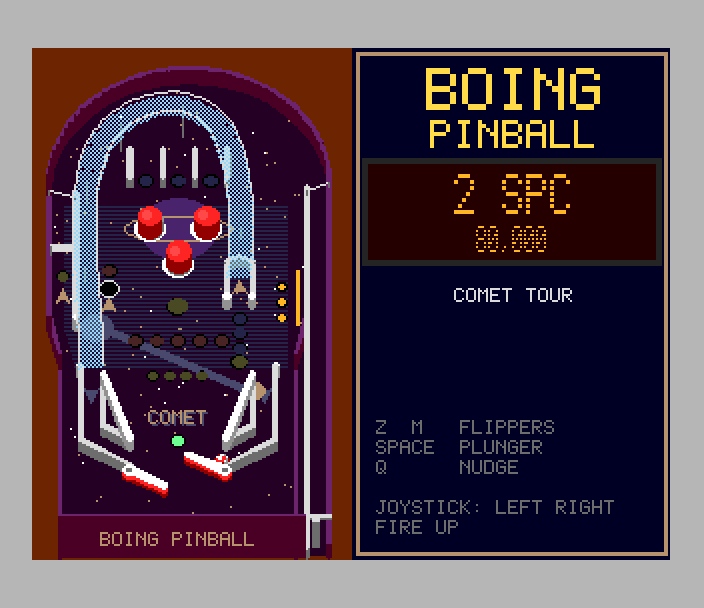

# Boing Pinball (Spectrum Next)

Port of `amiga_mcp/examples/boing_pinball` (itself a port of the browser
game): the Comet Tour table, with the Boing ball. Three pop bumpers, the
drop-target bank, the ramp, the left orbit with its spinner, the mission
saucer, slingshots, inlanes and outlanes, top lanes, the plunger. The
original's rules: skill shot, lane sets and the bonus multiplier, ramp locks
and multiball with jackpots, five missions leading to Supernova, ball save,
tilt, end-of-ball bonus. Three balls.

 

## Controls

| | |
|---|---|
| flippers | Z / M (or CAPS / SYMBOL SHIFT, O / P); Kempston left / right |
| plunger | hold SPACE (ENTER, A; Kempston fire / down), let go to launch |
| nudge | Q (Kempston up); nudge too often and the table tilts |
| start | SPACE on the title (the attract mode is the original's demo player) |

## How it's built

The original is 16.16 fixed point: built for the Z80 it is 61K of code and
far too slow at 120 steps a second. So:

- **Tables**: built on the host by the original `pb_tables.c`
  (`tools/orig/`, `tools/export_table.c`), converted to Z80 data by
  `tools/gen_table.py` (`src/table_0.c`). The geometry is exactly the
  original's.
- **Physics** (`src/pb_phys.c`): the original's functions one for one
  (capsule and circle collisions, the flipper's surface velocity w x r,
  one-way gates, slingshot and bumper kicks, spinners, the saucer, the ramp,
  substeps so nothing tunnels) in 16-bit units: 1/16 mm, 1/4 mm/s, Q14 unit
  vectors. Multiplies use the Z80N's MUL (the SDK's `fixmath.h`).
- **Rules** (`src/pb_rules.c`): the original's code, changed only where it
  touches physics units (marked `port:`).
- `tools/host_sim.c` and `tools/orig_sim.c` play bot games with this port
  and with the original core on the host: over 200 games, mean score 46.0K
  vs 42.3K, 25.6 vs 24.5 s a ball, the same substeps, no ball ever escapes or
  sticks. The Z80 build gives bit-identical games to the host build of the
  same code (same seed: same score, same number of steps).
- **Pictures** (`tools/gen_gfx.py`, from the original's `render.c`: its
  palette, walls, cylinders, ramps, lamps, the oblique view scaled to fit):
  the whole table on Layer 2 in 320 x 256 mode, loaded straight into banks
  by the .nex (`gfx/`, `src/data.asm`). Balls (8 frames of a spinning Boing
  ball), flippers (8 angles, the right one mirrored) and the plunger are
  hardware sprites. Lamps, drop targets, bumper and sling flashes and the
  spinner each own a palette entry. The dot-matrix display is drawn into
  Layer 2 when its text changes.
- **Memory**: the rules run from bank 20 mapped over the ROM, the table data
  and the front end from 8K pages at 0x4000 / 0x6000 (see `src/main.c`).
- 28 MHz; the simulation runs 120 steps a second against the 50 Hz frame
  (fixed timestep), physics about half the frame time.

Not ported: the Deep Dive and Robot Foundry tables (the data converts; each
needs its picture and its upper flipper's sprites), the MOD music (the AY
plays the original's effects), the painted AmigaOS 4 artwork.

## Test

`./zx test boing_pinball`: a Python bot reads `pin_probe` and plays like the
original's `pb_bot`, with the keys: plunges, flips at balls coming down onto
the flippers. It scores (bumpers, targets, the ramp), drains three balls,
enters BOT in the high-score table and returns to the title; the game is
recorded and replayed twice with every frame hash checked. On the host:
`cc -Isrc -I../../sdk/include -o host_sim tools/host_sim.c src/pb_phys.c src/pb_rules.c src/zmath.c src/sin_tab.c src/table_0.c`.
