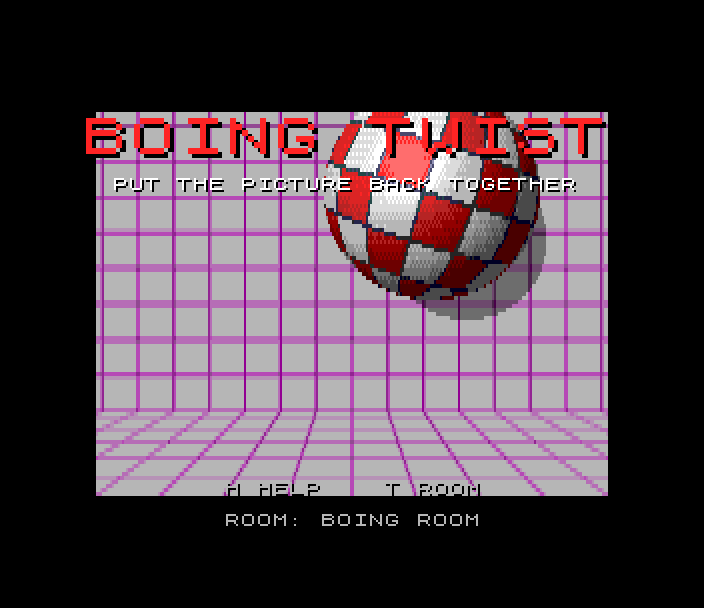
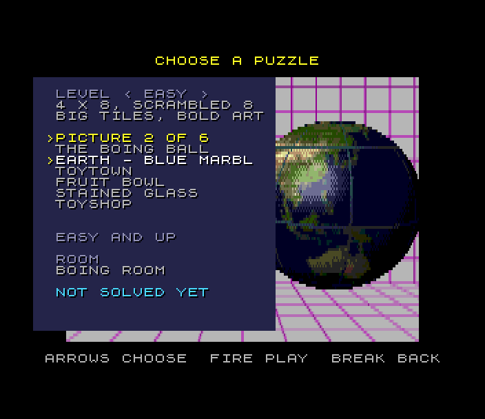
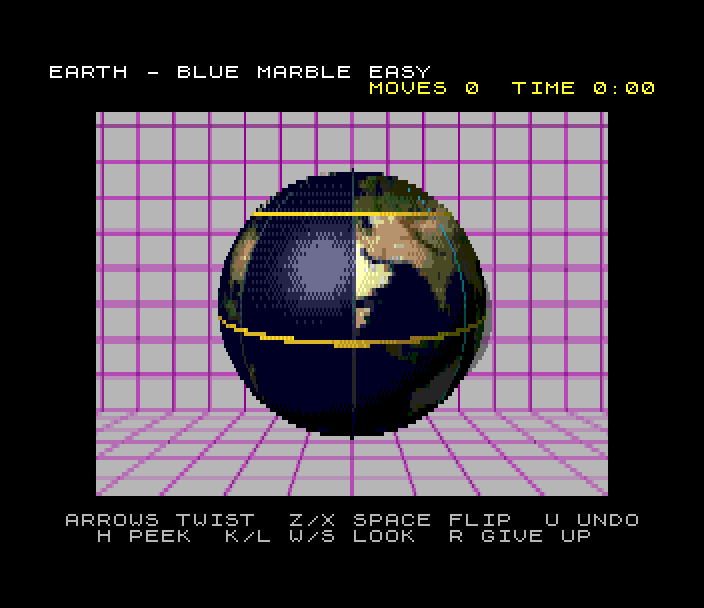
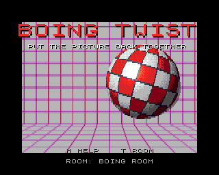

# Boing Twist (Spectrum Next)

Port of `amiga_mcp/examples/boing_twist`, a twisty puzzle on the Boing
ball for AmigaOS 4.1. A picture is wrapped round the ball, the ball is cut
into tiles along lines of latitude and longitude, and the tiles are
jumbled. Twist bands of tiles round the ball and flip halves of it over
until the picture is whole again. The ball sits in a room, the first the
1984 Boing demo's grey room with its purple grid and the ball's shadow on
the back wall; on the title the Boing ball bounces round it, spinning on
its leaning axis, as it did in the demo.

  



## Controls

| | |
|---|---|
| choose the band (yellow rings) | up / down: Q A, cursor keys, Sinclair or Kempston joystick |
| twist it one tile | left / right: O P, cursor keys, joystick |
| choose the half (cyan lines and ring) | Z / X, or fire held + left / right (the ball turns to face it) |
| flip the half | a tap of SPACE or fire |
| turn the ball to look | K / L round, W / S tilt, C faces the half again |
| undo | U |
| peek at the picture | H (held) |
| pause | ENTER |
| give up (it solves itself, move by move) | R |
| new scramble | N |
| room | T |
| back | BREAK (CAPS SHIFT + SPACE) |
| title | fire or ENTER: choose a puzzle; H help; T room |
| select | up / down: level, picture, room; left / right change it; fire or ENTER plays |

port: the original's arrows are kept (and QAOP and joysticks); its A / D
(the half) are Z / X here (A is down on QAOP), its Q / E (turn) are K / L
(Q is up), its Space / Return flip is a tap of SPACE or fire, its P (pause)
is ENTER, its Esc is BREAK. There is no mouse.

## The puzzle

The ball is cut into B bands by S segments: Easy 4 x 8 scrambled 8 moves,
Medium 6 x 12 by 20, Hard 8 x 16 (the Boing ball's own 128 tiles) by 40,
Expert 8 x 16 by 80. A **twist** turns a band one tile east or west; a
**flip** turns the S/2 segments either side of a meridian 180 degrees about
the horizontal axis through the middle of that half: a piece in band b goes
to band B-1-b, mirrored, upside down. A scramble is random moves from the
solved ball, so every one can be solved. The ball is solved when every tile
shows the picture that belongs there, allowing for the whole ball spun
round; tiles that look the same (the Boing checkerboard's) count as the
same, so the Easy Boing ball is "make a checkerboard again". Each picture
names the lowest level it suits; a level offers the pictures that suit it
or an easier one, the checkerboard on Easy only.

Scoring (port: the original keeps your best moves and time for each picture
and level in a file): a solve scores (500 + 25 for each move under three
times the scramble + 2 for each second under five minutes) times the level
(1-4), less 100 a peek; given up, nothing. The best moves and time per
picture and level are kept until the Next is reset; the top five scores go
in the high-score table with your initials.

## What's kept, what changed

Kept from the original:

- **The rules.** `src/bt_core.c` is the original's: the state, the two
  moves, scrambles (its xorshift), undo, the solved test with the tiles'
  signatures, the levels and its retry of a scramble that leaves the ball
  solved. One expression is rewritten around a zsdcc miscompile
  (`tools/orig/port.diff`: `bt_hash` built `h ^ slot.home` with byte 1 of
  `h` zeroed). With T held at start-up the Next runs the original's
  self-test, `bt_vector_hash()` (scrambles on five sizes and 15,000 moves and
  undos with the solved test along the way, folded into one number), and gets
  the original's `tests/vectors.h` (`3B792758`; the test checks it).
  `tools/check_core.sh` runs the original's host tests (18,567 checks) on the
  port's file and diffs it against the original.
- The game around it: the move queue, each move animated and applied when
  it ends (a twist 240 ms, a flip 420 ms; the scramble and a give-up
  faster), undo, peek, pause, give up, a new scramble, the turn to face the
  chosen half, the timer from the first move; all on 50 Hz ticks (fixed
  timestep), so a move takes its time however long the pictures take.
- **The look.** The original's camera (45 degrees, the ball 3.6 away), its
  light fixed to the eye (diffuse and a highlight, its shading table), the
  ball's mesh replaced by an exact sphere; the grooves between tiles, the
  yellow rings round the chosen band, the cyan lines of the chosen half and
  the ring with arrow heads round its flip axis; the room behind, drawn from
  the original's box (back wall 6.5 away, floor 1.5 down, grids of 0.5, its
  ten rooms with their colours, grids and textures), the shadow on the back
  wall or the floor as each room has it; the title's bounce (heights, sway,
  the -17 degree lean, the 70 degree a second spin, the thud when it lands)
  and the solved screen's.
- All 17 pictures and the Boing checkerboard, each choosing its room as in
  the original; the select screen's spinning preview.
- The sounds: the thud, the click of a band, the whoosh of a flip and the
  solved chord, from the original's synthesis (pitches, lengths, envelopes).

Changed (marked `port:` in the source):

- The picture is 256 x 96 texels in 25 colours a picture (+ the groove and
  the two selection colours), each in 8 shades (the shading dithered between
  them); the rooms are 16 colours, half height.
- Layer 2 is drawn 96 rows high and the copper shows each row twice, as
  Orbit Docking and Tank Duel do: half the pixels to draw.
- Tilting (W / S) is in steps of the original's 12 degrees from -36 to 36
  (it allows -60 to 60), each tilt a view made on the host; there is no zoom.
  The ball turns, twists and flips smoothly.
- A flip turns the ball to face the half first (the original lets you flip
  a half turned away).
- The title's and the solved screen's ball is drawn as it looks in the
  middle of the room wherever the bounce takes it (the original's moves a
  little in perspective), its shadow on the floor equally dark at any height.
- Expert's 80-move scramble is shown whole (the original's queue holds 64
  and drops the rest).
- The original's mouse, window/full-screen and RES options are gone; best
  scores aren't saved; high scores and initials are new; a title tune is new.

## How it is drawn

The original draws a textured mesh per tile with OpenGL. The Next has no
time for a mesh, and turning a sphere is the same pictures over and over,
so the work is split:

- **On the host** (`tools/gen_data.py`, `tools/geom.py`: the original's
  `render.c` camera, `ball_rot` and `rd_pick`), for every pixel the ball
  covers, which texel of the picture it shows when the ball is at yaw 0, and
  its shade: a *view* (`sdk/tools/texview.py`), one for each tilt, one for
  the title's leaning ball and one for the select screen's.
- **On the Next** the pieces are put together into the texture (`ball.c`:
  slot by slot from the picture, a piece turned round read backwards, in
  asm rows from a table per band: `render.asm`), with the grooves and the
  selection drawn into it; then the SDK's `texview` draws the view: a pixel
  is `texture[v][u + turn] | shade`, 68 T-states.
- **A turn** of the ball is the `+ turn`. **A twist** turns the band's rows
  of the texture (two DMA copies a row, from a copy of the band). **A flip**
  is drawn from a second texture laid out round the flip's axis (beta from
  the axis by alpha round it), made from the first at the start of the flip
  by the same renderer through a host-made table; in it the flip is a turn
  too. At steep tilts the far half shows at the rim: a second view draws
  those pixels from the first texture.

Frame rate (ZEsarUX, 28 MHz): 31-37 pictures a second while moves animate
(the test measures it), 42 on the title; a ball standing still isn't
redrawn.

## Next features used

- **Layer 2** 256 x 192, double buffered, its **write paging** (port
  0x123B with NextReg 0x13 naming any 16K bank): the renderer reads the
  texture and writes the screen at the same addresses, and builds the
  textures through it.
- **The copper**: line doubling (Layer 2's Y scroll every other line).
- **The palette**: 28 colours x 8 shades for the ball (a pixel is texel |
  shade << 5), the room's 16 colours and their shadowed copies at index |
  0x20 between them, so the shadow is an OR.
- **The tilemap** for all the text, with a drop shadow and panels, over the
  whole display (the play screen's bars in the border), and the title's
  letters three times size.
- **zxnDMA**: the twist's rows, the room copied to the back buffer.
- **MMU** banking: 66 banks of views, pictures and rooms; the text, the
  tables and the rules in a bank and a page at 0x0000-0x5FFF; Z80N `MUL` in
  the renderer's row set-up, `NEXTREG` for the MMU.
- **TurboSound**: the original's effects on chip 2, a title tune on chips 0
  and 1 (the SDK's `aystream`).
- 28 MHz; Kempston joystick.

## Memory

`src/bt.h`: 0x8000-0xEFFF the program; at 0x0000-0x5FFF bank 25 (the text,
the generated tables, the puzzle) and page 52 (the rules' code), or the
texture and a view's stream while the ball is drawn. Banks 16-24: the
textures, the Boing picture, a twisting band's copy, the room, the sound;
30-95: the views (7 tilts x 2, title, select, the flip's table), the 17
pictures (24K each), the 10 rooms (12K each) and their palettes.

## Building and testing

```
./zx build boing_twist
./zx test boing_twist                 # test.py
sh projects/boing_twist/tools/check_core.sh     # the rules on the host
python3 projects/boing_twist/tools/gen_data.py  # views, pictures, rooms (checked in)
python3 projects/boing_twist/tools/gen_sound.py # the sound (checked in)
.venv/bin/python projects/boing_twist/tools/make_gif.py
.venv/bin/python projects/boing_twist/tools/profile.py [samples] [title]
```

`test.py`: the original's self-test hash on the Z80N; a game recorded from
reset: the title (music on two chips), the select screen (the Earth on
Easy), the scramble; a bot plays the scramble backwards through the keys
(the band and a twist, the half by Z / X and by Kempston fire + direction,
a flip, one seen from 36 degrees up), with a twist and its undo, a turn and
a peek along the way, until the picture is whole: solved and scored (the
peek counted), the initials, the high-score table on the title. Then a
Medium game given up: it solves itself. The frame rate while the moves
animate must be at least 12 (it is 31-37). The recording is replayed twice:
every frame hash must match.

The pictures are NASA's and USGS's (public domain) and the original's
ChatGPT artwork (see the original's README); the code is MIT.
