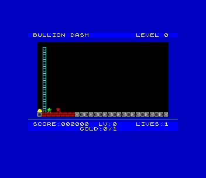

# Bullion Dash (48K)

A port of `amiga_mcp/examples/bullion_dash` (also on the Atari ST and the 3DO)
to the 48K ZX Spectrum, as a `.tap`. Collect all the gold on the screen, dig
holes in the brick floors to trap the guards, then climb to the top row.
150 levels and the original's level editor.



```sh
./zx build bullion_dash      # -> build/bullion_dash.tap
./zx run bullion_dash        # play it in a window
./zx test bullion_dash       # the bot plays it (test.py)
```

## Controls

| | |
|---|---|
| Q / A / O / P, cursor keys, Sinclair, Kempston | run, climb, hang from bars |
| FIRE (SPACE, M, 0) held + left / right | dig the brick below-left / below-right |
| BREAK (CAPS SHIFT + SPACE) | give up the life (restart the level) |
| on the title: O / P, FIRE, E | choose the first level, start, the editor |
| editor: QAOP move, FIRE put, Z / X tile, ENTER test, S / L keep / get, BREAK end | |

## What is the original's

`src/player.c`, `src/enemy.c`, `src/level.c` and `src/play.c` are the
original's `player.c`, `enemy.c`, `level.c` and `main.c` rules, statement for
statement: movement 2 pixels a frame on a grid of 10 x 14 pixel tiles,
gravity, bars, ladders, digging (10 frames), bricks growing back after 150
frames, guards that step along a breadth-first path to the player (slowed
down: below), fall into holes, steal gold (30%) and drop it, die in a
regrown brick and come back on the top row, hidden ladders shown when all
the gold is in, 100 a gold, 1000 a level, five lives. The 150 levels are the
original's, repaired so they can be won (below; `src/levels.txt`; as
released: `src/levels_original.txt`, extracted from its `level.c` by
`tools/extract_levels.py`). Every change is marked `port:` in the source:

- the logic runs at a fixed 50 Hz (`frame_wait()` ticks), the screen is
  drawn once a loop;
- the guards' breadth-first search runs once from the player instead of once
  from each guard (the SDK's `gridbfs`, which gives the same first step;
  checked on the host against the original search, and on the Spectrum in
  projects/sdktestgrid);
- the dug bricks are a list instead of a 28 x 16 timer array scanned every frame;
- a player buried by a regrowing brick, or fallen off the grid, dies (the
  original only ended a life when a guard touched the player, so he stood
  frozen); BREAK gives a life up;
- the title chooses the first level (O / P);
- sound: the original makes dig, gold, death and level samples but never
  plays them (only its MOD tune); here they are beeper effects, AY effects on
  a 128K. There is no music;
- high scores and the initials editor (the SDK's), which the original hasn't;
- the editor: SPACE is fire and 1-0 are the Sinclair joysticks on a
  Spectrum, so Z / X step through the ten tiles; there are no files, so S
  keeps the level in memory and L brings it back (the original saved
  `level_NNN.txt` files with F1 / F2); a test play returns to the editor when
  the player dies or wins (the original carried on with the built-in levels);
  hidden ladders and traps are drawn so they can be seen.

## The levels, repaired

As released, the original's levels can't be won. A win needs all the gold
and then the top row, and on 149 of the 150 levels a route search from the
start (digging allowed, guards ignored) can't reach all the gold, or can't
reach row 0 ([ORIGINAL_BUGS.md](ORIGINAL_BUGS.md), `tools/level_report.py`).

The levels are now repaired, the same in every version (the Amiga
original's `tools/repair_levels.py`). Each fix is the smallest edit that
works, and every level keeps its layout:
- a new or longer ladder;
- a hidden ladder for the way out;
- 1042 cells in all, 6.9 a level.

[REPAIRED_LEVELS.md](REPAIRED_LEVELS.md) lists every change, and
`src/levels_original.txt` keeps the levels as released.

`tools/check_levels.py`, part of the test, plays all 150 levels to the exit
with the host build of the rules (the one the Z80 build matches frame by
frame). The guards are left out, and the moves are the route search's.

## The guards, fixed

In the original, the guards step a tile every 3rd frame (the player takes
5 across, 7 up and down), so they catch the player on almost every level,
and they keep stolen gold until they're trapped. They now follow a new rule,
the same in every version (`port:`/`fix` in `src/game.h`, `src/enemy.c`,
`src/level.c`):
- **Speed:** a tile every 8 frames across and 10 up or down.
- **Start:** every guard waits 3 s at the start of a level, and a guard
  placed on the player's start row enters from the top instead, as a
  respawned guard does.
- **Stolen gold:** a guard drops it again after 4 s, on the first free cell
  with a floor that it stands on.

`tools/try_levels.py`'s bot (it takes the gold in the route search's order
and looks 150 frames ahead) plays all 150 levels with the port's rules:

| | cleared | caught | out of time |
|---|---|---|---|
| no guards (the bot's own limit) | 124 | 0 | 26 |
| the original's guards | 3 | 139 | 8 |
| the fixed guards | 66 | 56 | 28 |

With the fixed guards, runs give 62-74 cleared, depending on the guards'
random numbers. The guards still catch the bot on a third of the levels.


## 48K notes

- **Screen.** One tile is one 8 x 8 character cell, so the 28 x 16 grid is
  224 x 128 pixels at cells 2..29 x 2..17, with colour from the attributes
  (brick red, solid grey, ladders bright cyan, bars cyan, gold yellow). The
  SDK's `cellspr48` composes each changed cell (its tile, then the sprites
  over it) and writes it once: no flicker, and only the cells sprites left or
  entered, or tiles that changed (`tile_set` marks them), are redrawn. The
  player and guards are 8 x 8 pre-shifted sprites placed at the original's
  pixel position scaled by 8/10 across and 8/14 down (`src/coords.h`). They
  take the ink of the cells they are in: player green, guards red, a guard
  carrying gold yellow.
- **Levels in 8 KB.** 150 levels of 28 x 16 tiles are 33.6 KB as the
  original's nibbles and ~20 KB with zxrle, too much next to ~25 KB of code.
  The SDK's `gridpack` codes each tile with a binary arithmetic coder whose
  fixed probabilities depend on the tile before and the tile above (is it the
  tile before? the tile above? which one?), one model for all levels:
  8,286 bytes (the levels as released: 7,892), unpacked in ~0.1 s at the
  start of a level.
- **Guards' pathfinding.** The original searches the whole grid from each
  guard every third frame, ~0.5 M T-states each in C. `gridbfs` keeps one
  distance field from the player (asm, ~300 T-states a cell). It grows the
  field only until the guard asking is reached and keeps it while the player
  stays on a cell. When a guard can't reach the player at all, that answer
  carries over as the player moves, so it isn't searched again. Level 15 went
  from 17 to 30 fps with that.
- **No divisions.** The rules divide positions by 10 and 14 and test for
  remainders all the time. The scale tables used for drawing give both:
  `room_x = x * 8/10`, so the cell is `room_x >> 3` and the position is on a
  cell when `room_x & 7 == 0`.
- **Memory.** The code and levels fill 0x6A10..0xEF79. The variables (3.4 KB:
  the game state, the cell lists, the distance field) are below the code from
  0x5D00 (no stdio heap: `zpragma.inc`). Tables made at start-up (the sprite frames, the scale tables, the
  editor's two levels as nibbles, the pathfinding queue in one 256-byte page,
  the tile rows' addresses) are above the SDK's IM 2 table, 0xF101..0xFD20
  (`src/memmap.h`). 135 bytes are left below 0xF000.
- **Frame rate.** The rules run at 50 Hz. The screen is drawn 50 fps on
  levels where little moves, ~40 on level 1, 34-42 on busier ones, and
  25-30 when guards with no way to the player wander at random (level 15:
  the original's 32-bit random numbers and the keyboard read cost the most
  there). The test measures level 15 over 600 frames: 41.4 fps.
- **Sound.** Beeper effects (they stop the CPU for a moment). On a 128K,
  AY effects through the SDK's `ay_sfx`.

## The test

`test.py` (about 20 s):

1. On the title, E opens the editor. The test builds a level by moving the
   cursor and putting tiles: a brick floor, a ladder to the top row, gold,
   the player, and a guard dropping in two cells away. ENTER test-plays it.
   After the guards' 3 s start the bot digs a hole in front of the guard,
   who falls in; it takes the gold and climbs out: LEVEL COMPLETE. BREAK
   leaves the editor.
2. A game from level 4: the bot clears levels until the guards have caught
   it five times, then game over, initials (BOT), the title with the table.
3. Level 15, where the guards can't reach the player: gold, and the frame
   rate.
4. A 128K: the AY is found and the game runs.

The bot (`tools/bot.py`) reads the game's state (`gs`) at every game loop
(a breakpoint at `frame_wait`) and chooses the keys. It plans with the game's
own rules built for the host (`tools/hostsim.c`: the same C, with `gs` laid
out as on the Spectrum). For each move it could make (step, climb, dig and
drop, dig a trap, wait) and each second move, it runs the real rules ahead
and keeps the move that gets the most gold soonest without being caught. At
every game loop the test also runs the same frames with the same keys on the
host, and the Spectrum's game state must match byte for byte. That checks
the Z80 build, including the asm pathfinding and the level unpacker, against
the C. The session is recorded and replayed twice (every frame hash
matches). `tools/try_levels.py` plays all 150 levels with the bot on the
host (the numbers above).

Screenshots: `screenshots/` (title, editor, trap, cleared, play, demo,
gameover, initials, hiscores).
