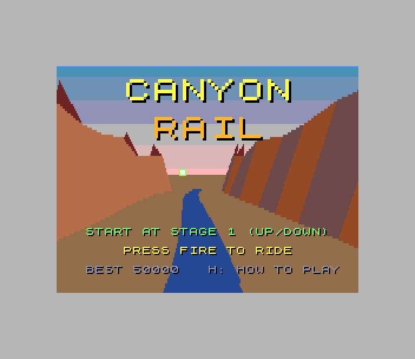
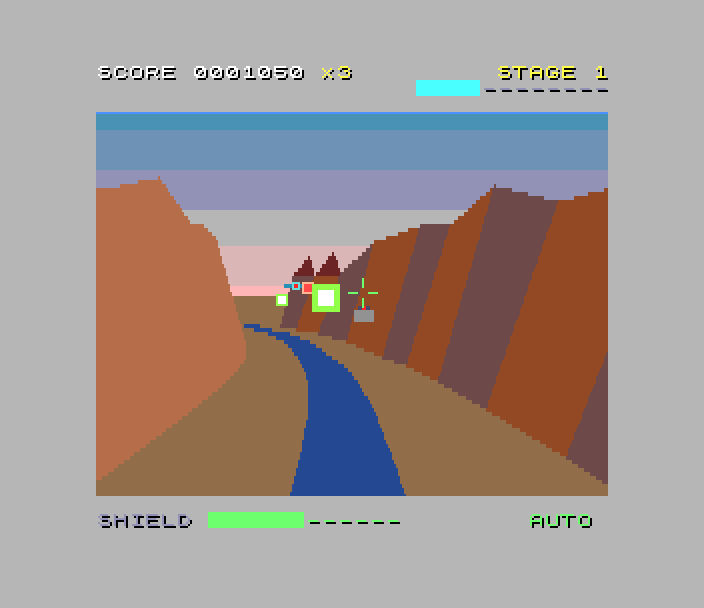
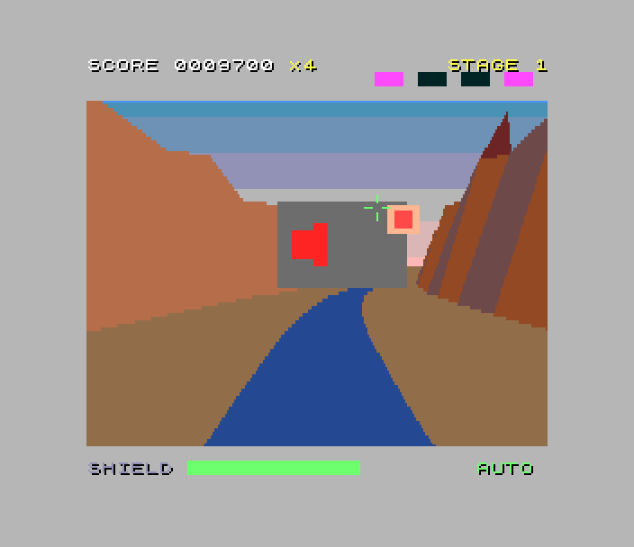
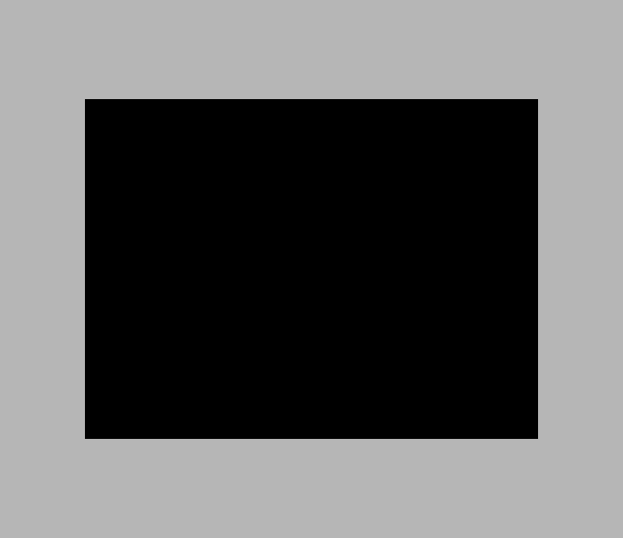

# Canyon Rail (Spectrum Next)

Port of `amiga_mcp/examples/canyon_rail`, a rail shooter on the shared
amiga3d engine (classic Amiga and AmigaOS 4). The ride takes you down a
winding canyon at a steady speed. You move the sight and fire. Turrets on
the walls and drones swooping across fire bolts at you: shoot those down
too, or your shield takes them. At the end of each stage the ride stops
in front of a guardian.

  



## The game

As the original:

- **Turrets** sit on the canyon walls and take two hits. **Drones** swoop
  across the canyon and take one.
- **Bolts** are their shots, aimed at where you will be. Shooting one
  down scores 25. A bolt that lands costs 12 shield points.
- **Fuel pods**: shoot them for +25 shield.
- **The guardian**: a core with four nodes orbiting it, each firing in
  turn. Shoot out all four (4 to 6 hits each) to clear the stage.
- Hits in a row build a multiplier, up to x8, on everything you score. A
  miss, or a hit taken, resets it.
- 3 stages, each with more targets, quicker fire and faster nodes.
- Scoring: turret 100, drone 150, bolt 25, pod 50, node 500, guardian
  2000 x the stage, all x the multiplier.
- An autopilot (B) shoots on its own. It also rides behind the title, a
  new ride each time.

## Controls

| | |
|---|---|
| Q A O P / cursor keys / joystick | move the sight |
| SPACE / fire | fire (hold it for five shots a second) |
| Up / down on the title | the stage to start at |
| P | pause |
| B | autopilot on / off |
| H | the rules and controls (two pages) |
| BREAK | back to the title |

High scores take initials: type them, or use up / down and fire.

## Build, run, test

```sh
./zx build canyon_rail          # -> projects/canyon_rail/build/canyon_rail.nex
./zx run canyon_rail            # a window to play in
./zx test canyon_rail           # test.py (below)
projects/canyon_rail/tools/check_trace.sh   # the rules against the original's C
```

`test.py` boots to the title, turns the help pages, starts stage 1, moves
the sight by keys and fires, then pauses and resumes. It hands over to the
autopilot, which clears stage 1 (targets, the guardian's four nodes) and
reaches stage 2. With the autopilot off, the bolts wear the shield down:
game over, the initials BOT, back to the title. The game is recorded from
reset and replayed twice, and every frame hash must match. It prints the
frame rate while riding: **11.8 frames a second** with the rules at the
original's 25 ticks a second.

`tools/check_trace.sh` builds `tools/trace_main.c` on the host with the
original's `cr_core.c` and amiga3d sources (from
`../amiga_mcp/examples/canyon_rail`, or `$CANYON_ORIG`), and on the Z80
(`make TRACE=1`: the rules alone, in `build-trace/`). It runs four whole
autopilot games on both and diffs the traces, which must be identical.

## What's kept, what changed

- The rules are the original's `cr_core.c`. Changes are marked `port:`.
  zsdcc's `int` is 16 bits, so three products that pass that are widened.
  The bolt's 64-bit FMUL / FDIV are their exact 32-bit equivalents. Where
  things are (the ride's line, the camera, the projection, the places of
  targets, nodes and bolts) is split out into `cr_place.c`, which stays
  resident because the picture uses it too.
- The camera and the hash come from the engine, bit for bit (sdk
  `a3cam.h`); its arc tangents are fix16.h's (`a3_atan2`).
- The canyon is the original's: slabs 100 long out to 1300 ahead (the
  classic Amiga's view range), each with floor, river, two walls sloping
  out as they rise, and spires on the rim. The ground is one tone with
  every other slab's bank as a quad in the second tone, and the river is
  a quad over them (the original draws three quads a slab). From 600 out,
  slabs are drawn in pairs.
- Turrets, drones, pods, bolts, explosions, the guardian and the sight
  are hardware sprites, drawn on the host from the original's models
  (`tools/gen_sprites.py`) at a ladder of sizes. The original draws them
  as polygons with the canyon. Sprites are over Layer 2, so one behind a
  wall at a bend still shows; the original's shots ignore the walls too,
  so what is seen can be hit.
- The sky is a copper gradient. Text, the HUD and every screen are on the
  tilemap.
- The effects are the original's synthesised ones as AY tones and noise.
  The original has no music, and neither does this port.
- High scores: a table of five with initials.

## Next features used

| Feature | Used for |
|---|---|
| **Layer 2** 256 x 192 | the canyon, painted far to near with sdk `l2poly`, double buffered (`l2_flip`) |
| **Copper** | each of the 96 drawn rows shown twice (half the rows to fill); the sky gradient |
| **Hardware sprites** | every target, shot, explosion, the guardian and the sight; patterns streamed from banks 40-47 into one half of pattern memory while the other half is shown, so nothing tears |
| **Tilemap** | the HUD, the title, help, game over and high-score screens |
| **Z80N `MUL`** | the camera rotation of the slab edges and the reciprocal scale (`view.asm`) |
| **28 MHz** | everything |
| **MMU banking** | the rules in bank 16, the picture and sprites in bank 18, the shell (with the tilemap, copper and high-score SDK modules) in bank 20, each mapped at 0x0000 when needed |
| **AY** | the effects |

## How it's built

- `src/cr_core.c`, `src/cr.h`: the original's rules (bank 16).
- `src/cr_place.c`: where things are (resident).
- `src/render.c`, `src/view.asm`: the canyon (bank 18). Each slab edge's
  points go through the camera rotation once, shared by the slabs either
  side, then a 1/z table onto the screen. The slab across the near plane
  is clipped there.
- `src/sprites.c`, `src/spr_tab.c`, `src/spr_data.asm`: the sprites (bank 18).
- `src/front.c`: the shell (bank 20): title, play, help, game over, high
  scores, the HUD, events to effects and explosions.
- `src/main.c`: memory map, start-up, the frame loop (fixed timestep: the
  rules tick at 25 Hz, up to 4 ticks a frame; the picture once a frame).
- `src/trace.c`: the `make TRACE=1` build for `tools/check_trace.sh`.

## Known differences

- About 12 frames a second, against the original's 50 on an AmigaOS 4
  machine. The rules keep the original's speed.
- Sprites are not hidden by the canyon walls.
