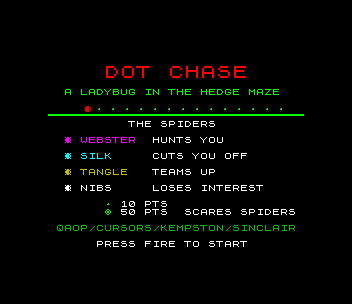
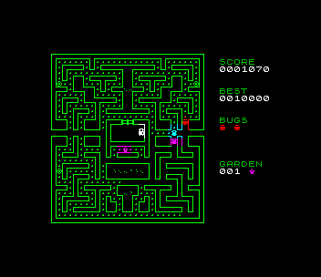
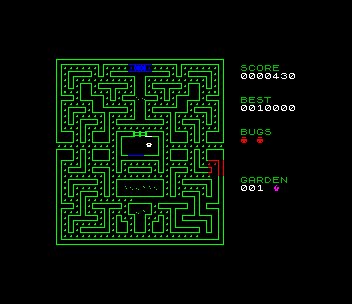
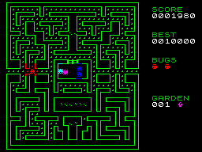

# Dot Chase (ZX Spectrum 48K)

Port of `amiga_mcp/examples/dot_chase`: a ladybug in a hedge maze. Gather
every seed while four spiders hunt you; eat a flower to scare them and catch
them for 150, 300, 600 and 1200 points. Garden treats appear twice a level,
an extra ladybug comes at 10,000 points, and each garden is faster and the
spiders stay scared for less time. Three ladybugs.

  

## Controls

| | |
|---|---|
| steer | Q / A / O / P, cursor keys (5 6 7 8), Sinclair 1 or 2, Kempston |
| start | fire (SPACE, M, 0, the joystick) or ENTER |
| initials | type three letters (or UP/DOWN + FIRE) after a high score |

As in the original, a direction is remembered and taken at the next turning.

## What was kept, what changed

`src/game.c` is the original game logic and `game_update()` its state
machine: the 28 x 31 maze, the four spiders and their characters (Webster
hunts you, Silk cuts you off, Tangle teams up with Webster, Nibs loses
interest when close), scatter and chase phases, the house and its dot
counters, frightened spiders, eaten spiders running home, speeds, tunnel
slowdown, the treats, scoring, extra life and level progression. Changes are
marked `port:`:

- **tile centres**: the original moves in steps of 1 to 3 pixels and turns
  only when a step lands exactly on a tile centre, so it skipped about one
  centre in five: turns were missed and the ladybug or a spider walked on
  into the hedge (a spider spent ~4% of its time inside hedges in a test
  game). Here a step that would pass a centre stops on it (the SDK's
  `grid_move`), costing at most a quarter of a pixel now and then: the same
  speeds, the movement the game means
- the maze is stored as its left halves (it is symmetric) and mirrored
- the frightened spiders' "random" target is the original's
  `(frame * 7 + id * 13) % 28`, worked out in 16 bits with the Amiga's
  32-bit results
- speed-only rewrites with the same results: the state at a fixed address
  and spider updates unrolled per spider (zsdcc makes several times faster
  code for fixed addresses than for pointers), collision tests as unsigned
  ranges, the passability test written out
- one high score became the SDK's table of five (the original's best of
  10,000 is the top entry)

`src/main.c` is the Spectrum front end, after the original's `draw.c`:
title screen with the spiders' names (alternating with the high scores),
the maze, "GO BUG GO" and "GARDEN CLEAR", the flowers pulsing, the dying
ladybug curling up, score popups, the HUD and the game over screen.
`src/sound.c` is the original's `sound.c`: seed pips, the catch, lose, bonus
and extra-life jingles, the crickets that speed up as the seeds run out and
the scared spiders' arpeggio. The original's 32-byte waveforms make its Paula
periods the same numbers as AY periods, so the AY plays the original notes
on a 128K; on a 48K they are short beeper slices.

## 48K notes

- **The maze in 6-pixel tiles.** 31 rows of 8 pixels need 248 lines; at 6
  pixels the maze is 168 x 186 and fits beside a HUD. The logic still works
  in the original's 8-unit tiles (speeds, collisions, AI untouched) and is
  drawn at 3/4 scale through a lookup table. The maze appears row by row
  in under a second at the start of a garden.
- **A shadow screen** (SDK `shadow48.h`) at 0x6000 holds the maze without
  sprites, bitmap and attributes. Each frame, straight after the interrupt,
  `spr8_frame` puts the sprites' old places back from it and draws the
  sprites again, top first, so each is finished before the beam reaches it:
  no flicker, no tearing. When a frame runs long the next one waits for the
  interrupt, so drawing always starts in the border (25 fps then, never torn
  images).
- **Colour from attributes.** The hedge is green ink on black; each sprite
  colours the 8 x 8 cells it covers (ladybug red, spiders magenta, cyan,
  yellow, white; scared blue, blinking white). That is the Spectrum's colour
  clash; the hedges are drawn as their edges (with leafy speckles inside
  thick hedge) rather than solid as in the original, so a passing sprite
  tints a few lines, not a block.
- **Logic at a fixed 50 Hz**, the picture redrawn every frame: **49.5 fps**
  over a whole bot game (47-50 per 10 s; the test measures it); the frames
  that miss are tile centres where all four spiders choose a direction, and
  the beeper's jingles. In play the keys are read every other frame (a read
  costs ~15,000 T-states; a direction is kept until the next turning
  anyway, and the SDK's interrupt latch catches taps).
- **Memory**: screen, shadow 0x6000-0x7AFF, game state 0x7B00-0x7F37 (both
  free once the loader has run), program 0x8000-0xEF59, the SDK's IM 2 table
  at 0xF000. About 160 bytes are left.
- **Sound**: the beeper stops the CPU, so a 48K plays one short slice of the
  most important sound each frame (a pip is ~4,000 T-states). On a 128K the
  AY plays everything, as the original's four channels do on three.

## Test

`./zx test dot_chase`: a bot reads the game state from memory (at 0x7B00;
`dc_layout` gives the offsets) and steers with the keys: breadth-first
search to the nearest seed along paths that stay two tiles clear of hunting
spiders, scared spiders chased while there is time. It clears the first
garden (catching spiders on the way), then stops looking out for spiders, so
lives are lost and the game ends; it enters BOT in the high-score table and
returns to the title. The game is recorded and replayed twice with every
frame hash checked, the frame rate is measured, and a 128K run checks the AY.

`tools/profile.py` samples where the CPU goes while the bot plays;
`tools/make_gif.py` makes `docs/images/dot_chase.gif`.
