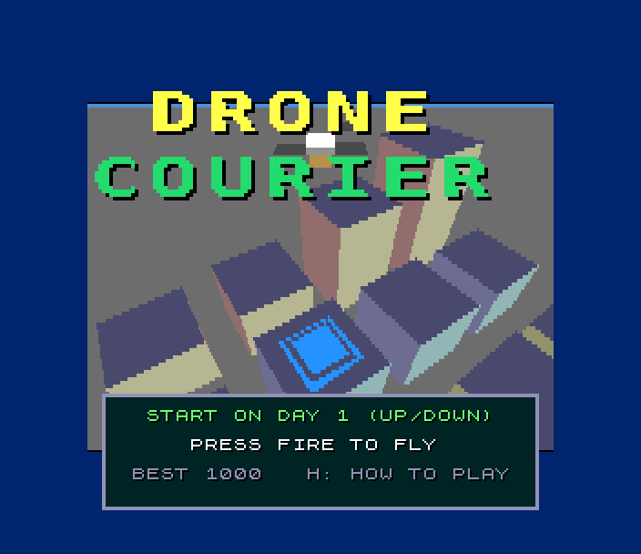
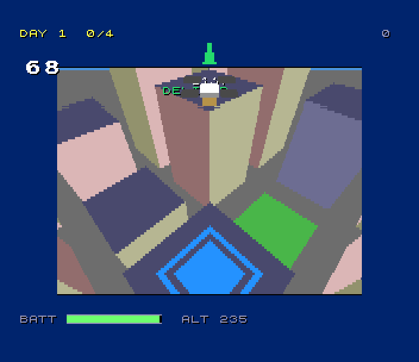
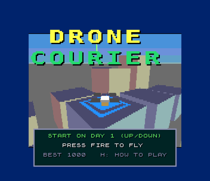

# Drone Courier (Spectrum Next)

Port of `amiga_mcp/examples/drone_courier`, an Amiga game on the shared
amiga3d engine (also on AmigaOS 4). Parcel deliveries by drone across a
city of towers: fly to the depot's blue rooftop pad and land to collect a
parcel, then land it on the customer's green pad before the clock runs
out. The arrow at the top and a beacon over the pad show the way.

 

## The game

As the original:

- Touch down gently on the pad: under 2 a tick down and 1.5 across.
  Harder, and you have to try again.
- From day 2 some parcels are fragile (red). Land one hard or knock a
  tower with it and it breaks.
- Clip a tower's side and the drone bounces off it.
- The battery drains as you fly, faster when climbing, and is charged
  each time you collect at the depot. A flat battery ends the game.
- The wind blows from day 2 and gusts, harder each day; the pads get
  smaller.
- 5 days of 4 to 8 jobs. Three failed jobs (a broken parcel, or the
  clock running out) end the game.
- Scoring: 200 a delivery, + 5 for each second left and 150 for a
  fragile parcel; 500 x the day for finishing it.
- An autopilot (B) flies on its own; it also flies behind the title.

## Controls

| | |
|---|---|
| fly | Q A O P, cursor keys, Sinclair or Kempston joystick: up / down forward / back, left / right turn |
| climb | SPACE or fire (let go and it sinks slowly) |
| title | up / down choose the day to start on, fire or ENTER starts |
| pause | ENTER |
| autopilot | B |
| help | H: the rules, then the controls |
| back to the title | BREAK (CAPS SHIFT + SPACE) |

port: the original's P (pause) is right on Q A O P, so ENTER pauses, as in
Marble Tilt. Its Esc is BREAK.

## What's kept, what changed

Kept from the original:

- **The rules, bit for bit.** `src/dc_core.c` is the original's file, on
  the SDK's `fix16.h` (the engine's 16.16 fixed point reproduced exactly):
  the city from the seed, the drone's flight in two half steps a tick, the
  wind and gusts, landings, bounces, fragile parcels, the battery, the
  clock, the days, the scoring, and the autopilot. The original's own
  tests (`src/test_cases.c`, 30 of them) run on the Next (hold T at
  start-up), ending with a long autopilot game whose state hash must match
  its `tests/vectors.h`. `tools/check_core.sh` checks the same on the host
  against the original built on the amiga3d engine.
- The rules' speed: 25 ticks a second, whatever the drawing does.
- **The 3D view.** The original's chase camera (170 behind and 70 above
  the drone, easing after its heading, looking down at the ground under
  it), its grid-cell cull, its towers (the roof and the walls facing the
  camera, in three tones), parks, pads, the beacon and the drone's shadow,
  sorted by depth as the engine sorts them. `tools/refview.py` is the
  original's scene() in Python; the test compares the Next's Layer 2
  with it.
- The HUD at the original's places: day and jobs, failed jobs, the big
  clock (red and flashing in the last 10 seconds), the score, the arrow
  and the distance to the next pad, COLLECT / DELIVER, the battery bar,
  the height, the wind gauge, AUTO; the messages; DAY'S DONE; the game-over
  box; the title over the autopilot's flight; the two help pages.
- The effects, made from the original's synthesis settings (tone sweeps,
  noise, lengths, loudness and priorities).

Changed (marked `port:` in the code):

- **The view is 4/5 of the original's and drawn 96 rows high.** Layer 2's
  256 x 192 holds the original's 320 x 240 at 4/5; the copper shows each
  row twice (the SDK's `l2double.h`), as the polygons' cost is mostly per
  row. The HUD is around it, in the border, as on the original's screen.
- **The drone is hardware sprites.** The chase camera keeps the drone at
  the same distance, so its picture depends only on the camera's pitch,
  its heading against the camera's, the parcel and the rotors' phase:
  `tools/gen_drone.py` renders the original's model for each (180 frames,
  80 x 32, in banks 25-39; the model's symmetry gives the other headings
  by mirroring). It is drawn over the city instead of sorted among the
  towers. Its shadow is still a polygon, sorted with them.
- **The view range is 440** (the original's `view_range`: 560 on the 68k,
  1400 on AmigaOS 4).
- The transform is the engine's in 16-bit pieces: a tower's corners are
  sums of per-column, per-row and per-height terms (one rounding where the
  engine has two, a 16th of a unit), and the projection takes its scale
  from a table. The hot path is in Z80N assembly (`src/view_asm.asm`).
- **Music.** The original has none. This port adds a short tune for two
  AY chips: full volume behind the title, quieter in flight.
- **High scores.** The original keeps a best score. This port has the
  SDK's five-entry table with initials, shown on the title in turn with
  its panel.
- The arrow to the pad has 16 headings (a sprite at twice its size).
- Text on 8-pixel rows (the tilemap), at the original's places.

## Frame rate

The rules always run at the original's 25 ticks a second (at most 4 at
once, as the original's game_update). The 3D view is drawn as fast as it
goes, measured by `test.py` and the `dc: perf` / `dc: lines` log lines
(every 2 seconds):

- **12.1 frames a second** while the autopilot flies from the depot to the
  first customer (the test's figure; 31 polygons, 17 towers a frame), and
  13.7 over the first minute of an autopilot game, between 10.5 and 16 by
  stretch. Flying by hand is a little faster (no autopilot to run).
- About 18 frames a second behind the game-over box (fewer towers in view).
- A drawn frame (in raster lines of ~1,800 T-states, 312 to a 50 Hz frame):
  the rules ~100 (of which the autopilot ~40), building the polygon list
  ~450, filling it ~480, the HUD and sprites ~50.

The speed came from (in order of what they gave): drawing 96 rows; the
drone as sprites (10 of ~45 polygons); the transform in 16-bit pieces and
assembly; the projection's reciprocal table; the view range 440; the
skyline cached for the autopilot (it searched the 144 blocks on every
tick); a fill for polygons wholly on the screen that steps their edges into
row buffers and hands each row to l2poly's span store. The fill now is
mostly pixels: the painter's overdraw is about 3 times the screen.

## Next features used

What it uses beyond a 48K/128K Spectrum, and why:

| feature | used for | why it's needed |
|---|---|---|
| **28 MHz** | the rules (16.16 fixed point, the autopilot), the 3D view | a tick of the rules takes ~35 raster lines at 28 MHz, the autopilot ~50 more; the view ~1,000 |
| **Layer 2, 256 x 192 x 8 bpp, double buffered** | the 3D city in the original's colours, the sky's gradient | the ULA's two colours per 8 x 8 cell can't show shaded towers |
| **copper** | Layer 2's Y scroll moved every other line: 96 drawn rows shown 192 high | half the rows to fill, for nothing on the CPU |
| **hardware sprites** | the drone (10 sprites, 4 bits a pixel, frames copied in by DMA when they change), the arrow to the pad, the wind gauge, the big text (the engine's 16 x 16 font, at twice its size on the title) | the drone is the original's model, sharper than the view, with no polygons to draw |
| **tilemap** (40 x 32, 4 bpp) | the HUD, panels and help pages in the ROM font with the original's drop shadow, the battery bar | text is never drawn into the 3D view |
| **zxnDMA** | clearing the sky and ground, long polygon spans, the drone's sprite frames | ~2 T-states a byte |
| **MMU banking** | the rules and the sound in bank 20 over the ROM (bank 21, the view, instead while drawing), the shell in page 44, the tests in page 45, the projection's reciprocal table (page 48) while the polygon list is built, the drone's frames (banks 25-39) | the code is ~60K against 28K free at 0x8000, plus ~250K of tables (the drone's frames, the reciprocals) |
| **Z80N `MUL`** | fix16's 32 x 32 multiplies and divisions (the rules), the camera transform and projection, l2poly's slopes | the original's 16.16 arithmetic, exactly, at a usable speed |
| **TurboSound** (3 AY chips) | the tune on chips 0 and 1, the effects on chip 2 (events, gusts and the rotors' hum on its three channels) | music and effects at once |
| **raster line** (NextReg 0x1E/0x1F) | the profiler's figures in the `dc: lines` log | |

## How it's built

- `src/dc_core.c`, `src/dc.h`: the original's rules (see above);
  `src/a3d.h` maps the engine's names onto `fix16.h`.
- `src/test_cases.c`, `src/vectors.h`: the original's tests.
- `src/view.c`, `src/view_asm.asm`: the 3D view (bank 21).
- `src/game.c` (page 44), `src/screens.c` (bank 20), `src/hud.c`: the
  shell, the help pages and high scores, the text and sprites.
- `src/sound.c` (bank 20): the effects and the tune.
- `tools/gen_gfx.py`: the palette, the font and arrow sprites, the
  projection's table; `tools/gen_drone.py`: the drone's frames;
  `tools/refview.py`: the original's view in Python (for the test);
  `tools/check_core.sh`: the rules against the original's on the host.
- `src/main.c`: the memory map and start-up.

Build: `./zx build drone_courier`. Test: `./zx test drone_courier`.

## Tests

`test.py` (through the harness):

1. The original's own tests (`src/test_cases.c`, 30) on the Next (T held
   at start-up), including its long autopilot game, whose state hash must
   be its `tests/vectors.h`'s.
2. Boot, the title (the city drawn, the autopilot flying behind it),
   SPACE starts day 1.
3. Flying by hand: fire climbs, up flies forward.
4. The copper shows each drawn row twice; the 3D view on Layer 2 against
   `tools/refview.py` (the original's scene() for the same state): under
   12% of the pixels differ (edges, the 16ths of a unit).
5. B: the autopilot collects and delivers a parcel (scores); the frame
   rate (12+) and the rules' 25 ticks a second; back at the depot, the
   next parcel.
6. The tune on chip 0, the rotors' hum on chip 2.
7. H: the help pages and back; ENTER pauses (the rules stop).
8. B again, by hand: the clock runs out three times (TOO LATE), game over.
9. FIRE: the high-score entry, initials BOT, back to the title (its second
   page: the table).
10. The start of the game (to the first delivery) recorded and replayed
    twice: every frame's hash matches.

On the host, `tools/check_core.sh` builds the port's rules (with fix16 in
64-bit C and as the Z80's C) and the original's on the amiga3d engine:
the 30 tests and three 20,000-tick autopilot games must agree.

## Known differences

- The drone's sprites are over the tilemap, so near the top of the view
  the drone can cover the distance and COLLECT / DELIVER text, which the
  original draws over it (the big letters, also sprites, have to be over
  the panels).
- ZEsarUX shows a copper move one line early (CLAUDE.md), so in the
  emulator the doubled rows pair up a line later than on a Next.

## Original bugs

None found that stop the game being playable.
