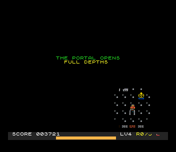

# Emberkeep (Next)

A port of `amiga_mcp/examples/emberkeep` (also on the Atari Falcon and the
3DO) to the ZX Spectrum Next, as a `.nex`. You explore four stone chambers
by the light of a small lantern; everything outside its light is pitch
black. Take the runes to open the portal, keep the lantern burning with oil
flasks, and don't blunder into the spikes or the things that patrol the
dark.



```sh
./zx build emberkeep         # -> build/emberkeep.nex
./zx run emberkeep           # play it in a window
./zx test emberkeep          # the bot plays it (test.py)
```

## Controls

| | |
|---|---|
| Q / A / O / P, cursor keys, Sinclair, Kempston | walk (4 directions) |
| SPACE (fire) or ENTER | begin; back to the title from the end screens |
| initials | type the letters, or UP / DOWN and FIRE |

## What is the original's

`src/game.c` and `src/levels.c` are the original's `game.cpp` and
`levels.cpp`. The rules are the same:

- walking 2 pixels a frame against the walls, X then Y;
- runes 100, oil 25 plus 400 units of fuel, a chamber 500 plus half the lantern;
- the lantern burns 1 unit every 4 frames out of 1000, and its light square
  shrinks from 40 to 8 pixels as it does;
- an empty lantern, a spike or a touching guard costs one of three lives and
  restarts the chamber;
- the guards' patrols, the four chambers (with the original's own fix for
  chamber 1's walled-in rune), and the title and end screens' words.

Changes are marked `port:`:

- C with 16-bit fields instead of C++ with 32-bit ones (the score is 32-bit);
- the logic runs at a fixed 50 Hz (`frame_wait()` ticks);
- `game_changes` tells the screen what to redraw, since the original redraws
  everything every frame;
- sound: the original's `audio.cpp` only logs. Here TurboSound plays effects
  for the runes, oil, deaths, the portal, the end screens and a low lantern,
  a title tune, and a slow line in the chambers;
- high scores and the initials editor (the SDK's), which the original hasn't;
- "THE PORTAL OPENS" and the next chamber's name during the original's
  one-second pause between chambers;
- the HUD's layout fits the tilemap's 8 x 8 cells. The fuel bar is on its own
  line, and the lantern's edges are in steps of two pixels (see below).

The art is the original's tile sheet (`art/tilesheet.png`), taken by
`tools/gen_gfx.py` the same way the original bakes it (nearest-neighbour to
16 x 16 tiles) but keeping its colours: 160 of them, where the original
snaps every pixel to 16.

## Next features used

- **Layer 2, 320 x 256, 256 colours.** That is the original's screen size,
  so the chamber is drawn at the original's pixel positions, once per
  chamber, from the original's tiles with their real colours. A pickup
  redraws one 16 x 16 tile, and the open portal flickers by redrawing its
  tile. The CPU draws nothing else.
- **Hardware sprites.** The player and up to six guards are 16 x 16 sprites
  with 256-colour patterns, cut from the same sheet with their backgrounds
  made see-through. The patterns ride in the `.nex` in bank 20 and go to the
  sprite memory once.
- **Clip windows and the copper: the lantern.** The original paints black
  rectangles around the light square, with its corners cut off, every frame.
  Here the light is the clip window of Layer 2 and of the sprites: whatever
  lies outside isn't shown, and the screen there is the fallback colour,
  black. A guard outside the light is invisible, and one at its edge is
  shown cut. The copper rewrites the windows twice down the screen, on the
  lines where the cut corners start and end, so the octagon-ish shape costs
  no CPU time. The list (about 30 instructions) is rebuilt and sent by DMA
  only when the player or the lantern changes, at the top of the frame.
  Layer 2's clip window works in pixel pairs in 320 mode, so the light's
  left and right edges can be one pixel wider than the original's.
- **The tilemap** (40 x 32, its own palettes) carries the HUD over the
  bottom 16 lines, the title's and the end screens' text, and the 2x
  EMBERKEEP letters.
- **TurboSound** (chip 0): effects and the tunes through the SDK.
- **28 MHz** (`next_init`), as every Next port here.

## Frame rate

50 fps throughout. The test measures 49.6 fps over a whole game of four
chambers (1,487 frames of play), and the rules run at a fixed 50 Hz.

## The test

`test.py` (about 75 s):

1. A game that is lost. The bot clears chambers 1-3, then walks into the
   spikes on purpose three times: game over, the initials (BOT), and the
   title with the new score. The session is recorded and replayed twice
   (every frame hash must match).
2. A game that is won: all four chambers, THE DARK IS BEATEN. The frame rate
   is measured here, and the GIF and the "guard in the light" picture are
   taken.

The bot (`tools/bot.py`) reads the game's state (`gs`) at every game loop
(a breakpoint at `frame_wait`). At each cell boundary it tries each
direction, and waiting, on the game's own rules built for the host
(`tools/hostsim.c`: the same `game.c` and `levels.c`, with `gs` laid out as
on the Next), then follows the shortest tile path. It keeps the move that
gets a rune, the portal, or closest, without a death. The patrols are
deterministic, so its look-ahead is exact. At every game loop the test also
runs the same frames with the same keys on the host, and the Next's game
state must match byte for byte. `tools/try_game.py` plays a whole game on
the host: it wins in 1,670 frames.

Screenshots: `screenshots/` (title, play, gameover, initials, hiscores, won).
