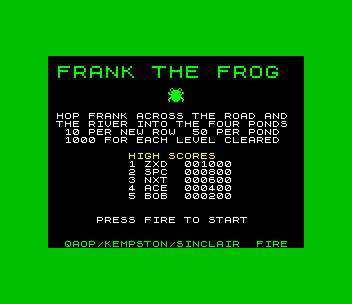
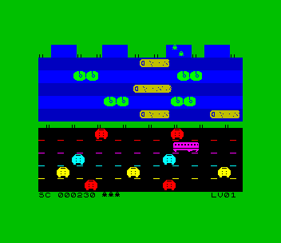
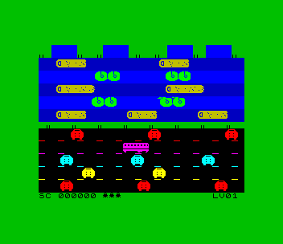

# Frank the Frog (ZX Spectrum 48K)

Port of `amiga_mcp/examples/frank_the_frog`: hop Frank across five lanes of
traffic and five lanes of river (logs and lily-pad rafts) into the four
ponds on the far bank. 10 points for each new row, 50 for a pond, 1000 for
each level; every level the traffic speeds up. Three lives.

 

## Controls

| | |
|---|---|
| hop | Q / A / O / P, Sinclair 1 or 2, Kempston: one hop per press |
| start | fire (SPACE, M, 0, 5, joystick) on the title screen |
| initials | type three letters (or UP/DOWN + FIRE) after a high score |

Presses are collected by the 50 Hz interrupt (SDK `input_sample()` /
`input_latch()`), so a quick tap is never lost even on a busy frame.

Sound: beeper effects on a 48K; on a 128K/+2/+3 the AY plays the original's
E-F chromatic riff behind the game, plus the effects.

## What was kept, what changed

`src/lanes.c`, `src/frank.c` and `src/score.c` are the original logic and
`game_tick()` in `src/main.c` is the original main loop's state machine:
lane layout and objects, speeds per level, the forgiving collision insets,
riding logs, being carried off screen, pond landing zones, scoring, lives,
levels. Changes are marked `port:`:

- 256x192: 16 columns of 16 px (the original has 20). The ten lanes and the
  home bank keep 16-pixel rows (two character rows each, so every lane has
  its own clean attribute colours); the median and the start strip are 8 px
  (13 rows of 16 would need 208 lines). The score bar shares the start strip.
- positions and speeds scaled by 0.8 and kept in 1/16 pixel, so the time
  between cars, the log speeds and the rides are the original's
- speed-only rewrites with the same results: pointer walks and add/subtract
  instead of indexing and multiplying, and `lanes_tick` in assembly
  (`src/lanes_tick.asm`; the C it implements is kept beside it)
- the bus is 32 px (36), logs 40 and 48 (48 and 64), so they fill whole bytes

`src/main.c` is the Spectrum front end: 1-bit art drawn for the machine,
solid pre-shifted objects that rewrite themselves and clear their own trail
(`src/lane_obj.asm`, half the lanes per frame), an XOR frog that takes a
clean colour in its cells, title, game over, high-score table.

The logic runs at a fixed 50 Hz; the screen is redrawn about 20 times a
second (each lane every other redraw), so the game plays at the original's
speed but objects move in steps of ~4 pixels.

## Test

`./zx test frank_the_frog`: a bot reads the lanes from memory (`lanes`,
`frank_probe`, `home_filled`), crosses the road, rides the logs and fills
ponds, then plays carelessly until the game is over; it enters BOT in the
high-score table and returns to the title. The game is recorded and replayed
twice with every frame hash checked. `--debug` prints the bot's last moves
before each death.
