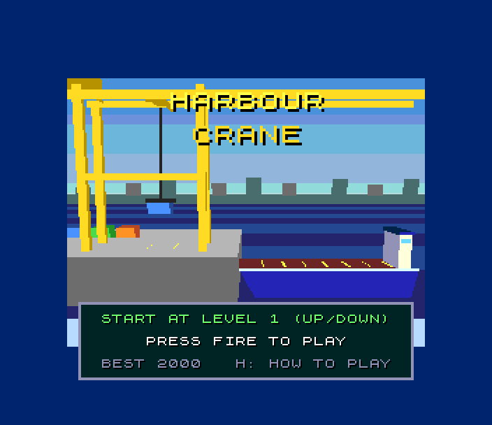
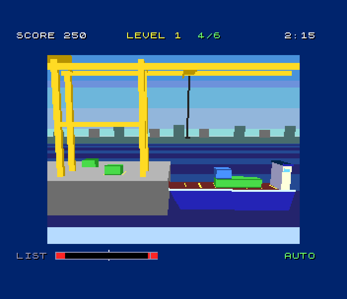
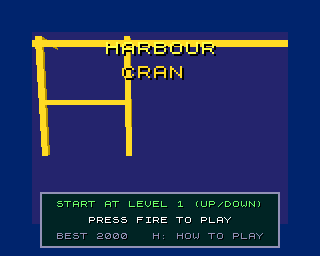

# Harbour Crane (Spectrum Next)

Port of `amiga_mcp/examples/harbour_crane`, a gantry crane loading a ship
that rolls in the swell, on the shared amiga3d engine (classic Amiga and
AmigaOS 4). The original is the Amiga version; there is a 3DO port of it,
and no ST one.

The crane runs from the quay out over the ship. Its trolley moves along the
gantry and its winch lets the hook up and down. Whatever hangs on the hook
swings like a pendulum, pushed by the trolley's starts and stops and by the
wind. Lift each container off the quay and land it on the deck, in one of
six slots, stacked up to four high. Land it low, square and on an even
stack. Keep the ship level: she lists towards her heavy side and rolls more
the higher the stacks. Eight levels, each with a clock.

 

## Controls

| | |
|---|---|
| A / D, cursor 5 / 8, Kempston left / right | move the trolley |
| W / S, cursor 7 / 6, Kempston up / down | winch in / out |
| SPACE, 0, Kempston fire | grab / let go |
| P | pause |
| B | autopilot on / off |
| H | the rules and controls (two pages) |
| BREAK (CAPS SHIFT + SPACE) | back to the title |
| on the title: up / down, fire or ENTER | the start level, play |

port: the original's keys are A/D, W/S, the cursor keys, space, P, B,
Help/H and Esc. The Spectrum's cursor keys are 5-8 (and 0), and BREAK takes
the place of Esc.

## What's kept, what changed

Kept from the original:

- **The rules, unchanged.** `src/hc_core.c` is the original's file with
  only its includes changed. That covers the trolley, the winch, the
  swinging load (the pendulum integrated four times a tick, with the
  trolley's acceleration, the wind and the winch's Coriolis term), landing,
  denting and losing containers, long containers on even stacks, the list
  and the swell's roll, capsizing, gusts, the clock, the 8 levels, the
  scoring and the autopilot.

  They run on the SDK's `fix16` (the amiga3d engine's 16.16 arithmetic,
  bit for bit) at the original's 25 ticks a second. `tools/check_core.sh`
  runs the original's tests (`tools/orig/test_cases.c`) on the port's rules
  on the host: all 51 pass, with fix16's 64-bit C and with its Z80 model.

  On the Next itself, holding T at start-up plays the original's long test
  (the autopilot from level 1, seed 1234, 15,000 ticks). It ends with the
  original's state hash, 0x6ADC57B8: level 4, score 4326, 29 loaded, 1
  lost. `test.py` checks it.
- **The picture**, from the original's own scene code (`render.c` in
  `src/view.c`). The camera, the far shore and its buildings, the sea's
  drifting bands, the quay and its queue are as in the original. So are the
  crane, its trolley, cable and hook, and the ship rolled by her heel about
  the original's pivot and lifted by the swell. Her load is drawn with the
  darker bands. The container on the hook is swung with the cable, and the
  splash is the original's. Everything is drawn in the original's
  palette and depth order (its 512 depth buckets).
- The HUD (score, level, loaded/total, the lost marks, the clock blinking
  red at the end), the LIST gauge with the heel and list needles, the
  wind arrow, AUTO, and the messages (DENTED!, LOST IN THE HARBOUR, GUST!,
  SHIP LOADED, LEVEL n: LOAD n CONTAINERS, PAUSED, the game-over box with
  its reason).
- The title with the autopilot working behind it, the start level, and
  the two help pages.
- The original's effects: their tones and noise, frame by frame.

Changed (marked `port:` in the code):

- **A fixed camera.** The original's camera follows the trolley a little
  (`cam.x = 60 + (tx - 100) / 6`). Here it stays at its middle, so the
  picture behind the moving parts never changes. The whole gantry is in
  view either way.
- **The view at 0.8.** The original's 320 x 256 scene (between its top and
  bottom panels) is the Next's 256 x 192 Layer 2. The score line and the
  gauges are in the border, where the original's panels are. The gauge is
  104 pixels wide (100 in the original).
- **The crane's near side is sprites.** The near legs, the crossbeams, the
  near rail and the brace never move, so they are hardware sprites over
  the picture. The original draws the trolley and the top of the cable
  just after the rail, so there they cover a few pixels of it. Here the
  rail is in front.
- **Small details made on the screen.** A container's darker bands are a
  pixel high and its ends a pixel wide; in the original they are 3 and 2
  units. Points are projected with Q12 maps and a reciprocal table, so
  positions can be a pixel off the original's. The sea's band edges move
  in 5-unit steps.
- **Music.** The original has none. The Next plays a shanty-like tune on
  the title (two TurboSound chips). The original's effects are AY register
  streams on the third chip.
- **High scores.** The original keeps a best score. Here there is a
  five-place table with initials (the SDK's editor), shown on the title in
  turn with the start screen. A score must be above 0 to enter.
- The title's demo seeds the next demo game with an xorshift, where the
  original uses the engine's `a3_hash`.

## Next features used

What it uses beyond a 48K/128K Spectrum, and why:

| feature | used for | why it's needed |
|---|---|---|
| **28 MHz and the Z80N's `MUL`** | the original's 16.16 rules (fix16's 32 x 32 multiplies and divisions from 16 x 16 MULs), the projection of the moving parts (`cv.asm`), l2poly's edge slopes | a tick of the rules is ~175K T-states (the pendulum's four steps alone ~110K); at 3.5 MHz the rules alone would take more than the machine has, and the original's arithmetic must be exact |
| **Layer 2, 256 x 192 x 8 bpp, double buffered** | the scene in the original's 32 colours plus a sky gradient and the sea's 180 shades of index | the original's flat-shaded 3D needs a colour per pixel; double buffering hides the redrawing |
| **zxnDMA** | each frame starts as a copy of the level backdrop (48K: ~17K T-states in ZEsarUX; at the zxnDMA's ~2 T-states a byte at most ~100K on the Next), the sea's palette, the sprite patterns | the scene behind the moving parts is never drawn by the CPU |
| **palettes** | the sea: each sea pixel holds where it is on the water, and the drifting bands are two runs of palette entries loaded by DMA each tick | the original redraws its sea bands every frame; here no pixel changes |
| **hardware sprites** (4-bit, palette offsets) | the crane's near legs, crossbeams, rail and brace (45 sprites from 31 host-made patterns); the gauge's needles and the wind arrow | the big near parts of the crane are never filled again, and they stay in front of the loads swinging behind them, as in the original |
| **tilemap** (40 x 32) | all text: the score line, messages, panels with borders, big words (2x letters defined on demand), help pages, high scores | text over the picture and in the border without touching Layer 2 |
| **MMU banking** | the rules in bank 20 and the picture's code and lists in bank 21, each mapped at 0x0000 while it runs; the game shell in page 44 at 0x6000 | the original's rules are 16K of zsdcc code, the picture 9K plus its lists; with the SDK, the text and the sound that is more than the 28K at 0x8000 |
| **TurboSound** (3 AY chips) | the title tune on chips 0 and 1, the effects on chip 2 (`aystream.h`) | music and effects at once |
| **raster line, NextReg 0x1E/0x1F** | timing (`hc: perf`) | |

## Frame rate

The rules always run at the original's 25 ticks a second (fixed timestep;
the test checks it). The picture is drawn as often as it can be. Over the
test's game (~14,000 frames) it averages **21-22 fps**. That is 25 fps
with a light deck, 15-20 when the ship is loaded high, and about 15-17
behind the title, where the autopilot also runs (another ~170K T-states a
tick).

## How it's built

- `tools/gen_gfx.py` (with `tools/geom.py`, the amiga3d camera in Python)
  makes the backdrop (sky, shore, sea indices, quay) in the original's
  depth order, the palette, and the crane's near side as sprite patterns.
  `tools/gen_sound.py` makes the effects (from the original's
  `game_sound_init`) and the tune.
- `src/view.c` (bank 21) is the original's `render.c` in camera space:
  - Each part's placement (world, the ship's heel, the load's swing) and
    the camera make one affine map. A box is its first corner plus its
    edge vectors (adds), and the ship's load comes from a slot/tier
    lattice.
  - `cv.asm` projects with a reciprocal table and MUL.
  - Faces go into the original's depth buckets, then are filled by
    l2poly.
  - What only changes when a container leaves the quay (the queue, the
    crane's far side) is drawn into a level backdrop in banks 27-29.
- `src/game.c` is the original's game shell (states, input, events and
  sounds, the text), plus the high scores. `src/hud.c` holds the tilemap
  text and gauges.
- `tools/check_core.sh` runs the original's tests on the port's rules on
  the host. `tools/sim.c` + `tools/botsim.py` is the test's bot against the
  host build. `tools/profile.py` is a sampling profiler.

## SDK

Uses `fix16.h` (Marble Tilt's: the amiga3d 16.16 arithmetic) and
`l2poly.h` (ScAIry Fun's: convex polygons on Layer 2). Added: input2's latching
(`in2_sample` from the frame interrupt, `in2_scan_latched`), so a key
tapped between two slow frames still counts (input2_latch.c; tested in
`projects/splittest`).

## Test

`./zx test harbour_crane`:

- The original's 15,000-tick autopilot game: the same state hash on the
  Next.
- The title, TurboSound music, 28 MHz, the start level by Kempston, the
  help pages.
- Recorded from reset, the game at level 1:
  - The bot (`tools/bot.py`, from the game's probe) loads the first
    container by hand with the keys: it grabs, lands it in slot 2 and
    scores.
  - P pauses.
  - The autopilot (B) loads the rest: SHIP LOADED, level 2.
  - The bot drops three containers past the stern: lost in the harbour,
    game over.
  - The initials BOT go into the table, then back to the title.
- The rules keep 25 ticks a second.
- The recording is replayed twice and every frame hash matches.

## Known issues

- With a heavily loaded ship the picture drops to ~15 fps. The rules stay
  at 25 ticks a second.
- In the emulator a container's darker bands are a pixel. Very small (far)
  boxes lose them.
- The near crane parts are in front of the trolley's lower edge and the
  cable's top, where the original draws the trolley over the rail.
