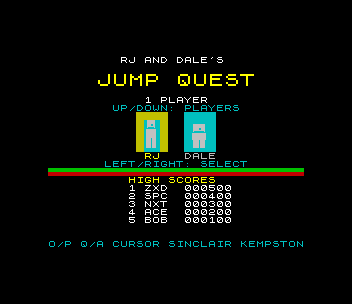
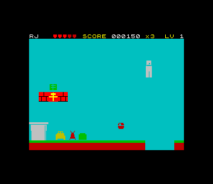
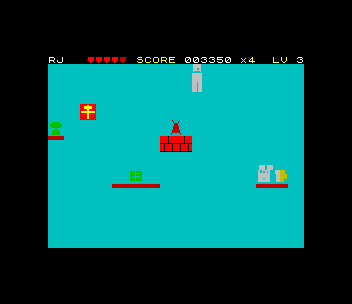
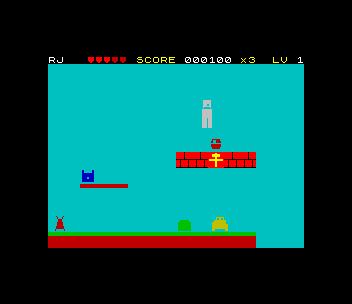

# Jump Quest (ZX Spectrum 48K)

Port of `amiga_mcp/examples/jump_quest`, RJ and Dale's side-scrolling
platformer: three levels (the Office Park, the Server Room, the Rooftop) of
beetles, flies, spiders and ants. Stomp them for 200 points, collect circuit
boards, diskettes, balls, pillows and plants for points, ? blocks for 100,
and finish a level for a 500 bonus. A briefcase makes you invulnerable for
3 s, a heart heals, a pillow with ZZ gives a life, and beer or wine is a speed
boost. Five hearts of health, three lives; one or two players taking turns.
(The ST and 3DO ports were compared; both keep the Amiga's rules.)

  

## Controls

| | |
|---|---|
| walk | O / P, cursor 5 / 8, Sinclair 1 or 2, Kempston |
| jump | fire (SPACE, M, 0, joystick) or Q / UP |
| title | LEFT / RIGHT pick RJ or Dale, UP / DOWN one or two players, fire starts |
| give up | BREAK (CAPS SHIFT + SPACE) during a game |
| initials | type three letters (or UP/DOWN + FIRE) after a high score |

Left alone, the title screen starts a demo that plays all three levels.

Sound: beeper effects (jump, stomp, collect, power-up, hurt, death, level
done) and the original's tune on the beeper on the title screen. On a 128K,
+2 or +3 the AY plays the original's two-channel tune (melody and bass, from
its pattern data) during the game too, with the effects on the third channel.

## What was kept, what changed

`src/jq.c` is the original's `player.c`, `enemy.c`, `items.c`, `level.c` and
`main.c`'s state machine, line for line where it could be: the 10.6 fixed
point, gravity, move speed, fall speed, collision probes and snaps, one-way
platforms, ? blocks, the enemies' patrols, sine flight and spider drops, the
items, scores, health, invulnerability, speed boost, lives, the two-player
turns, the level-complete and game-over timers, the camera. The levels are the
original's files (`tools/levels/`), packed. The logic runs at 50 ticks a
second, as on the Amiga. Changes are marked `port:` in the source:

- **Jump force.** The original's `JUMP_FORCE` of -78 jumps 14 pixels, but its
  levels need 32 (level 1's pipes) to 48 (level 3's climbs from platform to
  platform): no one could get past the first pipe. (The ST port reached level
  2 for its screenshot by poking the player's x.) `tools/solve.c` plays the
  original's code on the host: the levels clear from -172 on; the port uses
  -180, a 56-pixel jump. Everything else in the physics is unchanged, and the
  stomp bounce is still half a jump.
- **Score and lives kept.** The original's `start_level` calls `player_init`,
  which resets the score to 0 and the lives to 3, although the comment next
  to it says they are kept: every life and every level started from scratch
  and no game could end. The port keeps score, lives and health across lives
  and levels as the comment says (the death code already sets health to 3).
- **The view.** The original shows 20 x 14 tiles of 16 pixels; the port keeps
  the 16-pixel tiles (2 x 2 character cells, each with its own colours) and
  shows 16 x 12: tile rows 1-12 (row 0 is clouds or the ceiling, row 13 the
  earth under the grass), the top 8 pixels behind the HUD. The original's
  camera moves in whole tiles, so it began as character-strip scrolling (two
  columns a step: `sdk/cellspr48.h` `cs_scroll`). That cost more than a frame
  every 16 pixels on top of the game, so the view **jumps half a screen** when
  the player is within 80 pixels of its edge: a flip-screen in halves, which
  keeps 80+ pixels ahead of the player. The original's camera (`cam_x`) is
  still computed; it lags 60 pixels behind the player (it snaps to whole tiles
  every tick), which its 320-pixel screen could afford and 256 can't.
- **Items stand still.** The original bobs them two pixels up and down. As
  sprites they cost more than the rest of a frame, so they are drawn as tiles;
  their collision never used the bob. Items sit on empty tiles in all three
  levels (checked).
- **The player's head** stops at the HUD when a jump goes higher than the view.
- **Sound** is the Spectrum's (above); the tune is the original's notes.
- **Title, high scores, BREAK, demo** are port additions. The demo is the
  route the solver found through each level (`src/demo.h`), played in a row;
  `tools/routes.json` is the same data for the test.
- **Two players**: the original sums both scores on the game over screen; the
  port shows that, and each player's score can enter the high-score table.

## 48K notes

- **Speed.** 7 frames drawn a second over the demo (level 1: 7.0, 2: 6.8,
  3: 7.1, view jumps included; 9.4 over 10 s of level 1's running), with the
  logic at its full 50 ticks a second (tested). A tick of the original's logic
  costs ~30,000 T-states (13-17 enemies to move, the player's ~10 tile probes,
  box tests against 16 enemies and 24 items), so over 40% of the CPU goes to
  the game before anything is drawn; each drawn frame then composes the cells
  the sprites moved through (~600 T-states a cell), more cells the longer the
  frame. It plays at the Amiga's speed, but the picture moves in steps of
  5-7 ticks: the biggest weakness of this port.
- **Where the time went.** zsdcc: the first build ran at 8 fps with the logic
  at 30% speed: `enemies_update` 61,000 T-states a tick, `items_update` 23,000
  (a `% 12` per item), `sprites_from_game` 160,000 (arguments evaluated before a
  visibility test re-shifted every enemy). Now in asm: the enemies (with each
  walker's wall/floor results cached per tile column: tile solidity never
  changes, a ? block stays solid), the box tests (one unsigned compare an axis,
  a one-byte early reject), tile lookups, particles. `tools/profile.py` samples
  the PC per function.
- **A zsdcc miscompile.** The original's
  `px + pw > e->x + 3 && px < e->x + 13 && ...` in a loop over a struct array
  came out true for an enemy 90 pixels away (a hit on the first tick). Reading
  the fields into locals first fixed it; `tools/trace.c` + the test's tick by
  tick comparison of the Spectrum against the host build caught it.
- **Memory.** Code and tables fill 0x7850-0xEE3D; the variables are below
  (0x5D80), and the game state (2.7K, with the level's tiles) sits at 0xF200,
  above the IM 2 table and below the stack, out of contended memory (a canary
  between it and the stack is tested). The levels are packed with zxrle (5,180
  bytes to 601). The sprites are 1-bit and shifted when they change
  (`spr16_shift`, two buffers a sprite) instead of 8 pre-shifted copies.
- **Colour.** The tiles' colours come from the original's own drawing code
  (`tools/gen_gfx.py` builds `gfx_draw_tile`, `player_draw`, `enemies_draw`,
  `items_draw` on the host and converts per character cell: the sky is the
  paper, the most common other colour the ink). Sprites colour the cells they
  cover (cellspr48), keeping the paper.

## Files

| | |
|---|---|
| `src/jq.c`, `src/jq.h` | the original's logic, also built on the host |
| `src/enemies.asm`, `src/checks.asm`, `src/tile_px.asm` | its hot loops for the Spectrum (the C is the host's and the reference) |
| `src/game.asm` | the game state's address |
| `src/main.c` | the Spectrum front end: view, sprites, HUD, sound, title, demo, high scores |
| `src/gfx_data.c`, `src/music_data.c`, `src/levels_data.c`, `src/demo.h` | made by `tools/gen_gfx.py`, `gen_music.py`, `gen_levels.py`, `solve.sh` |
| `tools/amiga_draw.c`, `amiga_shim.h`, `gfx_dump.c` | the original's drawing functions (verbatim) on a host RastPort |
| `tools/amiga_music.h`, `tools/levels/` | the original's tune and levels (verbatim) |
| `tools/solve.c`, `solve.sh` | the beam search over `jq_tick` (routes, the jump force scan) |
| `tools/trace.c` | the host's player positions tick by tick (for comparing builds) |
| `tools/profile.py` | sampled PCs per function |

## Test

`./zx test jump_quest`:

1. Recorded from reset: the title left alone starts the demo, the bot (the
   solver's routes played in the game): it clears level 1 without losing a
   life while the view follows. SPACE stops it, FIRE starts a real game that
   walks right (keys) into the first beetle and the pit, three times: lives
   2, 1, 0, game over with 300 points (the diskette each life), initials BOT,
   back to the title.
2. The recording is replayed twice; every frame hash must match.
3. The demo plays all three levels to the CONGRATULATIONS screen with no life
   lost; the speed per level is printed; the GIF is taken.
4. The logic keeps 50 ticks a second; the stack never reaches the game state.
5. Two players with Dale; on a 128K the AY is found and the demo clears level 1.
