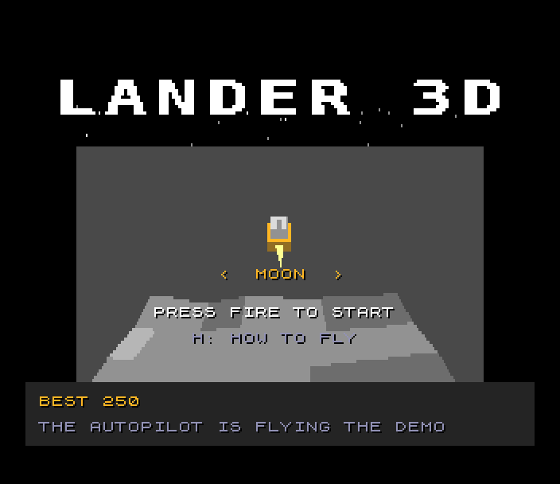
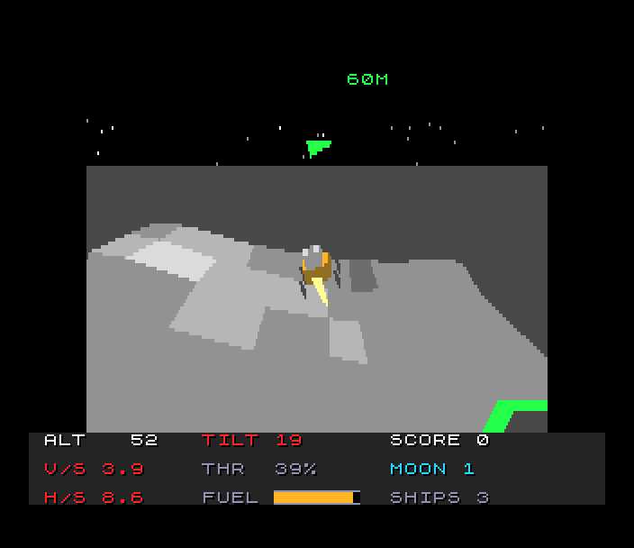
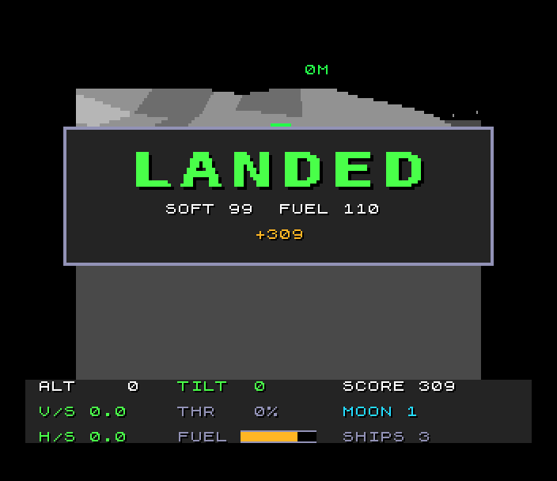
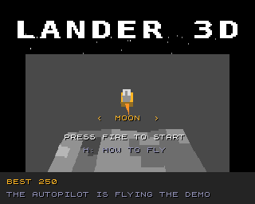

# Lander 3D (Spectrum Next)

Port of `amiga_mcp/examples/lander_3d`, the lunar-lander idea in three
dimensions on the shared amiga3d engine. You start high above generated
terrain, moving, with a fixed amount of fuel. The main engine pushes along
the lander's own up: tip it to move sideways, level it to stop, and keep
enough thrust on to stop gravity winning. Three pads are somewhere below:
a big green one worth x1, a yellow x2 and a small magenta x5 on rougher
ground.

  

## Controls

| | |
|---|---|
| tip forward / back / left / right | W S A D, the cursor keys, a Kempston, cursor or Sinclair 2 joystick |
| full thrust | SPACE, J or fire |
| steady throttle - / + | Q / E (10 % steps) |
| pause | P |
| autopilot | B (it also flies the title's demo) |
| help | H: the rules, then the controls |
| back to the title | BREAK (CAPS SHIFT + SPACE) |
| title | left / right choose Moon, Mars, Asteroid or Tour; fire or ENTER starts |

port: the original's keys are kept (W A S D and the cursor keys tip,
SPACE / J thrust, Q / E the steady throttle, P pause, H help); its Esc is
BREAK, its Return ENTER; B is the original's devbench "autopilot" hook.

## The game

Touch down with every leg on a pad, falling no faster than the world's
limit (2.5 m/s on the Moon, 3 on Mars, 1.5 on the asteroid), sliding no
faster than 1.5, 1.8 or 1.0 m/s and tilted no more than 10 degrees (12 on
the asteroid). The HUD shows each reading green within its limit, amber
close to it and red past it; the arrow at the top points to the nearest
pad. A landing scores (100 + softness + fuel left) x the pad; a safe
landing off the pads scores 25; anything else costs a ship (three ships).
**Moon**: 1.62 m/s2. **Mars**: 3.71 m/s2 and a gusting wind. **Asteroid**:
hardly any gravity, a weak engine, rough ground. **Tour** takes them in
turn. Each level starts higher, faster and farther out, with smaller pads.

## What's kept, what changed

Kept from the original:

- **The rules, bit for bit.** `src/ld_core.c` and `src/ld_auto.c` are the
  original's `ld_core.c` on the SDK's `fix16.h` (the amiga3d engine's 16.16
  fixed point, exactly): the craft and its RCS with the attitude assist,
  the 100 steps a second with sub-steps, Mars's wind and drag, the
  touchdown checks on the four feet and the bell, the pads, the scoring,
  the autopilot. `tools/check_core.sh` flies 18 flights (the autopilot and
  a pilot's inputs, on every world) with the original's code and with the
  port's (with fix16's host and Z80 code): the same state hashes every
  step. The game's own self-test (T held at start-up) flies three of them
  on the Z80N and logs the hashes; the test checks them against the
  original's.
- **The levels.** Every level's ground, pads, start and tank are made by
  the original's own code (`tools/gen_levels.c` builds `tools/orig/ld_core.c`
  with the amiga3d engine at build time): its value-noise hills, craters
  with raised rims, Mars's dunes, the asteroid's curvature, the pads placed
  by roughness and flattened, the start, and the autopilot's probe flight
  that sizes the tank (30 % more than it used).
- The rules' speed: 25 ticks a second of four steps (port: at most 10
  ticks a pass, the original's 4 would slow the game at this frame rate).
- **The picture**: the original's camera (behind and above, closer in as
  the ground comes up, looking down at the craft, never into a hill), its
  ground cells shaded by their slope in its pens, the plain beyond, the
  stars, the pads as two octagons, the lander's model (the gold descent
  stage, the ascent stage and its top, four legs, the bell) tilted by its
  pitch and roll, its flickering exhaust and its shadow, the arrow to the
  nearest pad and Mars's wind, the world's palette.
- The HUD (altitude, V/S, H/S and tilt coloured by the limits, throttle,
  the fuel gauge, score, world and level, ships), the result box with the
  original's messages, the title over the autopilot's demo, the two help
  pages. The big text is the original's 16 x 16 font.
- **The music**: the original's MOD ("Quiet Descent") through the SDK's
  modplay; the effects from the original's (noise for the engine, the
  thrusters and the crash, its chimes).

Changed (marked `port:` in the code):

- **The levels are a fixed set**: ten per world (from level 9 the
  original's levels differ only by their seed: later ones go round the last
  two), made at build time by the original's code. The original makes a
  new landscape for every try from a running seed and flies its autopilot
  over it in the background; on the Next that would take ~16 s of ground
  and ~50 s of probe a level. A crash retries the same landscape.
- **The ground is drawn near to far by columns**: the camera never turns
  (yaw 0), so each strip of cells between two grid lines is drawn from its
  far line down to what the nearer strips left in each column of the
  screen (`src/vfill.asm`): every pixel once, a hill hiding what is behind
  it as in the original's sorted picture; the wedges between a cell's side
  edge and the near line take the near cell. The pads, the shadow, the
  lander and the exhaust go over the ground, each clipped by the columns as
  they were when the strips nearer than it had been drawn. Lines wholly
  below the view and points far off its sides are left out.
- **The ground window** is 6 cells each side of the craft (the original's
  `ground_win` is 9 on the classic Amiga, 20 on AmigaOS 4); beyond it the
  plain, as the original's.
- **Half height**: the original's 320 x 216 view at 0.8 (256 wide), drawn
  92 rows high, the copper showing each row twice.
- **The lander** is drawn as boxes: the faces facing the camera chosen per
  axis from the direction to the craft (the original culls and sorts each
  face); a box in one pen (the legs, the ascent stage's top) is drawn as its
  outline.
- **The autopilot** (the title's demo, B) decides every 32 steps (0.32 s)
  instead of every step: it lands all 30 levels either way, with nearly the
  same scores (`tools/ap_rate.c` on the host), at a tenth of a frame
  instead of more than one. The self-test flies it every step.
- **High-score table** (the SDK's five entries and initials editor) on the
  title, in turn with the start panel; the original keeps the best score.
- **The HUD's lines** sit on 8-pixel tile rows (the original's are 12
  apart); the values are worked out every other pass.
- **zsdcc**: a few of the original's expressions are rewritten (the same
  values): 32-bit sums where its `int` is 32 bits, a multiply by a call's
  result through a local, divisions by 100 by `div100` (`src/fastdiv.asm`),
  the step on a copy of the craft. Speed-ups that keep the values: the
  rotation's sines kept while the angles stay, the touchdown test skipped
  while no foot can reach the ground (the cells' highest corners below),
  the products skipped at zero throttle, the 3-D length skipped while an
  L1 bound already gives one sub-step.

## Next features used

What it uses beyond a 48K/128K Spectrum, and why:

| feature | used for | why it's needed |
|---|---|---|
| **28 MHz and the Z80N `MUL`** | the original's rules (16.16 fixed point, 100 steps a second, the autopilot), the grid's projection (camera turn, reciprocal-table perspective), the lander's corners | the rules alone are ~45-60K T-states a step, 100 steps a second; a frame's maths would take seconds at 3.5 MHz |
| **barrel shifts** (`BSLA`, `BSRA`, `BSRL`) | the projection's 12- and 5-bit shifts of 32-bit products | a shift loop each would cost more than the multiply |
| **Layer 2, 256 x 192 x 8 bpp, double buffered** | the ground, the pads, the lander, the sky, in the original's 32 pens | filled shapes in many colours anywhere |
| **copper** | Layer 2's Y scroll (NextReg 0x17) every other line: 92 rows drawn show 184 | half the rows to fill |
| **zxnDMA** | the sky and the plain (whole rows), the column snapshots | ~2 T-states a byte |
| **hardware sprites** | the big text (the original's 16 x 16 font, each letter over its shadow) | words over the double-buffered view that never need erasing |
| **tilemap** (40 x 32, 4 bpp, over Layer 2) | the original's 8 x 8 text, the HUD's panel and fuel gauge, the result box, the title and help, in its 320 x 256 layout including the border | the HUD covers the whole display, also outside Layer 2 |
| **palettes** (Layer 2, sprites, tilemap) | each world's 32 pens in 9 bits; inks as palette offsets | |
| **MMU banking** | the rules (bank 20) with the autopilot (page 46), the view (bank 22) with its drawing (page 47), the text (bank 24) mapped in turn; the back buffer mapped over 0x0000-0x5FFF while it is drawn; a level's heights through slot 2 | the code is ~45K against 28K free at 0x8000 |
| **2 MB of RAM** | the 30 levels' heights and records (banks 40-90, 816K, made at build time) | the original's generator would take ~16 s a level on the Z80N |
| **TurboSound** (3 AY chips) | the original's MOD on chips 1 and 2, the effects on chip 0 | music and effects at once |

## Frame rate

The rules always run at the original's 25 ticks a second. The picture is
redrawn when it can: **4-9 frames a second** while flying (6-9 high up,
about 4 while the autopilot flies low over the ground, down to ~3 by a
pad close to the camera; the test logs it), 6-7 behind the title. A frame is about 13 lines of up to 14
grid points, ~2,000-4,000 column runs, and 15-20 polygons. Where the time
goes (`tools/timefn.py`, `tools/profile.py`): the ground's columns about a
third, the grid's projection a fifth, the lander, pads and their polygons
a fifth, the rules a fifth. The original runs at 25 fps on a 68020 at
14 MHz.

## How it's built

- **Rules** (`src/ld_core.c` bank 20, `src/ld_auto.c` page 46): the
  original's, on `fix16.h`; `src/ter.c` reads a level's heights from its
  pages; `src/fastdiv.asm` divides by 100.
- **Levels** (`tools/gen_levels.c`, run by the Makefile): the original's
  `ld_new_level()` with the probe for each world and level, written as
  records (`src/lv_rec.h`) and 3-byte heights, `rpp` rows a page.
- **View** (`src/view.c` bank 22; `src/vfill.c`, `vfill.asm`, `vproj.asm`,
  `vobj.asm` page 47; `src/vcam.c`): the camera, the grid's projection and
  cells' pens, the strips' column runs, the objects' corners and polygons.
- **Text** (`src/hud.c`, `src/screens.c`, `src/game_out.c`, bank 24).
- **Shell** (`src/game.c`, `src/game_rules.c`, `src/main.c`): input, the
  fixed timestep, the states, sound, the memory map.
- **Music and sprites** made at build time from the original's MOD and
  font: `tools/make_music.py` (`sdk/tools/mod2ay.py`), `tools/gen_gfx.py`.

## Test

`./zx test lander_3d`:

- three of the original's flights on the Next give its hashes;
- boots to the title, Kempston, the music plays on two chips;
- Kempston fire starts the Moon; SPACE thrusts, W tips forward, E E E sets
  the steady throttle;
- B: the autopilot lands on a pad (scores) and level 2 starts;
- autopilot off, no thrust: it crashes, a ship each time; three: game over;
- the initials ZED go into the high-score table; back to the title;
- the frame rate while flying;
- the game is recorded from reset and replayed twice: every frame hash
  matches.

`sh tools/check_core.sh` compares the rules with the original's on the
host. `tools/host_view.c` draws the view on the host (the asm's C models).

## Known issues

- The frame rate is below the 12 aimed at (see above).
- At high altitude most of the view is the plain: the window of the grid
  follows the craft (as the original's), 6 cells each side.
- Very near the camera, grid points far off the screen are clamped: the
  wedges of the nearest strip can be a few pixels off.
