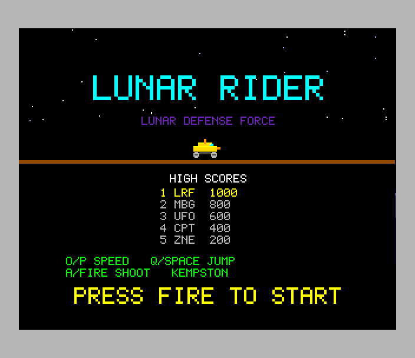
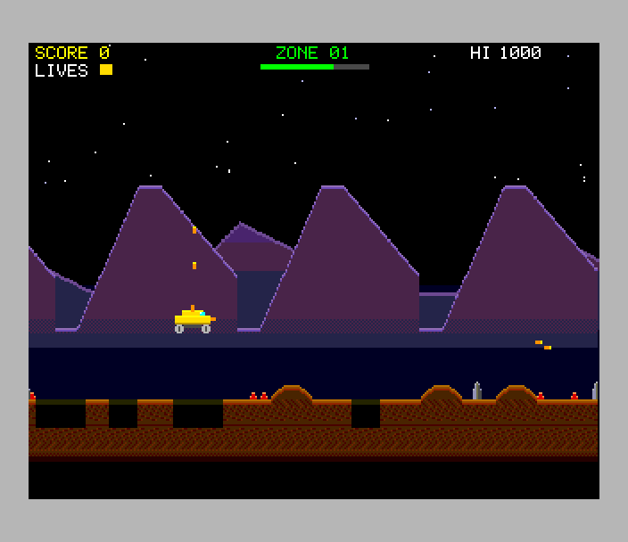
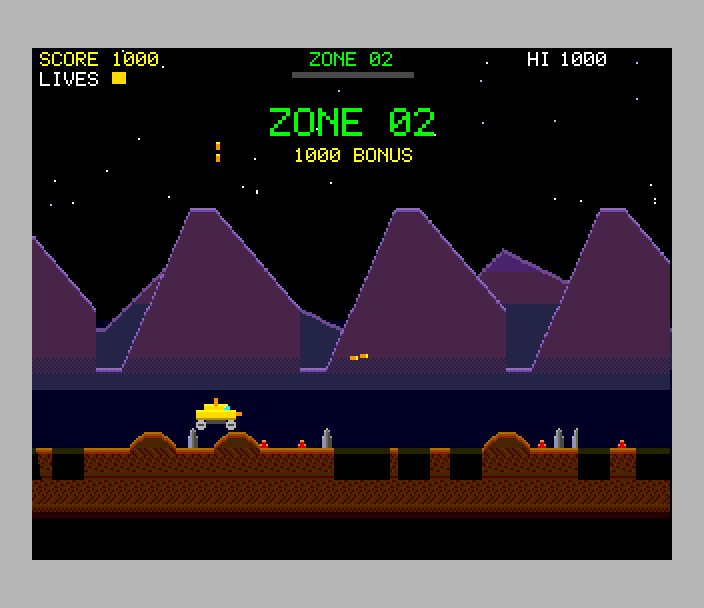
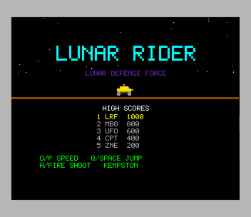

# Lunar Rider (ZX Spectrum Next)

Port of `amiga_mcp/examples/lunar_rider`: drive a moon buggy along a
scrolling lunar surface, jumping craters and rocks, avoiding mines, and
shooting forward and upwards at UFOs, their bombs and meteors. Every 500
pixels is a checkpoint (+1000); after zone 26 the course starts again,
harder.

  

## Controls

| | |
|---|---|
| speed up / slow down | P / O, joystick right / left (Kempston, Sinclair 1/2) |
| jump | Q, SPACE, joystick up |
| shoot (forward and up) | A, M, 0, joystick fire |
| start | fire or jump on the title screen |
| initials | type three letters (or up/down and fire) after a high score |

As the original: left/right are speed, up/space jump, A and fire shoot.

## What was kept, what changed

`src/game.c` is the original's game logic, unchanged except where marked
`port:`: the terrain generator and its random numbers, the buggy's
physics (jump velocity, gravity, the ground and crater tests), the three
speeds, the bullets, the UFOs (small, large) and meteors with their bombs,
the explosions, checkpoints and loops with difficulty, lives and scoring
(rocks 100, small UFOs 200, meteors 300, large UFOs 500, checkpoints 1000).
It runs at a fixed 50 Hz, the Amiga's frame rate.

- **one original bug fixed**: the start area kept clear was world x 0..30,
  but the buggy stands at x 80..104, so a game could start over a crater
  with a rock ahead. See [ORIGINAL_BUGS.md](ORIGINAL_BUGS.md), which also
  lists the quirks kept (one-pixel rocks and mines, respawns where the buggy
  died).
- the high-score table and the initials are added (the SDK's; the
  original only showed the current score as "HI")
- leaving the game over screen needs a new press of fire after a second
  (the original took a held one at once)
- the far mountains have a 160-pixel period (the original's is ~171) so
  they repeat every 320 pixels, and both mountain layers scroll
  continuously (the original wraps their offsets at 640, a small jump)
- deaths are logged with their cause (crater, rock, mine, bomb, enemy) for
  the tests

`src/view.c` draws it (the original's `draw.c`), `src/sound.c` is the
sound (the original's `sound.c`), `src/main.c` the loop (`main.c`).

## Next features used

What the Next adds over a regular Spectrum, and what it's used for:

| | |
|---|---|
| **Layer 2, 320 x 256, 256 colours** | the original's screen size, pixel for pixel, so its coordinates are the game's; the art is redrawn with shading (lit ridges, dithered rock layers, a textured regolith) |
| **Layer 2 hardware X scroll, changed by the copper** | parallax without redrawing: the screen is three bands of rows (stars + HUD, near mountains at 1/2 speed, the ground at full speed), each a ring of 320 columns with its own scroll offset, set by the copper at the band's first row. Scrolling draws only the 1-3 columns entering view each frame (SDK `l2scroll.h`) |
| **the tilemap, its own scroll register** | a fourth layer behind Layer 2: the sky gradient and the far mountains at 1/4 speed (35 tiles, 4 bpp). The near mountains overlap the far ones on the same rows, so they need separate layers: a raster split can't do it |
| **layer order, global transparency, fallback colour** | sprites over Layer 2 over the tilemap (NextReg 0x15); Layer 2's sky is the transparent colour, so the far mountains show through |
| **hardware sprites** | the buggy (two 16 x 16, two wheel frames), small and large UFOs (flashing), meteors, bombs, bullets; the explosion is the original's growing square made of four quarter sprites, mirrored (one pattern a stage) |
| **28 MHz** | the original's 16.16 game logic runs as is in C (zsdcc's 32-bit arithmetic) |
| **MMU banking** | that logic (~10K) runs from 16K bank 22 mapped over the ROM at 0x0000; Layer 2 in banks 16-20, the sprite patterns in bank 21 (loaded by the .nex) |
| **TurboSound (3 AY chips)** | the original's "bouncy bass" on chip 0 and its five effects on chip 1's three channels (as on Paula's channels 0-2, so an effect only cuts the one on its own channel) |

Speed: **50 fps** with the logic at 50 Hz (the test measures it). A frame's
work (logic, columns, HUD, sprites, sound) takes about 140 of the 312 raster
lines at 28 MHz.

Memory: 0x0000-0x3FFF bank 22 (game.c), 0x4000-0x5FFF the tilemap (bank 5),
0x6000-~0xD700 the rest of the program, the SDK and the C library, 0xF000
the IM 2 table and the stack.

## Test

`./zx test lunar_rider`: boots, starts; a bot rides (holds A to shoot,
jumps with Q when a crater, rock or mine is just ahead, reading the game's
`lunar_probe`); it passes a checkpoint and scores, loses its three lives,
game over, fire, enters BOT in the high-score table and returns to the
title. Checked: the logic at 50 Hz and 50 fps while riding, the bass on
chip 0, and the whole game recorded and replayed twice with every frame
hash matching. Screenshots: `screenshots/`; the GIF:
`tools/make_gif.py`; the pictures: `tools/gen_gfx.py`. The scrolling
module has its own test, `projects/scrolltest`.
