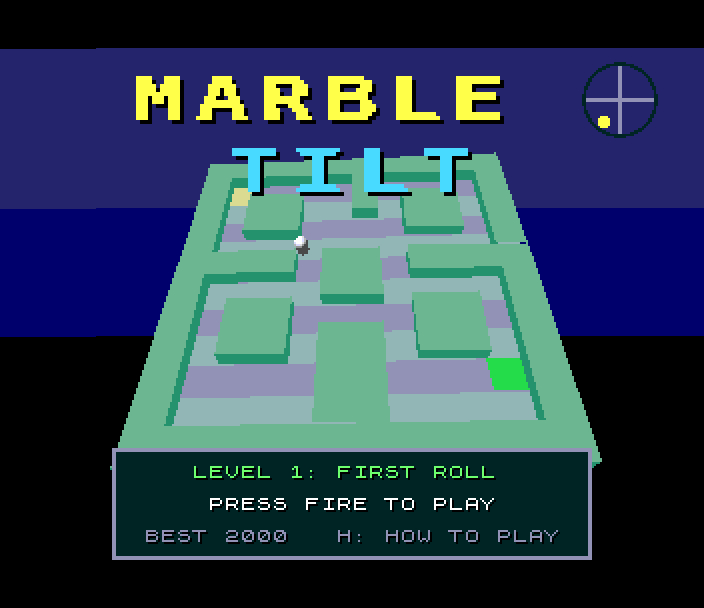
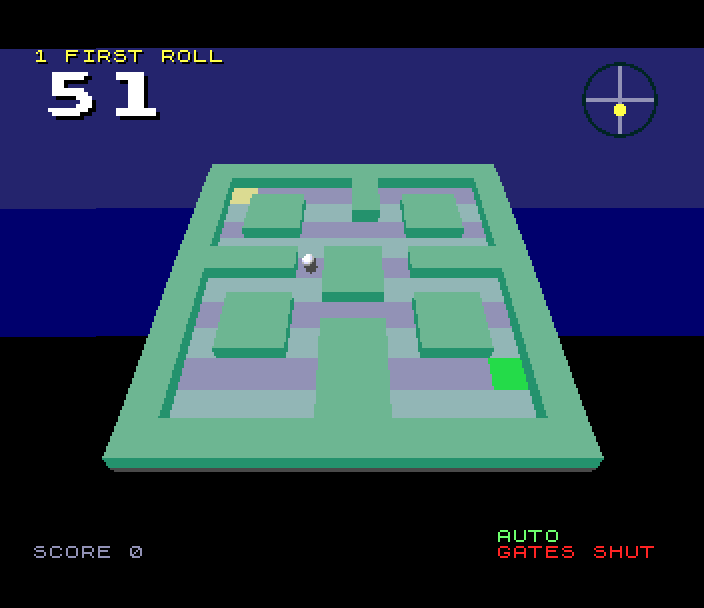
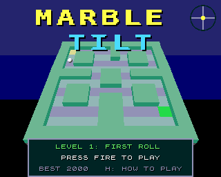

# Marble Tilt (Spectrum Next)

Port of `amiga_mcp/examples/marble_tilt`, an Amiga game on the shared
amiga3d engine (also on the Atari Falcon and the 3DO). Tilt a floating 3D
maze to roll a marble to the green exit before the clock runs out. Eight
levels have holes, gates that open and shut, bumpers, sand and
checkpoints. The marble keeps rolling, so tilt back to slow it.

 

## Controls

| | |
|---|---|
| tilt | Q A O P, cursor keys, Sinclair or Kempston joystick. Up (Q) rolls the marble away from you, down (A) towards you |
| title | up/down (or left/right) choose the level to start on, fire or ENTER starts |
| pause | ENTER |
| autopilot | B: it rolls on its own (it also plays behind the title) |
| help | H: the rules, then the controls |
| back to the title | BREAK (CAPS SHIFT + SPACE) |

port: the original's P (pause) is right on QAOP, so ENTER pauses. Its Esc
is BREAK.

## What's kept, what changed

Kept from the original:

- **The rules, bit for bit.** `src/mt_core.c` is the original's `mt_core.c`:
  the eight levels, the tilt easing in a fifth of a second, rolling,
  friction, sand, bouncing off walls at 40%, bumpers, gates (3 s open,
  3 s shut, never shutting on the marble), holes and checkpoints, the
  clock (falling costs 3 s), the scoring (100 x the level for each one
  done, 10 for each second left) and the autopilot. It runs on the SDK's
  `fix16.h`, the engine's 16.16 fixed point reproduced exactly. The
  original's own determinism test runs on the Next (hold T at start-up):
  the autopilot's whole game ends with the hash in its `tests/vectors.h`.
  `tools/check_core.sh` checks the same on the host, and per level.
- The rules' speed, 25 ticks a second, whatever the drawing does.
- **The 3D look.** This is the original's camera, its board geometry and
  colours, the tilt drawn at twice its size, its draw order, and the
  marble with its shadow. The marble drops away and shrinks through a
  hole.
- The HUD: level name, the big clock (red in the last 10 seconds), the
  score, falls, GATES SHUT, AUTO, the tilt gauge, the messages, THROUGH!,
  the game-over box, the title over the autopilot's game, and the two help
  pages. The big text is in the original's own 16 x 16 font.
- The effects, made from the original's synthesis settings (tone sweeps,
  noise, lengths, loudness).

Changed (marked `port:` in the code):

- **The board is filled from host-made tables.** zsdcc's C can't project
  ~500 points per frame. So `tools/gen_view.py` runs the original's camera
  (`tools/geom.py`, integer for integer) on the host. It does this for
  every tilt step the original eases through (11 x 11). The Next fills the
  polygons with `l2fill`. Fewer, bigger polygons than the original's runs:
  the floor runs on under walls, and stacked walls are one block. The
  picture is the same, and `test.py` checks the Next's Layer 2 against the
  host's picture pixel for pixel.
- **Boards are cached and drawn in the background.** A new board takes
  about three frames of CPU (850-1050 raster lines). So finished boards
  are kept in spare RAM: four Layer 2 screens on a 1 MB Next (as ZEsarUX
  is), 25 on a 2 MB one. One is shown by pointing NextReg 0x12 at it. A new
  board is drawn in the time each frame has left over, while the marble,
  rules and text keep their rates. While the stick moves, the board
  follows a step behind: a board finished after the tilt moved on is shown
  if it lies on the way.
- **The marble is a sprite.** The original sorts it among the walls. Here
  its pattern is cut each time it moves, using the Layer 2 pixels under
  it. A block from a nearer board row hides it (the blocks' colours encode
  their row). Below the board, everything but the void hides it.
- **The shadow** takes the floor's own colour at half brightness (the
  sprite palette), not the original's flat grey.
- **The sky** (the original's 16-step copper gradient) has three steps.
  The Next's 8-bit fallback colour that fills the border has nothing in
  between.
- **Music.** The original has none. This port adds a short tune for two
  AY chips: full volume behind the title, quieter in play.
- **High scores.** The original keeps a best score. This port has the
  SDK's five-entry table with initials, shown on the title in turn with
  its panel.
- Text on 8-pixel rows (the tilemap), at the original's places.
- The view is 7/8 of the original's scale (fov 233 rather than 266), so
  the whole board fits Layer 2's 256 x 192 at every tilt. The HUD sits in
  the border, as on the original's 320 x 256 screen.

## Frame rate

Measured by `test.py` while the autopilot plays level 1:

- **50 passes of the main loop a second.** Each pass updates the marble
  sprite, the gauge, the text and the sound.
- **25 ticks of the rules a second**, as the original runs them.
- About 15 frames overran in the test's ~4,900-frame game.
- **Boards:** a tilt seen before (cached) is shown in the next frame. A new
  one takes 6-8 frames of leftover time, so while the stick moves the
  board changes 6-8 times a second, easing through the steps (e.g. 6, 8,
  10 over 12 frames).

The `mt: perf` log lines (every 2 s) give passes, ticks, boards shown,
drawn and cached, the last board's cost in raster lines, and what the AY
chips play.

## Next features used

What it uses beyond a 48K/128K Spectrum, and why:

| feature | used for | why it's needed |
|---|---|---|
| **28 MHz** | the rules (16.16 fixed point, four collision passes a tick), filling a board's ~50-90 polygons, cutting the marble's sprite | a tick of the rules alone takes ~100 raster lines at 28 MHz; at 3.5 MHz the rules would not keep up with the clock |
| **Layer 2, 256 x 192 x 8 bpp** | the 3D board in the original's colours (block colours repeated per board row for the marble's mask), the void | the ULA's two colours per 8 x 8 cell can't show a shaded, tilted maze |
| **Layer 2 from any bank** (NextReg 0x12) | the board cache: a finished board is shown by pointing 0x12 at its banks; no copying | showing a cached tilt costs one register write |
| **hardware sprites** | the marble and its shadow (one 16 x 16 pattern made as it moves), the tilt gauge, the title, the clock and THROUGH! at twice their size (sprite zoom) | the marble moves at the rules' rate without redrawing the board; big letters with no drawing |
| **sprite clip window** | keeps the marble off the title's panels | sprites are over the tilemap (for the big letters on the game-over box) |
| **the sprite palette** | its first 128 entries are the board's colours at half brightness: the shadow's pixels are the floor's colour indices under it | a see-through shadow with no blending hardware |
| **tilemap** (40 x 32, 4 bpp) | the text, panels and help pages in the ROM font with the original's drop shadow | text is never drawn into the board, so the board is only redrawn when the tilt changes |
| **copper** | the sky's bands in the border (the fallback colour, NextReg 0x4A) | the original's copper gradient, with no CPU time |
| **zxnDMA** | clearing the void's bands, long polygon spans, sprite pattern uploads | ~2 T-states a byte |
| **MMU banking** | the rules and small tables in bank 20 over the ROM, the game shell in page 44 at 0x6000, the board's tables (40 pages) mapped in while drawing, Layer 2 pages for drawing and for the marble's mask | the code alone is ~33K against 28K free at 0x8000, plus 330K of tables |
| **Z80N `MUL`** | fix16's 32 x 32 multiplies and divisions (the rules), l2fill's slopes, the cell lookups | the original's 16.16 arithmetic, exactly, at a usable speed |
| **TurboSound** (3 AY chips) | the tune on chips 0 and 1, the effects on chip 2 (host-made register streams) | music and effects at once |
| **raster line** (NextReg 0x1E/0x1F) | timing a board's drawing | the `board=` figure in the perf log |

The core and its tables fit a 1 MB Next. A 2 MB Next gives the board cache
21 more screens (detected at start-up).

## How it's built

- `src/mt_core.c`, `src/mt.h`: the original's rules (see above).
- `tools/geom.py`: the amiga3d camera and the board's tilt in Python,
  integer for integer.
- `tools/gen_view.py`: the vertex tables (2048 bytes a tilt, four tilts a
  page, banks 26-45), the bumpers' rings, and the levels' polygon lists
  (one page). Also the palette, the marble's pictures (a shaded ball at 10
  sizes, the shadow's ellipse from the original's octagon) and the sprite
  patterns (gauge, the original's 16 x 16 font). `render()` is the host's
  picture of a board.
- `tools/gen_sound.py`: the effects and the tune as AY streams (bank 47).
- `src/view.c`: the board cache, drawing, the marble. `src/game.c`: the
  original's game shell (title, play, game over, help, events, sound) plus
  the high scores. `src/hud.c`: tilemap text, big sprite letters, the
  gauge. `src/main.c`: memory map and start-up.
- `tools/profile.py`: a sampling profiler (by function and module).
  `tools/check_core.sh`: the port's rules against the original's on the
  host. `tools/make_gif.py`: the GIF.

The generated files (`gfx/`, `sound/`, `src/view_data.*`,
`src/marble_data.*`, `src/view_pages.asm`, `src/sound_data.*`) are
checked in. Remake them with `python3 tools/gen_view.py` and
`python3 tools/gen_sound.py`. The originals are in `tools/orig`.

## SDK modules this game added

- `fix16.h`: the amiga3d engine's 16.16 fixed point, bit for bit
  (`fmul`/`fdiv` in Z80N asm). Tests: `projects/fixfilltest` against a
  Python model, `sdk/tools/test_fix16.c` (the asm's C model against
  64-bit).
- `l2fill.h`: convex polygons for scenes of many small ones, into any
  Layer 2 bank. `sdk/tools/l2fill.py` is its pixel-exact host model.
  Test: `projects/fixfilltest`.
- A fix to `fixmath.h`'s `isqrt32`, which was one too big for some values
  of 2^31 and over. A fix to `spr_pattern`, which now uploads by DMA.
- It also uses `l2poly`/`persp` (from ScAIry Fun's branch) only through
  `geomtest`.

## Test

`./zx test marble_tilt`:

- The original's whole autopilot game runs on the Next (T held at
  start-up). It covers 5000 ticks and all 8 levels, scores 9360, and its
  state hash is the original's `tests/vectors.h`.
- Title: the music plays on two TurboSound chips. Kempston right/left
  choose the level, and fire starts.
- The board on Layer 2 equals the host's projection through l2fill's
  model, pixel for pixel.
- P tilts the board fully right and the board shown follows. Q tilts it
  away.
- B: the original's autopilot rolls level 1 to the exit and scores, then
  on to The Moat.
- With the autopilot off, the marble rolls into a hole: a fall, then back
  at the start.
- The clock runs out: game over. The score makes the table, the initials
  ZED go in, and it's back to the title.
- 50 passes a second and 25 ticks a second while playing.
- The whole game is recorded from reset and replayed twice. Every frame
  hash matches, and the two replays are identical.

Screenshots: `screenshots/` (title, start, play, through, fall,
gameover, initials, hiscores).

## Known issues

- While the stick moves, the board's picture follows a few frames behind.
  The marble is always placed on the board as shown, so the two agree.
- The emulator (a 1 MB Next) has room for four cached boards.
  Alternating between many tilts redraws more often than on a 2 MB Next.
- The sky has three steps where the original has sixteen.
