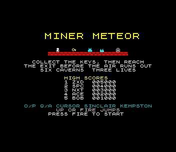
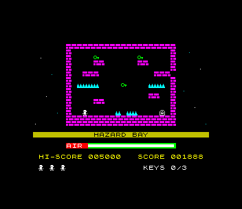
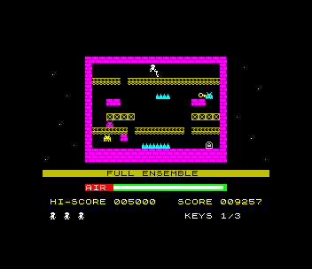
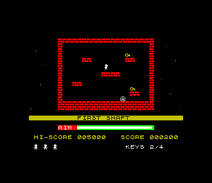

# Miner Meteor (ZX Spectrum 48K)

Port of `amiga_mcp/examples/miner_meteor`, a single-screen platformer: in
each of six caverns, collect every key to open the exit, then reach it before
the air runs out. Spikes, conveyor belts, floors that crumble under you, and
guardians patrolling the ledges. 100 points a key, 1000 a cavern plus half
the air left. Three lives.

  

## Controls

| | |
|---|---|
| walk | O / P, cursor 5 / 8, Sinclair 1 or 2, Kempston |
| jump | Q, UP, or fire (SPACE, M, 0, joystick) |
| start | fire or ENTER on the title screen |
| give up | BREAK (CAPS SHIFT + SPACE) during a game |
| initials | type three letters (or UP/DOWN + FIRE) after a high score |

Left alone, the title screen starts a demo that plays all six caverns.

Sound: beeper effects (jump, key, death, cavern cleared) and a title tune on
the beeper; on a 128K/+2/+3 the AY plays the tune during the game too, plus
the effects.

## What was kept, what changed

`src/game.c` is the original's `game.cpp` (the `MinerGame` methods over one
`GameState`) and `src/levels.txt` is its six caverns row for row, including the
three rows the original fixed to make caverns 2 and 6 winnable, and its
`JUMP_IMPULSE` of -12. The guardians, scoring, air, collapse timers, conveyors,
jump edge-trigger and collision snaps are unchanged; the player's collision is
the original's code moved into the SDK (`plat.h`) without changes. The logic
runs at a fixed 50 ticks a second, as on the Amiga.

Changes are marked `port:`:

- **half size.** The 320x240 cavern is drawn at 160x120, one 16-pixel tile per
  8x8 character cell (20 x 15 cells), so every tile has its own attribute
  colours and the sprites move a pixel for the original's two. The logic still
  works in the original's pixels.
- **look.** 1-bit tiles and sprites drawn for the Spectrum from the
  original's tile sheet: brick walls coloured by the cavern's
  `palette_variant` (which the original defines but doesn't use), keys that
  cycle colours, belts that move, crumbling floors that sink a line at a time,
  an exit that flashes when open, the air as a bar, HUD below the cavern.
- **death flash.** The original restarts the cavern on the same tick; the port
  flashes it for half a second first (the logic waits).
- **loading time.** The frames spent redrawing a whole cavern don't count as
  logic time (the Amiga's redraw is instant), so a cavern always starts the same.
- **BREAK** gives up a game (the Amiga's ESC quit the program).
- **demo** (port addition): `src/demo.h` is the fastest route through each cavern,
  found by `tools/solve.sh`: a breadth-first search over `game_tick()` built for
  the host (2.9, 4.7, 17.1, 4.2, 4.9 and 6.4 s; the original's README lists
  3.0, 6.1, 17.1, 4.2, 5.3 and 6.0 s from its own search).
- **sound** (port addition): the Amiga's sound functions are stubs.
- types: `int16_t`/`uint8_t` for the original's `LONG`s, a counter for
  `tick % 6`, and a list of crumbling floors instead of a pass over all 300
  cells a tick. Same results.

## 48K notes

- **Drawing.** `sdk/cellspr48.h` keeps the cavern as tile ids and composes a
  cell only when something in it changed: its tile, then each sprite over it
  ORed in from a pre-shifted copy, then written once. Nothing is erased and
  redrawn, so the sprites never flicker. Colour is per cell: a sprite gives
  the cells it covers its ink and keeps the paper. That's the classic clash,
  and it only shows where the miner passes a key or the exit.
- **Speed.** It draws 46.5 frames a second on average over the demo. By
  cavern: 2: 49.6, 3: 49.8, 4: 36.4, 5: 50.0, 6: 33.5 fps; cavern 1 is ~50.
  Caverns 4 and 6 move three guardians and the miner every frame (about ten
  cells composed). When a frame is late the logic runs twice, so the game
  always plays at the original's speed. The biggest single cost left is the
  SDK's `input_read`, ~15,000 T-states a frame (with `input_fast`).
- **Where the time went.** zsdcc's code for pointers to structs was the
  surprise. The first `cs_update`, a loop over 8 sprite structs, took 17,000
  T-states doing nothing. The sprite pass, the cell composer, the dirty-cell
  marking, the belt refresh and `plat_kind_at` are now asm, and
  the C left in hot paths works on static copies. `tools/timefn.py` (T-states
  per call, by breakpoints) and `tools/profile.py` (sampled PCs per function)
  measured it all; built with `EXTRA_CFLAGS=-DPROFILE`, the game paints the
  border per stage of the frame.
- **Belts.** A belt cell's three moving lines are rewritten straight from its
  tile (`cs_refresh`), a quarter of the belt each frame. Composing all 36 cells
  at once cost a whole frame every fourth frame.
- **Beeper effects** play a short chunk a frame (~4,500 T-states), so a jump or
  a key never costs the game a frame; the long jingles play while the game is
  paused anyway.
- **Memory.** The program ends at 0xEC9A (the SDK's interrupt table is at
  0xF000). The pre-shifted sprites are 1.8K, and the packed levels 624 bytes.

## Files

| | |
|---|---|
| `src/game.c`, `src/game.h` | the rules (port of `game.cpp`), also built on the host |
| `src/levels.txt` | the caverns; `tools/make_data.sh` packs them into `src/levels_data.c` (`sdk/tools/levelpack.py`) |
| `src/levels.c` | the guardians and palette variants (the original's tables) |
| `src/main.c` | the Spectrum front end: art, cavern view, HUD, sound, title, demo, high scores |
| `src/demo.h` | the demo routes (made by `tools/solve.sh`) |
| `tools/solve.c`, `tools/solve.sh` | the route search; writes `tools/routes.json` (the test bot's) and `src/demo.h` |
| `tools/profile.py`, `tools/timefn.py` | where a frame's time goes |

## Test

`./zx test miner_meteor`:

1. A bot plays cavern 1 by the solver's route, holding the keys for each logic
   tick: it stops the emulator at every `game_tick()` and sets the next tick's
   keys there, so the interrupt's latch sees exactly the route's presses.
   Then in cavern 2 it walks into the spikes until the game is over (three
   lives lost), types BOT in the high scores, and is back at the title. The
   game is recorded.
2. The recording is replayed twice; every frame's hash must match.
3. The title's demo plays all six caverns to the win screen without losing a
   life; the GIF is taken from it, and the speed is measured (at least 45 fps
   overall).
4. On a 128K the AY is found, and the route clears cavern 1 there too.

Screenshots go to `screenshots/`.
