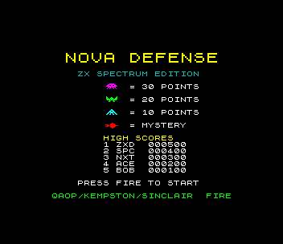
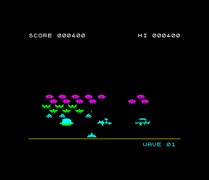
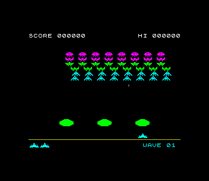

# Nova Defense (ZX Spectrum 48K)

Port of `amiga_mcp/examples/nova_defense`: defend the base against a
staggered swarm of 48 aliens in three kinds (30 / 20 / 10 points), a bonus
comet crossing the top (50-300 points), three crystal shields that erode where
they are hit, and waves that start faster each time.

 

## Controls

| | |
|---|---|
| left / right | O / P, Sinclair 1 (6/7), Sinclair 2 (1/2), Kempston |
| fire | SPACE, M, 0, 5 or joystick fire |
| start | fire on the title screen |
| initials | type three letters (or UP/DOWN + FIRE) after a high score |

Sound: beeper on a 48K (short blips, so the game keeps its speed); on a
128K/+2/+3 the AY plays the original's march, effects and the background
arpeggio instead.

## What was kept, what changed

`src/game.c` is the original game logic: rules, scoring, the march speed-up
as aliens die, firing rates, the comet, shield erosion, waves and lives.
Changes are marked `port:` in the source:

- the playfield is 256x192 instead of 320x256: positions, sizes and speeds
  scaled (x 0.8 horizontally); each alien row sits on its own character row,
  so the attribute colours never clash, and a drop is one character row (the
  swarm reaches the shields after 9 drops and the player after 12, close to
  the original's 11 and 14)
- speed-only rewrites with the same results: table lookups instead of
  multiplies, the swarm bounds from each row's first and last alien, the
  bullet tests only rows it can reach, and the shield rows that changed are
  marked for redrawing

`src/main.c` is the Spectrum front end: 1-bit art redrawn for the machine,
attribute colours by row, XOR sprites that are only redrawn when they move,
the swarm drawn two rows a frame (`src/swarm_row.asm`), title, game over and a
high-score table with initials (SDK `hs_*`).

The logic runs at a fixed 50 Hz (frame_wait() returns how many frames passed
and the game catches up), so the game plays at the original's speed; the
screen is redrawn 35-48 times a second depending on how busy it is.

## Test

`./zx test nova_defense`: boots, starts, a bot plays a whole game (scores,
gets shot, game over), enters BOT in the high-score table, returns to the
title; the game is recorded and replayed twice with every frame hash checked.
`nova_probe` (player and alien bullet positions) is there for the bot.
