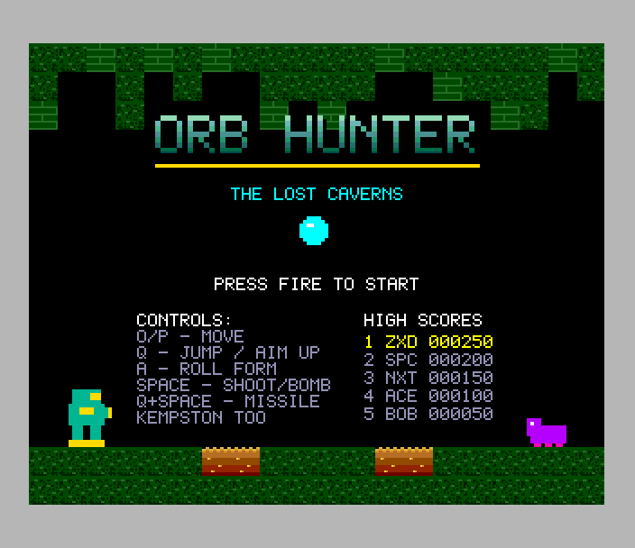
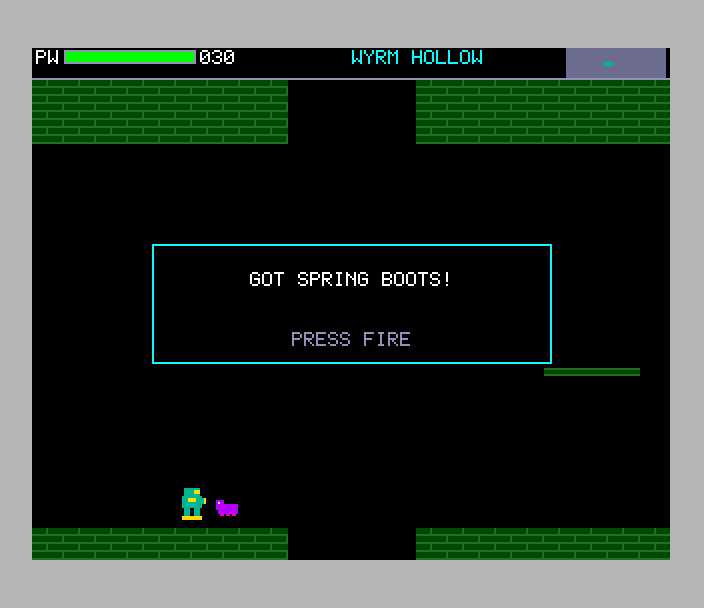
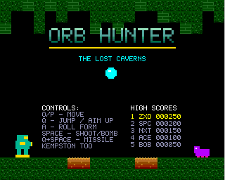

# Orb Hunter (Spectrum Next)

Port of `amiga_mcp/examples/orb_hunter` (the original, for the classic
Amiga and AmigaOS 4; the 3DO version is a port of it): exploring the lost
caverns. Its world is 8 x 6 rooms of 20 x 16 tiles (a screen each):
caverns, magma halls, corridors, the citadel, the dens of two bosses.
Shoot the creatures (100 points, a boss 2000), collect the power-ups
(power cells, rocket packs, the roll form and its bombs, the far shot, the
frost ray, spring boots, the spin strike, the heat suit) to reach new
areas, and don't let your energy run out.

 

## Controls

| keys | Kempston | |
|---|---|---|
| O / P (cursor 5 / 8) | left / right | run |
| Q or Z (cursor 7) | up | jump; with fire: a missile |
| A (cursor 6) | down | roll form (once found) |
| SPACE (M, 0) | fire | shoot; rolled: a bomb |
| ENTER | | start |

Sinclair joysticks work too. On the item screen fire carries on; after game
over a good score asks for initials (type them, or up / down and fire).

## What's kept, what changed

Kept from the original:

- **The rules**, `src/game.c`: the original's game.c as it is, in 16.16
  fixed point, run 50 times a second as the original's main loop does: the
  hunter's running, jumping (and the short jump when the key is let go),
  gravity and falls, one-way ledges, lava, rolling and unrolling under low
  ceilings, beams, missiles that open the barred doors, bombs (and the bomb
  jump), the six creatures' behaviour, both bosses, the power-ups, the
  scores, the room-to-room moves and the energy. `tests/host_diff.c` plays
  400,000 steps of random play (through dozens of games, deaths, items and
  over a thousand room changes) on the port and on the original's own
  game.c and levels.c, and compares the whole game state after every step.
- **The world**: made by the original's own `levels.c` on the host
  (`tools/gen_world.c`), the same rooms, doors, ledges and lava, the same
  item and creature placings.
- **The look**: its 16-colour palette; the hunter, the creatures, the
  bosses, shots, missiles, bombs and their flash, orbs and sparks drawn
  pixel for pixel by the original's routines (ported to `tools/gen_gfx.py`);
  its HUD (energy bar, missiles, area name, the map of rooms), item screen,
  title and game over.
- **Sound**: the original's music (`rock_blaster.mod`, the two channels it
  plays) and its eight effects.

Changed (marked `port:` in the code):

- **Enemies are shown.** In the original a frame-counter test hides every
  creature and boss, and hides the hunter while it is invulnerable
  ([ORIGINAL_BUGS.md](ORIGINAL_BUGS.md)). Here creatures are always drawn
  and the hunter flickers.
- **The tiles** keep the original's designs (rock with its specks, bricks
  with their mortar, metal panels, ledges, lava whose surface and sparks
  move as the original's, barred doors, the save point) with more shades;
  the title is a picture (the original's title over a cavern) with the
  controls and the high scores on it.
- **High scores** are new: a table of five with initials. Game over waits
  for a new press of fire (the original takes a held one).
- The HUD's debug line (hunter Y, room) is left out; the text uses the
  SDK's 5x7 font, the original's but for nine glyphs.
- Where the world is kept (the current room in RAM, the rest in a bank) and
  the particles in their own file (`particles.c`, the rules' bank is 16K):
  the code is the original's.

## Next features used

What it uses beyond a 48K/128K Spectrum, and why:

| feature | used for | why it's needed |
|---|---|---|
| **Layer 2, 320 x 256 x 8 bpp** | the rooms, the HUD, the title picture (its own banks, shown by switching NextReg 0x12) | the original's screen is 320 x 256 with 16 colours anywhere; the ULA has 256 x 192 with two colours per 8 x 8 cell. A room is drawn once when it is entered (cleared by DMA, then its tiles, about 1.5 frames); after that only lava, the save point and opened doors are drawn again |
| **hardware sprites, 4-bit, palette offsets** (`nextsprl.h`) | everything that moves: the hunter, up to 12 creatures, the bosses (2 x 2 sprites each), shots, missiles, bombs and their flash (four mirrored corner sprites when it is bigger than 16 pixels), orbs, 24 sparks (one pattern, its colour from the palette offset) | nothing moving is drawn into Layer 2, so nothing has to be erased; the list goes to the hardware by DMA each frame. A sprite clip window keeps them under the HUD, as the original draws its HUD last |
| **zxnDMA** | clearing a room's area and the screen, copying the world for a new game, the sprite list | a room's 75K cleared in about 150,000 T-states |
| **28 MHz** | the original's 16.16 arithmetic (32-bit, through zsdcc's library) for 12 creatures, 6 shots, 24 sparks, 50 times a second | a step takes about a fifth of a frame at 28 MHz; at 3.5 MHz it would take more than a frame |
| **MMU banking** | the rules' code (16K) in bank 30 at 0x0000, over the ROM, which the game doesn't need; the world (15K) and its working copy, the tiles and sprite patterns, the music's rows in banks, mapped through the ULA's two pages (0x4000-0x7FFF) | the program would be 45K; 0x8000-0xEFFF holds 28K |
| **TurboSound** (3 AY chips) | the MOD's two channels on chip 1 (`modplay`), the effects on chip 0 | music and up to three effects at once |

It fits a **1 MB Next** (no 2 MB needed): its data uses banks 16-30.

## Frame rate

**50 fps** while playing (the test measures 50 in every 100-frame window
spent in one room; 45 on average over the whole test, which includes
starting and entering rooms). The rules run 50 steps a second, one for
every frame that passed (up to 8 in a frame, so entering a room, about 1.5
frames, doesn't slow the game); the test checks steps against frames.

## How it's built

- `tools/gen_world.c` (`make -C tools world`) runs the original's levels.c:
  `gfx/world.bin` and `src/items_data.c`.
- `tools/gen_gfx.py` draws the tiles, the sprites (the original's
  routines) and the title: `gfx/`, `src/gfx_data.*`.
- `tools/make_music.py` converts the MOD with `sdk/tools/mod2ay.py`.
- `src/game.c` (the rules, in bank 30), `src/particles.c`, `src/world.c`
  (rooms in banks), `src/draw.c` (Layer 2, sprites, screens),
  `src/tile16.asm` (a tile into Layer 2), `src/sound.c`, `src/main.c`
  (the original's main loop, high scores, the probe).
- `tools/profile.py` samples where the time goes.

## Testing

`make -C tests` plays the port's rules against the original's on the host.
`./zx test orb_hunter` (`test.py`): boots to the title (28 MHz, the
picture, the music); the Kempston starts a game and runs, O runs left; the
hunter runs and jumps down into room 3,3 and picks up the spring boots (the
item screen, fire carries on). Then, recorded from reset: `tools/bot.py`
plays through the keys: out of the start room, down into the next cavern,
shoots a creature (100 points), then walks into the creatures (moving on
when nothing hurts it) until they wear its energy down; game over, initials
typed into the table, back to the title. The recording is replayed twice
and every frame's hash must match. `tools/make_gif.py` makes the GIF above.

## Known issues

- Entering a room takes about 1.5 frames (the rules keep their pace).
- A room is drawn on the one Layer 2 buffer while it is shown, so its tiles
  appear over a frame (the original draws to a hidden buffer).
