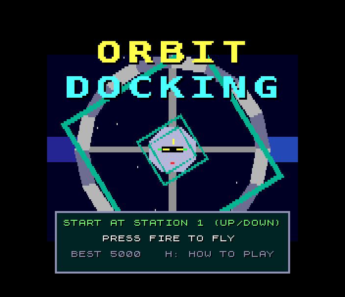
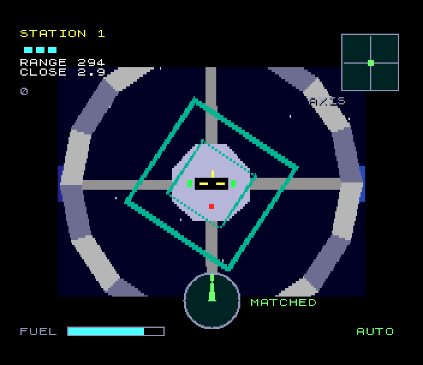
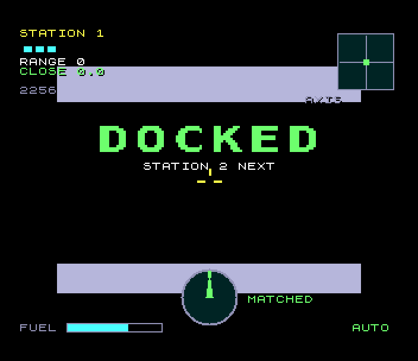
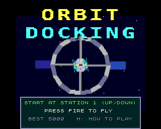

# Orbit Docking (Spectrum Next)

Port of `amiga_mcp/examples/orbit_docking`, a slow, tense docking simulator
on the shared amiga3d engine. A station spins about its long axis; its
docking port is a slot at the end of its hub, turning with it. Fly in along
the axis, roll to match the slot and turn as fast as it turns, and close in
gently. There is no friction in space: a push lasts until you push back,
and fuel is limited.

  

## Controls

| | |
|---|---|
| move across | Q A O P, cursor keys, Sinclair or Kempston joystick (the craft's own left, right, up, down) |
| in / out | W / S, or fire + up / down |
| roll | K / L, or fire + left / right |
| pause | ENTER |
| autopilot | B (it also flies behind the title) |
| help | H: the rules, then the controls |
| back to the title | BREAK (CAPS SHIFT + SPACE) |
| title | up / down choose the station to start at, fire or ENTER starts |

port: the original's cursor keys, W / S and fire-as-shift are kept; its
A / D (roll) are K / L here (A is down on QAOP), its P (pause) is ENTER
(P is right), its Esc is BREAK.

## The game

At contact the craft must be within 14 units of the axis, closing at under
1.6 a tick, drifting across at under 0.8, rolled within 8 degrees of the
slot (it looks the same turned half round), and turning within 7 degrees a
second of it. Anything else is a crash, and the message says which limit
you broke. Three crashes end the game. Six stations, from a slow spin with
you on the axis to a fast spin the other way, well off the axis, with three
pieces of debris drifting across the approach. Scoring: 1000 a dock + 500 x
the station + 2 for each unit of fuel left, less a little for the time.

## What's kept, what changed

Kept from the original:

- **The rules, bit for bit.** `src/od_core.c` is the original's
  `od_core.c` on the SDK's `fix16.h` (the amiga3d engine's 16.16 fixed
  point, exactly): the thrusters in the craft's rolled frame, the spin, the
  docking limits and crashes, fuel, debris, the six stations, scoring and
  the autopilot. With T held at start-up the Next flies the original's long
  autopilot game (its `tests/test_cases.c`, seed 1234: 4413 ticks, 5 docks,
  3 crashes, score 13942) and logs its state hash, which is the original's
  `tests/vectors.h` (`EFE8A63F`; the test checks it).
  `tools/check_core.sh` runs the original (on the amiga3d engine), the port
  and the port with fix16's Z80 C on the host: the same hashes for that
  game and for games from every station.
- The rules' speed, 25 ticks a second, at most 4 a pass as the original.
- **The picture.** The original's camera (looking back down the axis,
  rolled with the craft: rolled to match the slot, the station stands
  still), its station (the hub, the slot and its lights, four arms, the
  ring, two solar panels), the approach markers, the spinning debris, its
  colours, its draw order (the engine's depth buckets of each polygon's
  mean depth plus its bias), the stars turning with the roll.
- The instruments: range and closing rate (green or red near the port),
  the score, the lives, the axis box with the craft's dot, the roll dial
  with its needle and green mark, MATCHED / TURN, the fuel gauge, AUTO, the
  sight, DOCKED, the crash messages, the game-over box, the title over the
  autopilot's game, and the two help pages. The big text is the original's
  own 16 x 16 font.
- The effects, from the original's synthesis settings (its tones and noise,
  lengths and loudness).

Changed (marked `port:` in the code):

- **The projection.** The camera never yaws or pitches, so each plane
  across the station's axis (the hub's face, the ring, the arms, ...) is a
  turned and scaled copy of its shape: a frame works out two coefficients
  a plane and four multiplies a corner (`vproj.asm`), not a full camera
  transform a corner.
- **Half height.** The view is drawn 96 rows high and the copper shows each
  row twice: half the rows to fill. The original's 320 x 256 view is at 0.8
  on Layer 2's 256 x 192 (6 rows top and bottom are off it).
- **Hidden sides culled.** The hub's and the ring's sides facing away
  (behind the rest in the original's picture) aren't drawn. A polygon with
  a corner nearer than the near plane is left out (the camera only gets
  there beside the hub, about to crash).
- **The HUD's lines** are on 8-pixel tile rows (a few pixels off the
  original's); the fuel gauge is 4 pixels lower; the axis box is 48 pixels
  square (49 in the original).
- **High-score table** (the SDK's five entries and initials editor), shown
  on the title in turn with the start panel. The original keeps one best
  score.
- **Music.** The original has none; the title plays a slow tune written for
  the port.
- **zsdcc.** A few of the original's expressions are rewritten (the same
  values): 32-bit `int`s where the original's `int` is 32 bits, the
  debris' position through fix16's multiply and divide, the autopilot and
  the collision tests on local copies of the fields. zsdcc's code for the
  originals dropped a thrust, returned 0 or the low 16 bits for the debris'
  position, and crashed the craft 22.003 units from the debris' slice
  (found by comparing the long autopilot game tick by tick with the host).

## Next features used

What it uses beyond a 48K/128K Spectrum, and why:

| feature | used for | why it's needed |
|---|---|---|
| **28 MHz and the Z80N `MUL`** | the original's rules (16.16 fixed point, square roots, the autopilot's look-ahead at debris), the projection (two `MUL`s a product, ~220 points a frame with the stars), the polygon edges | the rules alone are ~11K of 32-bit arithmetic run 25 times a second; a frame's maths would take seconds at 3.5 MHz |
| **Layer 2, 256 x 192 x 8 bpp, double buffered** | the station, the markers, the debris, the stars, in the original's colours | filled polygons in many colours anywhere; the ULA's two colours per 8 x 8 cell couldn't show the shaded station |
| **copper** | Layer 2's Y scroll (NextReg 0x17) every other line: the 96 rows drawn show 192 | half the rows to fill |
| **zxnDMA** | long spans of the polygons (l2poly), the dial's patterns redrawn, the sprite patterns | a CPU copy is ~10x slower |
| **hardware sprites** | the big text (the original's 16 x 16 font at 1x and 2x, each letter over its shadow), the axis box and its dot, the lives, the roll dial (its 48 x 48 picture redrawn into 9 patterns when the needle moves) | instruments and text never have to be drawn into or restored from the 3D picture |
| **tilemap** (40 x 32, 4 bpp, over Layer 2) | the original's 8 x 8 text, panels, the fuel gauge, in its 320 x 256 layout including the border | the HUD covers the whole display, also outside Layer 2 |
| **palettes** (Layer 2, sprites, tilemap) | the original's 32 pens in 9 bits; inks as palette offsets | |
| **MMU banking** | the rules (bank 20), the view and its tables (bank 21), the text screens and HUD (bank 24) mapped in turn at 0x0000; the sprite patterns, the sound | zsdcc's code for the rules is 11K, the view 12K, the text 12K, against 28K free at 0x8000 |
| **TurboSound** (3 AY chips) | the title tune on chips 0 and 1, the effects on chip 2 | the effects and music at once |
| **raster line, frame counter** | the fixed timestep, the `od: perf` lines | |

## Frame rate

The rules always run at the original's 25 ticks a second. The picture is
redrawn when it can: **14-20 frames a second** while the autopilot flies
station 1 (the test logs it), 16-19 behind the title. A frame is about 35
polygons (up to ~45 far out: the ring, its sides facing the camera, the
arms, the hub, the slot and lights, the panels, the markers, debris).
Where the time goes (`tools/profile.py`): the polygon fill (l2poly) about
a third, the corners' projection a fifth, the draw list and the rest of
the view in C a fifth, the rules and the HUD the rest. The original ran at
25 fps on an A1200's 68020.

## How it's built

- **Rules** (`src/od_core.c`, bank 20): the original's, on `fix16.h`.
- **View** (`src/view.c`, `src/vproj.asm`, bank 21): the station's model
  made at start-up from the original's `render.c` numbers, the corners
  grouped by plane; each frame the planes' coefficients, `vproj` for their
  corners, the polygons into depth buckets, l2poly to fill them.
- **Text and instruments** (`src/screens.c`, `src/hud.c`, bank 24).
- **Shell** (`src/game.c`, `src/main.c`): input, the fixed timestep, the
  states, events and sound, the memory map.
- **Pictures and sound** made on the host (checked in): `tools/gen_gfx.py`
  (the sprite patterns: the original's 16 x 16 font, the axis box),
  `tools/gen_sound.py` (the effects from the original's settings, the
  tune).

## Test

`./zx test orbit_docking`:

- the original's long autopilot game on the Next gives its hash;
- boots to the title, Kempston, the music plays on two chips;
- Kempston fire starts station 1, W closes on the station, L rolls;
- B: the autopilot docks at station 1 (scores) and moves on to station 2;
- autopilot off, W held: rams the station, a crash a life, three: game over;
- the initials ZED go into the high-score table; back to the title;
- at least 12 frames a second while the autopilot flies;
- the game is recorded from reset and replayed twice: every frame hash
  matches.

`sh tools/check_core.sh` compares the rules with the original's on the host.

## Known issues

- Close to the station with the camera off to its side (about to hit the
  hub), polygons that reach behind the camera are left out.
- The markers' thin bars break up far away (2 units thick, half height).
