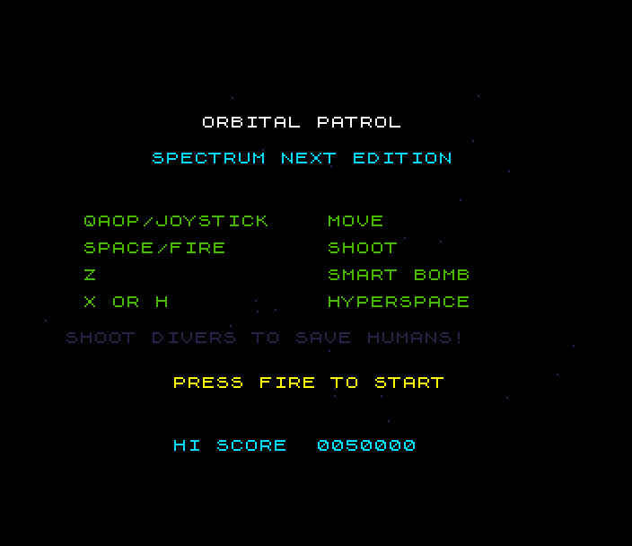
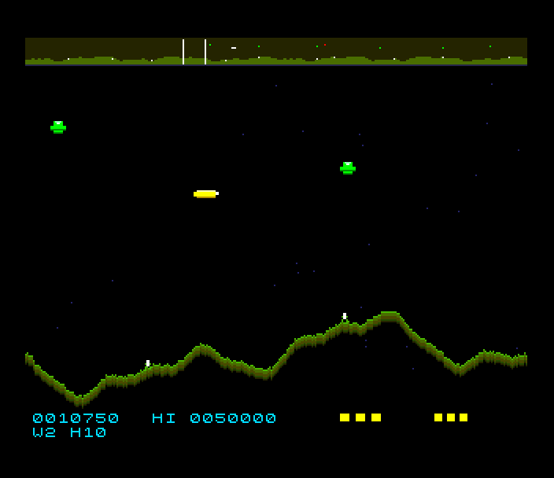
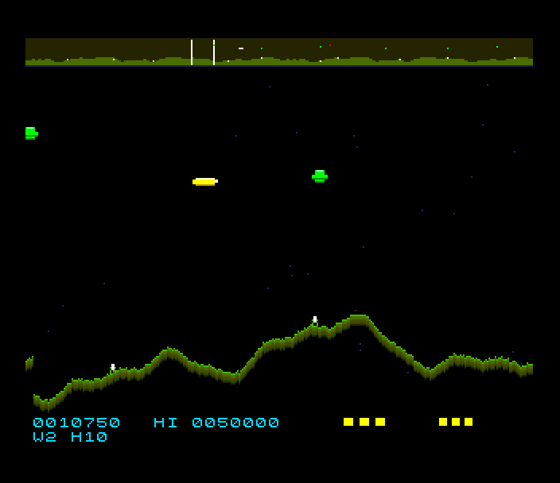

# Orbital Patrol (Spectrum Next)

Port of `amiga_mcp/examples/orbital_patrol` (the Amiga original; the Atari
ST and 3DO versions share its game code). A side-scrolling planet-defence
shooter: fly left and right over a wrap-around world six screens wide, shoot
the divers before they carry the humans off (a diver that reaches the top
with one becomes a stalker), catch falling humans and put them down, and
use smart bombs and hyperspace when it gets crowded. A wave ends when every
enemy is gone; each human still alive is worth 1000. Lose them all and the
planet is destroyed: the terrain goes and every diver becomes a stalker.

 

## Controls

| | |
|---|---|
| fly | Q / A / O / P, Sinclair 1 or 2, Kempston (left/right turn and thrust) |
| shoot | SPACE, M, 0 or fire |
| smart bomb | Z |
| hyperspace | X or H |
| start | SPACE, ENTER or fire |
| initials | type three letters (or UP/DOWN + FIRE) after a high score |

## What's kept, what changed

`src/game.c` is the original's `game.c` and `src/flow.c` the state machine
of its `main.c` (wave start, playing, dying, respawning, wave clear, game
over). Kept: the 1920-pixel world in 8.8 fixed point, 32-bit as in the
original; the ship's thrust, drag and speed limits; the six enemy types and
their AI (divers seeking, grabbing and carrying humans off, stalkers,
chasers with their shots, droppers laying mines, hives splitting into
drones); the humans walking, falling and being caught; smart bombs (3),
hyperspace with its 1-in-6 death; the chaser timer; the waves' make-up;
the scoring and the wave bonus; the original's random-number generator, so
a given input plays exactly the original's game. The test checks that: it
builds the original's code on the host and compares (see Test).

The screen is the original's 320 x 256, pixel for pixel: the scanner at
the top with the terrain, the viewport's brackets and every object as a
dot; the HUD at the bottom (score, high score, lives, smart bombs, wave
and humans); the terrain's ridge line; the stars scrolling at a quarter of
the speed; the ship, enemies, humans, lasers, shots, mines, particles and
explosions with the original's shapes, recoloured with shading.

Changed (marked `port:` in the code):

- **int is 16 bits** in zsdcc and 32 on the Amiga: the terrain generator's
  `x * 256 / 320` overflowed from x = 128 (broken hills). It's computed in
  32 bits; the host comparison found it.
- **Faster arithmetic with the same results:** `game_rand() % n` in 16 bits
  (game_rand is 0..32767), signed `/ 256` by shifts, and the five collision
  loops as an assembly scan (`src/coll.asm`, 24-bit: the world's
  coordinates fit). The original loops are kept under `COLL_IN_C`, and the
  host build uses them.
- **Explosions** are four mirrored sprites, so the cross's lines are 2 pixels
  wide. Particles in the original's colour 12 (black in its palette) aren't
  shown, as in the original.
- **High scores:** the SDK's table of five three-letter names (the original
  keeps ten 8-letter names on disk). After game over: the initials, the
  table for 6 seconds (or FIRE), then the title.
- **The title** reads "SPECTRUM NEXT EDITION" and lists the Spectrum's keys.
  The two star colours (the original gives both the same colour) are a dim
  and a pale blue. The terrain's ridge is shaded.
- **Sound:** the original's MOD (`tools/orbital_patrol.mod`, converted by
  `sdk/tools/mod2ay.py`: arp/lead/stab, bass, drums and hats as AY tones,
  kicks and noise) plays from start-up as in the original. The original's
  synthesised effects are AY effects: a falling laser pulse, noise bursts
  for explosions, a rising pick-up, a falling human, the bomb, the
  hyperspace sweep, the death and the wave fanfare.

## Next features used

| feature | used for | why it's needed |
|---|---|---|
| **Layer 2, 320 x 256 x 8 bpp** | the whole screen at the original's size: scanner, playfield, HUD | the original's 320 x 256 in 256 colours. The ULA screen is 256 x 192 with two colours per 8 x 8 cell |
| **Layer 2 hardware scrolling** (NextReg 0x16 / 0x71) | the playfield: Layer 2's 320 columns are a window on the 1920-pixel world, scrolled by the viewport. Only the columns that scroll in are drawn (the ridge: 7 pixels each, `src/terrain.asm`), typically 0-36 a frame | redrawing a scrolling screen every frame would take most of the frame |
| **copper** | the scroll changes row by row: the scanner (rows 0-19) and the HUD (from row 237) stay still while the playfield rows scroll. The list is rebuilt every frame | one Layer 2 picture holding a fixed scanner and HUD around a scrolling playfield |
| **tilemap** (40 x 32, behind Layer 2) | the stars, hardware-scrolled at a quarter of the speed (the original's parallax), seen through Layer 2's transparent sky | a second scrolling layer at its own speed, with no drawing |
| **hardware sprites** (8-bit patterns, mirroring, clip window) | everything that moves: ship and flame, enemies, humans, lasers, shots, mines, particles and explosions (mirrored quarters), up to 128 a frame; the wave messages and the game-over prompt as sprite text. Clipped to the playfield in hardware | no drawing and no erasing of moving objects |
| **DMA (zxnDMA)** | the sprite attributes (512 bytes a frame, to port 0x57), the copper list, clearing Layer 2 | the frame's update fits in the border |
| **28 MHz** | the original's 32-bit game logic in zsdcc's C | one game step takes about a quarter to half of a 28 MHz frame. At 3.5 MHz it would take two to four frames |
| **MMU banking** | the program from 0x4A00 (bank 5 with the ULA off), the game's state in a RAM page at 0x0000, Layer 2's pages mapped through slot 1 for drawing, the music linked above the interrupt table | the original's logic is 18K of zsdcc code and its state 5.6K: more than 0x8000-0xEFFF holds |
| **TurboSound** (3 AY chips) | the MOD's four channels on chips 1 and 2, the effects on chip 0 | music and effects together. One AY has three channels |

## Frame rate

The logic runs the original's 50 steps a second (`frame_wait()`, at most 4
steps a frame). In the test's game (waves 1-4) the picture runs at
**47-50 fps** (36 in the first 5 seconds, which include the wave's start).
With the most enemies (wave 8+: 16 enemies, hives, mines, 8 shots at once)
it is 28-46 fps. Where the time goes at wave 8: the original's 32-bit C
logic about half of the frame, the collision scan ~10%, terrain columns,
sprites and scanner the rest.

## Memory

| | |
|---|---|
| 0x0000-0x1FFF | page 46: the game's state (`state.c`), view's font copy, column tables and sprite attributes (mapped once the IM 2 interrupts are on) |
| 0x2000-0x3FFF | the ROM; Layer 2's pages while drawing |
| 0x4000-0x48FF | the stars' tilemap |
| 0x4A00-0xEFFF | the program (about 0xE500 used) |
| 0xF000-0xF1F3 | the SDK's IM 2 table; 0xF200-0xFDFF the music (loaded in page 44, copied up) |
| banks 16-20, 21 | Layer 2; the sprite patterns (`tools/gen_gfx.py`) |
| page 47 | the test's input tape (below) |

## Test

`./zx test orbital_patrol` (about 5 minutes):

- boots to the title; the MOD plays
- recorded from the load: a bot reads `gs` every frame and chases the
  nearest enemy, lines up with it, faces it and fires, dodges shots, mines
  and enemies, and smart-bombs crowds. It clears waves 1-3 and then plays
  carelessly until the game is over. Checks points, a wave cleared, lives
  lost, game over, the frame rate
- the initials (BOT), the high scores, back to the title
- the recording replayed twice: every frame hash matches
- **the original's code on the host**: the game records the input every
  step took (page 47) and logs its state every 25 steps; `tools/ref.c`
  (the same `game.c` and `flow.c` built with the host's compiler, whose int
  is 32-bit as on the Amiga, with the original collision loops) plays that
  input and must log the same state at every checkpoint

`--debug` prints the bot now and then; `--gif` writes
`docs/images/orbital_patrol.gif`.

## Known issues

- Particles keep their screen positions while the playfield scrolls under
  them, as in the original.
- With the most enemies the picture drops to 28 fps; the game itself keeps
  the original's speed.
