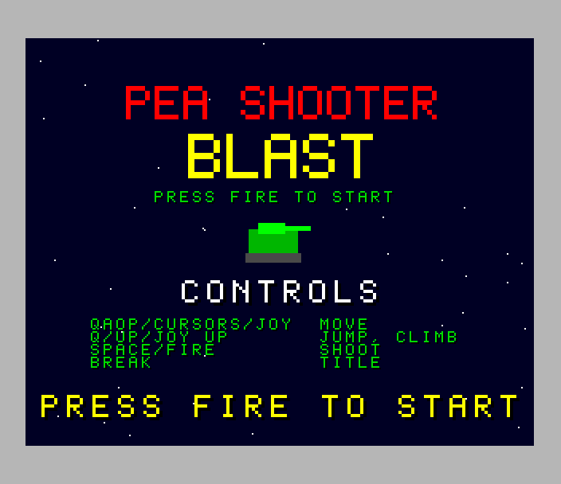
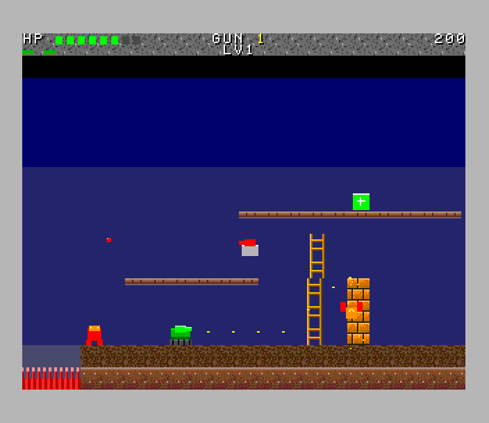
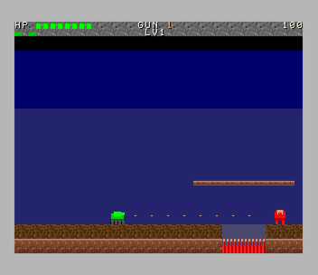

# Pea Shooter Blast (Spectrum Next)

Port of `amiga_mcp/examples/pea_shooter_blast` (also on the Atari STE and
the 3DO): a side-scrolling tank game. Drive the tank through three levels
(an underground tunnel, caves, a factory), jump the spike pits, climb the
ladders, shoot the walkers, flyers, turrets and hoppers, pick up gun and
health powerups, and get past each level's boss to the exit gate.

 

## Controls

| | |
|---|---|
| move | O / P, cursor keys, Sinclair or Kempston joystick |
| jump, climb up | Q, cursor up, joystick up |
| climb down | A, cursor down, joystick down |
| shoot (hold for auto-fire) | SPACE, M, 0 or fire |
| back to the title | BREAK (CAPS SHIFT + SPACE) |
| title | fire starts |

port: the original's A/D/W keys and Esc are Q A O P and BREAK here.

## What's kept, what changed

Kept from the original:

- **The rules, unchanged.** `src/game.c`, `src/levels.c` and `src/game.h`
  are the original's files. A small `exec/types.h` gives them the Amiga's
  type sizes (WORD 16 bits, LONG 32), which are zsdcc's int and long. The
  test plays a scripted 2,500-frame game on the Next and checks its state
  hash against the same game played by the original's code compiled for
  the Mac (`tools/host_trace.sh`).
- The original's speed: one game step a frame at 50 Hz, with a fixed
  timestep.
- The levels, enemies, AI, weapons, powerups, scoring and the HUD's
  layout. The title has its starfield, words and tank.
- The music, the original's MOD ("Pea Patrol"), and its six synthesised
  effects.

Changed (marked `port:` in the code):

- **Two fixes so the game can be finished** (`src/port_fixes.c`,
  [ORIGINAL_BUGS.md](ORIGINAL_BUGS.md)). In the original the jump is too
  low for its own walls, and a metal block shuts level 1, so levels 1 and
  3 can't be completed. The jump is now 4.5 instead of 3.5, through the
  original's own tunables, and the block has a doorway like the original's
  boss-arena walls.
- **Art redrawn for 256 colours.** The tiles and sprites keep the original's
  shapes and colours, with shading added. Behind the playfield, a gradient
  per level replaces the flat background.
- **Text on 8-pixel rows** (the tilemap), in the original's 5x7 font with a
  drop shadow. The title's big words are drawn as the original draws them.
- **The effects last at least two frames.** The original's last 5-45 ms,
  but the AY changes once a frame.
- **A high-score table** with initials, the SDK's. On the title it
  alternates with the controls every 5 s. The original has no table.

## Next features used

What it uses beyond a 48K/128K Spectrum, and why:

| feature | used for | why it's needed |
|---|---|---|
| **28 MHz** | the original's rules in 16.16 fixed point (32-bit arithmetic in zsdcc's library calls) at 50 steps a second | a step takes about 170K T-states, more than two frames' worth at 3.5 MHz |
| **Layer 2, 320 x 256 x 8 bpp** | the playfield at the original's resolution and 256 colours | the original's 16-colour 320 x 256 screen, shaded, with no attribute clash |
| **Layer 2 hardware scrolling** (NextReg 0x16 / 0x71, sdk l2scroll) | the side-scrolling: the 320 columns are a ring, and only the map columns coming into view are drawn (4 at most a frame, each 16 copies of a 16-byte tile column) | the original redraws 22 x 16 tiles every frame; here scrolling costs almost nothing |
| **copper** | a vertical gradient behind each level: Layer 2's pen 0 changes every 4 lines | a background with depth for no CPU time and no pixels |
| **hardware sprites, 4-bit, zoomed** | the tank, enemies, the boss (2 x 2) and its health bar, bullets, powerups, up to 32 particles, and explosion flashes (squares zoomed 2x or 4x up to 61 pixels) | nothing that moves is drawn into the playfield, so nothing has to be restored; palette offsets colour the particles |
| **tilemap** (40 x 32, over everything) | the HUD, GAME OVER and LEVEL CLEAR, the title's text and the high scores, with big letters at 2-3x | the text stays put while the playfield scrolls under it |
| **MMU banking** | the rules in bank 40 at 0x0000 (over the ROM), the levels and their 6K maps in page 82 at 0x4000, the HUD, fonts, palettes, song and test probe in page 84 at 0x6000, the title picture and the sprite list in page 88 (at 0x4000 while they run), the scripted hash run in page 86 | zsdcc's code for the original's rules is 15K, and with everything else it is about 64K, against the 28K free at 0x8000 |
| **TurboSound** (3 AY chips) | the MOD's lead, bass and drums on chip 0, its echo channel on chip 1, the effects on chip 2 | music and effects at once |
| **zxnDMA** | sprite patterns and attributes, Layer 2 clears | ~2 T-states a byte |

## How it's built

- **Pictures** (`tools/gen_gfx.py`): the original's tile shapes (draw.c's
  RectFill and Draw calls), shaded, stored column-major (a tile column
  is 16 bytes, like a slice of a Layer 2 column). The sprites are the
  original's shapes as 4-bit patterns. Also the palettes and the gradients.
- **Sound** (`tools/gen_sound.py`, `sdk/tools/mod2ay.py`): the MOD's 4
  channels and 6 samples become AY instruments. The effects' frequencies,
  envelopes and noise come from build_sfx.
- **Memory map**: `src/main.c`, `src/memmap.h`. `make` checks that each page
  stays within 8K and the bank within 16K.
- `sh tools/make_assets.sh` remakes everything above and the host trace.
  `sh tools/reach.sh` runs the reachability search (ORIGINAL_BUGS.md).

## Frame rate

In the test's game the picture is drawn at **48.5 frames a second** on
average (lowest 5-second sample 45, most samples 50), and the logic runs at the original's 50
steps. A frame costs about 170K T-states for the rules, 57K for the
sprites and 27K for the HUD, out of 560K. The late frames are a new level
(the levels and a whole screen of columns) and the title.

## SDK modules this game added

- `tmtext.h`: tilemap text slots, rewritten only when they change, and big
  letters from a tile pool (tested in `projects/texttest`)
- `nextsprl.h`: `spl_scale` (hardware zoom, checked in `projects/nextlibtest`);
  `spl_zmask` moved into its own file (`nextsprl_z.c`), so games that don't
  mask don't link `l2wpoly`

## Test

`./zx test pea_shooter_blast`:

- 28 MHz, the title, the MOD on TurboSound, the high-score page.
- The scripted game's state hash is the original's on the host.
- The Kempston joystick starts a game and drives the tank; BREAK goes back
  to the title.
- A recorded game. The bot holds right and fire, and jumps where the
  shortest way through level 1 (`tools/reach.c`) jumps, when the tank gets
  there. It shoots enemies, scores and reaches the gate (LEVEL CLEAR). In
  level 2 it drives into the spike pit until every life is gone. Then game
  over, the initials, and the title with them in the table.
- The frame rate while playing.
- The recording replays twice with every frame's hash the same.

## Known issues

- On the Next the scroll moves in whole pixels, as the original's does,
  and the copper gradient shows its steps (9-bit colour).
- One effect plays at a time, as the original plays them on one free channel.
- The test plays levels 1 and 2; `tools/reach.c` shows level 3 can be
  finished with the fixes.
