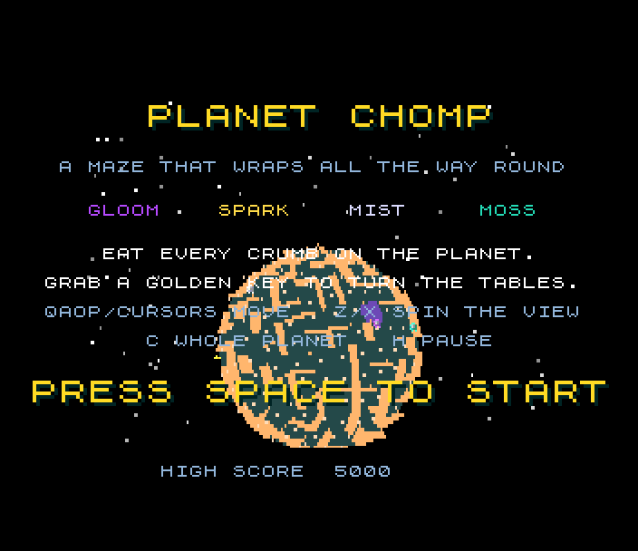
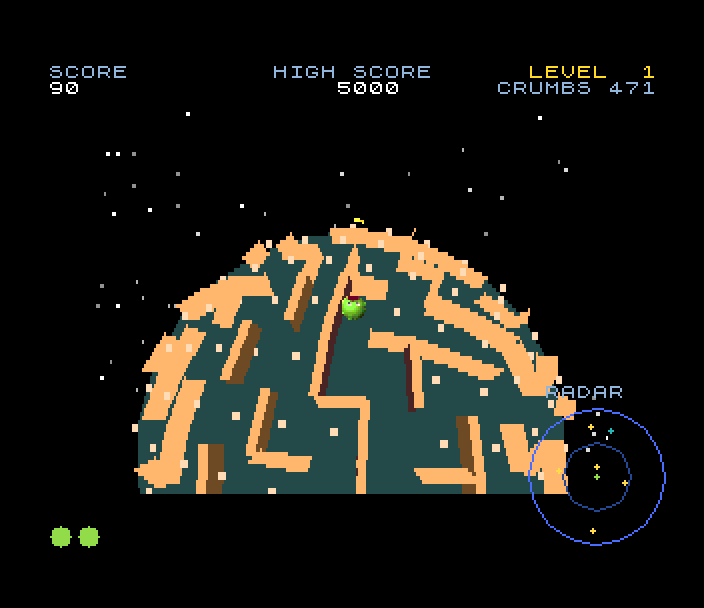

# Planet Chomp (Spectrum Next)

Port of `amiga_mcp/examples/planet_chomp`, a maze chase on a tiny planet
(the 3DO and Amiga version of the Unity game). The maze wraps all the way
round a sphere. Eat every crumb, dodge the four spooks (GLOOM, SPARK, MIST,
MOSS), and grab a golden key to turn the tables. The camera hovers over the
chomper and follows it round the planet in perspective 3D.

 

## Controls

| | |
|---|---|
| steer | Q A O P, cursor keys, Sinclair or Kempston joystick: relative to the screen; a turn waits for the next junction |
| spin the view | Z / X |
| whole planet | C |
| pause | H |
| start | SPACE, ENTER or fire |
| high score | type three letters (or up / down and fire) |
| (tests) | B lets the original's autopilot play the game for you |

The attract demo starts by itself after 15 s on the title. port: the
original's Q / E (spin) and P (pause) are taken by QAOP, so they are Z / X
and H.

## What's kept, what changed

Kept from the original:

- **The rules, bit for bit.** `src/game.c` and `src/maze.c` are the
  original's `game.c` and `maze.c` (GameDirector.cs, Ghost.cs, Chomper.cs,
  Mover.cs, SphereMaze.cs): the rail movement, the buffered screen-relative
  steering, the four spooks' targeting (chaser, ambusher, flanker, drifter),
  scatter and chase phases, frightened spooks and the combo scores, the keys,
  lives, the extra life at 10000, the level speeds, the camera, the
  autopilot of the attract demo. Every level's maze is carved on the Next by
  the original's algorithm and random numbers. `tools/compare.sh` runs the
  original's code (with 32-bit longs, as on the 3DO and the Amiga) and the
  port's side by side on the host for 300,000 ticks of scripted play and
  the demo: the state after every tick is the same. The test checks the
  Next's level-1 maze against the original's.
- The renderer's camera, horizon tests, wall shading (120 + 150 |side .
  view|), colours, the starfield (the original's own random stars), the nest,
  the planet's silhouette, painter's order by depth buckets.
- The sprites are the original's textures (its `sprites.c`, run on the host):
  the chomper in 4 facings x 3 mouths, normal and powered, the spooks, the
  frightened, flashing and eaten ones, the key; the original's choice of
  texture, mouth phase, facing and the dying chomper's shrink.
- The HUD's layout (the tilemap covers the original's 320 x 256 frame), the
  radar, the power bar, the score popups, the title, game over.
- The sound effects, from the original's pitch functions.

Changed (marked `port:` in the code):

- **16-bit vectors.** The original keeps Q14 directions and Q8 positions in
  32-bit longs; they all fit 16 bits, so they are `vec3` (sdk) with the
  original's products and shifts. The few sums that pass 16 bits stay 32.
  Surface tangents are worked out when needed instead of being a 12K table.
- **The walls on screen.** The original projects each wall's eight corners.
  Here every lattice corner on the camera's side of the horizon (and not
  more than a cell below the bottom of the screen) is rotated and projected
  twice, at the ground and at the walls' top, once a frame; a wall is its
  two corners' points with its thickness as a screen-space offset (its side
  normal through the camera). A crumb sits between two corners across its
  cell, 3/4 of the way up the walls (0.56 instead of 0.5). The screen is
  256 x 192, the original's 320 x 240 at 0.8.
- **Speed.** The view is drawn 96 rows high and the copper shows each row
  twice. Only cells within ~70 degrees of the camera are drawn (the
  original draws up to the horizon; the planet's rim shows bare ground).
  A wall at most a pixel thick on screen is one quad in the top's colour
  instead of a side and a top. The planet's disc sits in a background copy
  of the starfield, redrawn only when the camera's height changes.
- **Sprites in front.** The chomper, spooks and keys are hardware sprites,
  always over the walls (the original sorts them in). Sizes come from 10
  pre-scaled sizes, 4 to 28 pixels.
- **The radar** is redrawn every 4th frame. The nest is drawn straight
  after the planet (a flat disc on the ground hides nothing standing on it).
- **Text on 8-pixel rows**, big words at 2x (the title's 3x is 2x).
- **High-score table.** The original keeps one high score; here the SDK's
  five-entry table and initials editor, shown on the title in turn with
  the instructions.
- **Music.** The original has none; the title plays a tune made from its
  start jingle's notes.

## Next features used

What it uses beyond a 48K/128K Spectrum, and why:

| feature | used for | why it's needed |
|---|---|---|
| **28 MHz and the Z80N `MUL`** | the original's rules (50 steps a second of 16 x 16 -> 32 vector maths and square roots), the 3D transform of ~120-200 corners a frame (8 x 8 `MUL`s against a Q7 camera matrix patched into the code), the polygon edges' slopes | the corner transform alone takes ~325 raster lines a frame at 28 MHz, more than a whole frame at 3.5 MHz; the logic ~40 lines a step |
| **Layer 2, 256 x 192 x 8 bpp, double buffered** | the planet, the maze's walls (8 shades), crumbs, the nest, the stars, in the original's colours | filled polygons in many colours anywhere; the ULA's two colours per 8 x 8 cell can't show shaded walls over a planet |
| **zxnDMA** | each frame starts as a DMA copy of the background, the starfield and the planet's disc (24K in about 6 raster lines); the sprites' patterns are sent by DMA when an actor's texture or size changes | a CPU copy would take a frame by itself |
| **hardware sprites** (64 patterns, 70 sprites) | the chomper, spooks, keys (16 x 16 or 32 x 32 quads, patterns streamed from 10 banks of pre-scaled frames), the score popups, the radar's dots, the lives | moving things never touch the Layer 2 picture, and scaling them by depth is a pattern swap |
| **tilemap** (40 x 32, 4 bpp, over everything) | the HUD, the radar's rings, the power bar, the title, game over, the high scores and the initials, in the original's 320 x 256 layout including the border | text and HUD never have to be drawn into or restored from the 3D picture |
| **palettes** (Layer 2, sprites, tilemap) | the original's colours in 9 bits; 82 sprite colours; a palette offset per tilemap colour | |
| **MMU banking** | the code in parts mapped in turn (rules in bank 16, their grid tables in bank 17, the renderer in bank 18 with its corner records and tables in pages 38-40, the sprite/radar code in page 41, the HUD in bank 21); 10 banks of sprite frames, the starfield in 3, the background (stars and disc) in 37-38, the sound | zsdcc's code for the original's rules is 15K, the renderer 12K, the HUD 6K, and the tables ~30K, against 28K free at 0x8000 |
| **TurboSound** (3 AY chips) | the title tune on chips 0 and 1, the effects on chip 0, the crumbs' plinks on chip 2, the ambience (hum, bubbling) on chip 1 | the original plays crumbs, effects and an ambience loop at the same time on separate Paula channels |
| **copper** | Layer 2's Y scroll (NextReg 0x17) set every other line: the 96 rows drawn show 192 high | half the rows to fill, the polygons' cost being mostly per row |
| **raster line** (NextReg 0x1E/0x1F) | the built-in profiler (`pc: perf` lines) | measuring each part of the frame |

## Frame rate

The logic always runs at the original's 50 steps a second (fixed timestep,
up to 8 steps a frame). The picture is redrawn when it can: about **9-9.5
frames a second** while playing (the profiler's `pc: perf` lines). A drawn
frame costs about 1680 raster lines of ~1800 T-states (312 to a 50 Hz
frame):

| part | lines |
|---|---|
| the logic, ~5.4 steps at ~60 lines | ~330 |
| the corners' transform (~160 of 488, two points each) | ~325 |
| the crumbs' list | ~190 |
| the walls' list | ~250 |
| the fill (walls, crumbs, the nest) | ~400 |
| camera, sprites and radar, background, sprite patterns | ~185 |

The speed pass took it from 4.5-6.5: drawing 96 rows (fill 930 -> 720),
the radius cull and the thin walls (fill -> 400, lists -15%), the disc in
the background (-83). What limits it now is no single part: the logic is
the original's rules at 50 Hz (a dozen 16 x 16 -> 32 normalises, square
roots and 32-bit divides a step), and the transform and the two lists
each walk every corner, cell or wall with a horizon test before culling.
Ideas not done: cull in clusters of cells (each list visits all of them;
~150 lines), DMA for long spans (few are long now). The 3DO renderer on a
16 MHz Falcon managed 1 fps and on a 32 MHz 68060 about 9.

## How it's built

- **Tables** (`tools/gen_data.c`): the original's `maze.c` on the host
  makes the sphere's grid (neighbours, directions, edge lengths), the
  lattice corners, each edge's corners and side normal, each cell's corners,
  the projection's scale table.
- **Pictures** (`tools/gen_sprites.c`, `tools/gen_gfx.py`): the original's
  `sprites.c` draws its textures; they are scaled to 10 sizes, quantised to
  one sprite palette and packed into banks. The starfield is the
  original's. The radar's rings and the power bar become tiles.
- **Sound** (`tools/gen_sound.py`): the original's effects (its `freq()`
  functions, envelopes, volumes) as AY register streams, and the title tune.
- **The Next's frame** (`src/main.c`): the flip, the sprites (`actors.c`),
  the logic steps, the starfield by DMA, the corners (`xform.asm`), the
  crumbs and walls into depth buckets and the fill (`draw.asm`), the sprites'
  positions and the radar (`view.c`), the HUD (`hud.c`).

`sh tools/make_assets.sh` remakes everything from `tools/orig` and runs the
host comparison. `.venv/bin/python projects/planet_chomp/tools/profile.py
1000 play` samples where the time goes.

## SDK modules this game added

- `vec3.h` (`vec3.asm`, `vec3.c`): Q14 3-vectors with exact 32-bit products:
  dot, cross, scale, matrix, the common fixed-point normalise; host twins
  for host tests. Test: `projects/sdktestnext`.
- `isqrt32` (fixmath) is about 3x faster (seed table, one Newton step, exact
  correction). Test: 1500 values in `projects/sdktestnext`.
- It uses zx-scairy-fun's `l2poly.h` for the planet's disc and the nest.

## Test

`./zx test planet_chomp`:

- boots, 28 MHz, the level-1 maze is the original's;
- the title tune plays on two chips;
- SPACE starts a game; B lets the bot (the original's autopilot, steering
  through the keys) play: it eats crumbs, takes a key and eats a frightened
  spook; the effects and ambience play;
- the bot lets go, the spooks catch the chomper three times, game over;
  the bot types BOT into the high-score table; back to the title;
- the game is recorded from reset and replayed twice: every frame hash
  matches.

## Known issues

- About 9 frames a second, below the 12 aimed for (see Frame rate): the
  game runs at its real speed, but the picture is a little jerky.
- Sprites are always over the walls: a spook behind a wall shows in front
  of it.
- Z, X, C, H and B are read once a frame: a very short tap can be missed;
  initials typed faster than the frame rate (one letter a drawn frame) lose
  letters.
