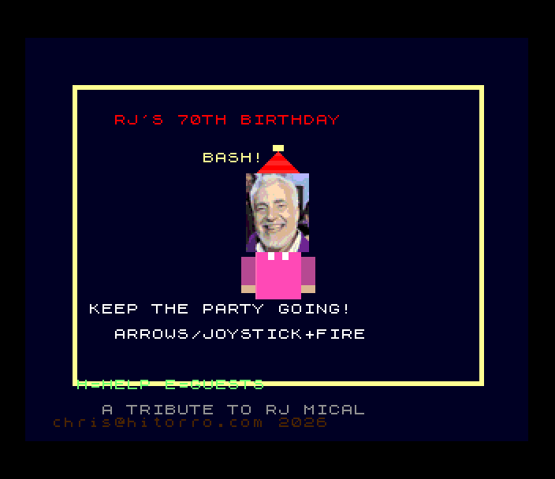
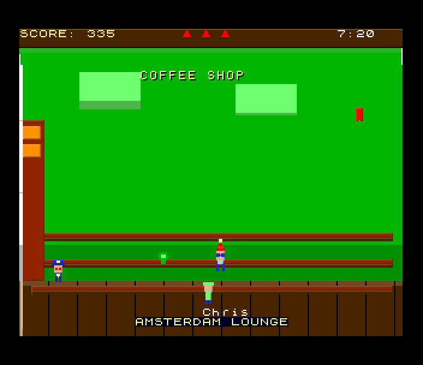
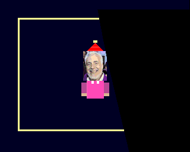

# RJ's Birthday Bash (Spectrum Next)

Port of `amiga_mcp/examples/rj_birthday`, a party arcade game made for RJ
Mical's 70th birthday. RJ walks through a house of six themed rooms
(the foyer, the Amsterdam lounge, Tokyo, the Silicon Valley den, the Bay
Area patio and the living room) keeping the guests happy: catch the gifts,
serve brownies and sushi, demo the Amiga, deliver on a scooter, light the
cake, and stay out of the pot police's way.

 

## Controls

| | |
|---|---|
| move | Q A O P, cursor keys, Sinclair or Kempston joystick |
| interact / start | SPACE, M, 0 or fire |
| help, guest list (title) | H, E (E also in play: the guest list, the game paused) |
| typing (names) | the letter keys, DELETE (CAPS SHIFT + 0), ENTER |
| leave / skip | BREAK (CAPS SHIFT + SPACE): the original's Esc |

port: the original's Q on the title quits; there's nothing to quit to on
the Spectrum, and Q is up.

## What's kept, what changed

Kept from the original:

- **The rules**: `src/game.c` is the original's `game.c` (and
  `src/game_rooms.c` three of its room updates, moved but unchanged): the
  rooms and what happens in each, the guests' wants and patience, the pot
  police, the jail, the party clock (7 to 12 o'clock in 150 seconds), the
  lives, the happiness, the scoring, the easter eggs. It runs once a PAL
  frame, as the original's main loop does.
- **The camera**: the original's smooth follow
  (`camera_x += (target - camera_x + 3) / 4`) across the 1920-pixel house.
- **The house**: drawn on the host from `rooms.c`'s geometry
  (`tools/gen_gfx.py`), in its colours, with the same signs, posters and
  furniture. **The title**: its frame, the party hat, RJ's photo head
  (`rj_head.jpg`, 48 colours) and body.
- **Its own high-score table** with typed names, **the guest list** and
  its editor (E), the credits scrolling with the guests' names, the jail
  screen, the win screen with the cake.
- **The music**: the original's two MODs, `party.mod` on the title and in
  play and `birthday.mod` on the end screens (as its main loop switches
  them), converted with `sdk/tools/mod2ay.py`, an AY instrument for each
  sample.

Changed (marked `port:` in the code):

- **The art is redrawn for 256 colours**: the rooms are shaded (walls lit
  from above, wood grain, carpet and tile texture, the city and the bay
  through the windows), from the original's 16 flat pens, which are the
  middles of the ramps.
- **The actors are hardware sprites**, redrawn at the original's sizes
  from `draw.c`: RJ with his glasses and party hat, the guests in eight
  colours (normal, happy, angry), their want bubbles and patience bars,
  the police, the items, the Boing balls with their shadows, the smoke
  puffs. RJ holds the item he carries (the original draws a small icon).
- **Text is the Spectrum's ROM font on the tilemap**, at the original's
  places on the 8-pixel grid. In the house the name tags, speech bubbles
  and messages scroll with it, so they step in 8-pixel columns as the
  guests walk.
- **Saving**: the original writes its high scores and guest list to disk.
  The port keeps them in memory (the .nex starts with the original's
  shipped guest list and a default table).
- **Effects and voices**: the original's effects are 8-bit samples it
  synthesises at start-up. `tools/gen_sound.py` makes the same samples
  and plays each 50th of a second on the AY as a tone at its pitch (or
  noise) at its loudness. The arcade cabinet's four speech clips are
  turned into AY sound the same way. They keep the clips' rhythm and pitch
  but not the words; RJ's bubble still says them, and the music still
  pauses for each clip's length. **All four MOD channels are music**: the
  original kept two of Paula's four for effects. The effects have the
  third AY chip.
- The help screen's lines are the tilemap's rows one after another, and
  it lists the Spectrum's keys.

## Frame rate

About 49 frames a second in play (measured by the test; the game itself
always steps 50 times a second). At the start of a game, and when the
camera jumps back to the foyer after the jail, the whole screen of the
house (320 columns) is copied at once; otherwise the 1-4 columns that
come into view each frame.

## Next features used

What it uses beyond a 48K/128K Spectrum, and why:

| feature | used for | why it's needed |
|---|---|---|
| **Layer 2, 320 x 256 x 8 bpp** | the house and the title, 129 colours, made on the host | the original's 320 x 256 screen at its own scale; the ULA's two colours per 8 x 8 cell couldn't show the rooms, let alone the photo |
| **hardware X scroll** (NextReg 0x16, 0x71) | Layer 2 as a 320-column ring: the house's columns copied in as they come into view (`sdk/l2pic.h`), the screen scrolled to the camera | the original redraws its whole screen every frame; this copies a few columns |
| **copper** (`nextsplit.h`) | at row 16 the scroll switches on (the HUD above stays still), at row 240 the tilemap's switches off (the room's name) | one Layer 2 and one tilemap show a fixed bar and a scrolling house |
| **tilemap** (40 x 32, scrolled) | the HUD, the screens' text, and the name tags and bubbles that scroll with the house | text over the picture without redrawing it |
| **hardware sprites, palette offsets** | RJ, the guests, the police, the items, the Boing balls, the puffs; one guest pattern set in eight colours by palette offset | nothing that moves is drawn into the house, so nothing has to be restored |
| **MMU paging, banks** | the house as column RLE in banks 16-22 (85 K), the rules in bank 24 at 0x0000, the screens in bank 26, the songs in page 55 | the house and the code don't fit in 64 K |
| **TurboSound** (3 AY chips) | the MODs' four channels on chips 0 and 1, the effects and voices on chip 2 (`modplay.h`, `aystream.h`) | music and effects at once |
| **28 MHz** | | the column copying and the sprites in one frame |

## SDK modules

- `sdk/l2pic.h` (new): a picture wider than the screen on Layer 2's
  320 x 256 mode, stored as column RLE in banks (`sdk/tools/l2pic.py`
  packs it), scrolled by the hardware with the columns copied in as they
  come into view. Test: `projects/l2pictest`.

## Building

    ./zx build rj_birthday
    ./zx test rj_birthday

The pictures and the sound are made on the host and checked in:
`python3 tools/gen_gfx.py`, `python3 tools/gen_sound.py` (they read the
original's files, copied to `tools/orig/`).
