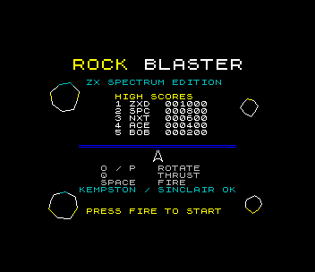
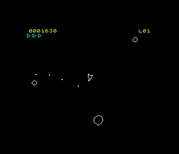
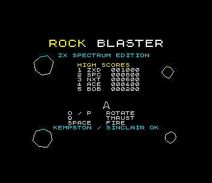

# Rock Blaster (ZX Spectrum 48K)

Port of `amiga_mcp/examples/rock_blaster`: a vector rock shooter. Turn,
thrust and fire; large rocks split into two medium ones, medium into two
small (20 / 50 / 100 points); clear the screen and the next wave brings two
more large rocks. Three lives, 100 frames of safety after each respawn,
everything wraps around the screen.

 

## Controls

| | |
|---|---|
| rotate | O / P, Sinclair 1 (6/7), Sinclair 2 (1/2), cursor, Kempston left/right |
| thrust | Q, or joystick up |
| fire | SPACE, M, 0, 5 or joystick fire (one shot every 8 frames while held, as the original) |
| start | fire on the title screen |
| initials | type three letters (or UP/DOWN + FIRE) after a high score |

The original's A/Z, D/C and W keys aren't used: the SDK's QAOP layout is the
Spectrum convention, and A is "down" in it.

## What was kept, what changed

`src/game.c` is the original game logic: the ship's thrust (0.20), drag
(253/256 a frame), speed limit and 16.16 position; bullets at 4 px a frame for
40 frames; rock speeds (0.4-0.8 px a frame, x1.5 for medium, x2 for small);
circle collisions with the original's radii; the scoring, the waves
(4 + 2 per level), three lives, the respawn and game-over timers, and the
order of the update (the original's quirk that bullets freeze while the ship
is dead is kept). Changes are marked `port:` in the source:

- the world is 320 x 240 (the original's 320 x 256 cut to the Spectrum's 4:3)
  and is shown at 0.8 scale on the 256 x 192 screen, so every speed, radius
  and distance is the original's; shapes are the original's outlines scaled
  by 0.8 at start-up
- rocks, bullets and particles move in 16-bit 1/128-pixel units (the ship
  keeps the original's 16.16); collisions compare whole pixels (at most 1 px
  different from the original's whole part of the difference)
- the SDK's xorshift random numbers instead of the 32-bit LCG
- particles have no colour (1-bit screen) and vanish when they leave the
  screen (the original kept moving them, invisible)
- game over goes to the high-score table and the title instead of starting
  a new game at once; the original had no high scores
- the ship is drawn in 128 directions (it turns in 256, as the original)

`src/main.c` is the Spectrum front end. `src/objs.asm` has the logic's
per-frame loops (moving rocks, bullets, particles, the ship's drag and
wrap, the collision list) and the drawing plans: zsdcc's code for them was
most of the frame.

## How it draws

The playfield is XOR wireframes drawn straight onto the screen with the
SDK's `line48` (no back buffer: 6 KB would not fit, and copying it would
take two frames). Drawing a shape again takes it off, whatever was drawn
over it, so after each frame's logic the game lists where every rock, the
ship, its flame, the bullets and the particles should be, and the next frame
takes off and redraws only what changed (`poly_sync`). The HUD is XOR text
too, so rocks can fly through it. Shapes wrap around the screen edges the
way the playfield does (the row table maps y mod 192, x is a byte). Each
shape is a compiled polygon: its edges' octants, lengths and error terms
are worked out once at start-up (the ship's for each of 128 angles).

The logic runs at a fixed 50 Hz (`frame_wait()` returns how many frames
passed and the game catches up), so it plays at the original's speed
whatever the frame rate. Frame rate (`rb: fps=` in the log, measured by the
test's bot, which fires all the time): 30-39 fps with a few rocks, 12-25
with 8-17 rocks and explosions. When a frame overruns,
the next one redraws only half of the rocks (they take turns), so the ship
and the shots keep their rate.

## 48K notes

How it fits a 48K Spectrum:

- **Memory.** The program is 0x8000-0xECF2 (27.4 KB: code, the game state,
  the original's MOD as AY data, 1.2 KB packed). Tables built at start-up
  live in the 9 KB below it, which the BASIC loader is done with once the
  game runs (`src/lowmem.h`): the ship's 128 compiled outlines (3.5 KB), the
  flame's 64 (1.1 KB), the 12 rock outlines, the world-to-screen tables, the
  point lists and the unpacked music rows (2 KB). Above: the SDK's IM 2 table
  and the line drawer's row table at 0xF000-0xF3FF, then the stack.
- **3.5 MHz.** About 70,000 T-states a frame. A large rock's outline is ~90
  pixels: ~9,000 T-states to draw and as much to erase, so the line drawer is
  eight specialised Bresenham loops (~80 T-states a pixel) and a polygon
  continues each edge from where the last one stopped; game objects move in
  16-bit fixed point except the ship. Profiled with the harness's
  breakpoints and a sampling profiler (PC at random T-states).
- **1 bit + attributes.** Wireframes are 1-bit by nature; colour comes from
  attributes by area: the score row yellow, the lives cyan, game over red.
  Rocks flying through those areas take their colour, a little of the
  Spectrum's colour clash kept on purpose.
- **Beeper.** Effects are short and blocking (a falling blip for a shot,
  noise bursts for rocks, a falling tone and noise for the ship): the
  fixed-timestep logic absorbs the time they take.

What the 128K adds: the AY plays the original's MOD (`tools/make_music.py`
converts `tools/rock_blaster.mod` with `sdk/tools/mod2ay.py`: the brass lead
and the bass on channels B and C, as the original kept two of Paula's four
channels for the music) and the effects on channel A, without the beeper's
pauses. The same `.tap` runs on both.

## Files

| | |
|---|---|
| `src/game.c`, `src/game.h` | the original's logic (port changes marked) |
| `src/main.c` | screens, drawing, HUD, sound, the main loop |
| `src/objs.asm` | the per-frame object loops and the drawing plans |
| `src/lowmem.h` | the RAM below the program |
| `src/music_song.c` | generated by `tools/make_music.py` |
| `tools/bot.py` | the test's player (reads `gs` by symbol) |
| `tools/make_gif.py` | `docs/images/rock_blaster.gif` |

## Test

`./zx test rock_blaster`: boots, starts, the bot aims at the nearest rock and
fires (scores several thousand points, reaches level 3), later thrusts into
the rocks until the game is over, types BOT into the high-score table and
returns to the title; the game is recorded and replayed twice with every
frame hash checked. Then a 128K: the AY is found, the Kempston starts the
game and turns the ship, and the AY's channels B and C play the music.
