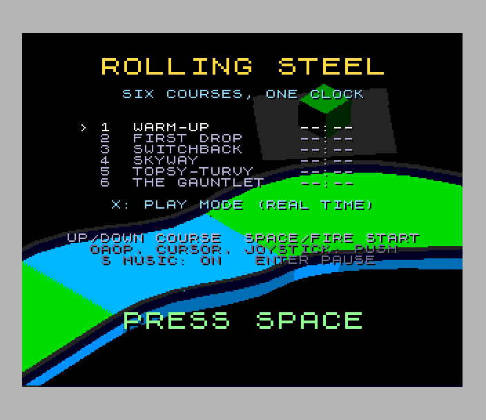
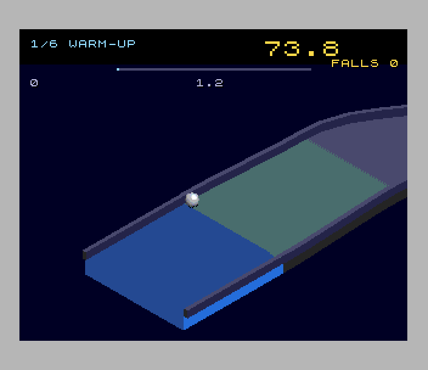
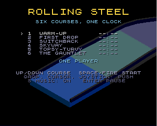

# Rolling Steel (Spectrum Next)

Port of `amiga_mcp/examples/rolling_steel`, an isometric roll-a-marble-downhill
game in the spirit of the 1984 Atari cabinet (the 3DO version's C, rebuilt from
the Unity game [geekychris/rolling_steel](https://github.com/geekychris/rolling_steel),
MIT, `tools/orig/LICENSE.original`). There are six floating courses and one
clock that carries over between them, with no jump and no brakes. Ice slides,
sand bites and acid dissolves. Sweepers, crushers, fans, chasers and blobs get
in the way.

 

**It needs a 2 MB Next** (the courses are 1.4 MB). ZEsarUX is one by default.

## Controls

| | |
|---|---|
| push the marble | Q A O P, cursor keys, Sinclair or Kempston joystick. Up (Q) pushes away from you |
| title | up/down choose the course to start from (course 1 is the full run), SPACE/fire starts, S music on/off, X play mode / exact mode |
| pause | ENTER |
| autopilot | B: the original's demo driver takes over (and plays behind the title after 25 s) |

port: the original's P pauses (P is on QAOP here, so ENTER does), C turns the
music on and off (S here), and Z/X, +/- and C with up/down turn, zoom and tilt
the view: the view here is fixed (see below), so they have no keys. Two
players (split screen) were left out.

## Two modes

- **Play mode** (the default): the original's physics stepped 25 times a
  second with a doubled step (2/50 s: every per-step amount doubled, the
  move twice as far, timers ticked twice), so the game keeps up with real
  time. The clock, timers, camera and the rest of the game still run at 50
  steps a second. This is an approximation of the original: the same
  courses and rules, but the rolling and bouncing differ in detail from a
  50 Hz run, and the race won't hash the same.
- **Exact mode** (X on the title): the original's physics at 50 Hz, step
  for step (the hash test). The Next can't run it in real time, so it
  plays in slow motion.

Each mode has its own best times and high-score table: a score from one
isn't comparable with the other's. Speeds are under Speed.

## What's kept, what changed

Kept from the original:

- **The rules, exactly.** `src/game.c` is the original's `game.c` (its
  `port:` changes are for zsdcc and the banks), and `src/phys.asm` is the
  original's `phys.c` in Z80N assembly with its 32-bit arithmetic done the
  same way: every product's low 32 bits, every division truncated, every
  shift arithmetic, every contact in the same order. The marble's spin,
  Coulomb friction at the contact point, PhysX's bounce rules, sweepers,
  crushers, fans, acid, crumbling tiles, steel chasers (mass 3) and blobs;
  the clock (a fall costs 3 seconds and puts you back behind where you last
  touched), medals, best times and the autopilot. `test.py` runs the
  original's C on the host (`tools/hostsim.c`) and the Next side by side:
  the attract demo's race state hashes the same at every change of state
  through all six courses.
- The rules' rate: 50 steps a second, as Unity's FixedUpdate (exact mode;
  play mode steps the physics at 25 Hz, see Two modes).
- **The look.** Each course is the original's own geometry, lit and fogged
  by the original's model (`render.c`'s colours, six fog depths), drawn
  through the original's camera and projection at its default view
  (`tools/rsview.py`, integer for integer where the Next has to agree with
  it). The marble, steel chasers, blobs, the wipeout's shards and sparks are
  the original's shaded sphere sprites. The crushers and sweeper arms are
  its lit boxes. Crumbling tiles shiver and drop away.
- The camera: the original's (`IsoCamera.cs`), following with its lead and
  lag, shaking on a wipeout, flying along the course behind the title and
  circling the goal.
- The HUD: course and name, the big clock (red in the last 10 seconds),
  falls, the progress bar, the course time and best time, the banners
  (DISSOLVED, -3 SECONDS, COURSE CLEAR with the medal, OUT OF TIME, ALL
  CLEAR, PAUSED), the title with the courses' best times, in the original's
  pens and places. The original darkens the strip behind the HUD and the
  banners' boxes, and so does this port.
- The seven themes (the title's and one per course) and the ten effects,
  from the original's own definitions (`tools/orig/tools/sounds.py`), and the
  rolling rumble that follows the marble's speed.

Changed (marked `port:` in the code):

- **The view is fixed at the original's default** (yaw 0, pitch 35 degrees,
  11.4 pixels a unit). So each course is drawn once on the host into one big
  picture (`tools/gen_course.py`), run-length coded down its columns and
  along its rows, and Layer 2 (320 x 256) holds the part around the camera
  as a ring: the hardware scroll moves it and a move fills only the columns
  and rows coming into view (`src/l2view.asm`). `tools/gen_course.py`'s
  picture and the Next's Layer 2 agree pixel for pixel. The original can
  turn, zoom and tilt the view because it projects every face each frame;
  the Next can't project ~900 faces a frame.
- The fog of a face comes from its depth below the stretch of course nearest
  it on screen (the original's from the camera's focus, which is about
  there when you see it).
- The floating scenery holds still (the original bobs and turns it).
- **Moving things are hardware sprites** over the picture, sorted by depth:
  the marble and enemies with their shadows, the debris, the crushers (one
  picture moved up and down), the sweeper arms (16 turns over half a
  circle, made on the host), crumbling tiles (cut where the course in front
  hides them). A sprite isn't hidden by course in front of it except for the
  tiles.
- The shadow is a dithered dark oval (the original darkens the deck). Under
  a rolling ball it lies at the ball's own contact; in the air the original's
  deck search finds it, every 4th frame.
- The death flash brightens Layer 2's palette towards the original's colour.
- **The physics is assembly** (zsdcc made 38 KB of slow code of `phys.c`),
  with exact shortcuts: a triangle's sphere, plane or edge test is skipped
  while the ball can't have moved far enough to change its outcome (an
  odometer of every move and push; `phys.asm`'s notes), and products are
  16 x 16 where the values fit. None of this changes a result (the hash).
- No ghost of your best run (it kept 65 KB of samples and drew a see-through
  marble). Best times last the session.
- **High scores** (the SDK's table with initials): 1000 times the course
  number for each course finished, plus the clock left in tenths, plus 500 /
  300 / 100 for a gold / silver / bronze medal. The original keeps best times
  only.
- Music: the original's samples become AY square tones whose volumes follow
  the original's envelopes, drums on the noise.

## Speed

The original's rules are heavy: a step of the marble against ~2,000 course
triangles is a few thousand 32-bit operations, and a steel chaser nearby
does the same. A physics step costs about 0.9-1.3 frames of the 28 MHz
Z80N. The loop runs as many 50 Hz game steps as frames went by (up to 16 in
play mode, 8 in exact mode), then draws one picture. Measured by `test.py`
with the autopilot on course 1:

| mode | pictures a second | game speed |
|---|---|---|
| **play** (default) | **about 4** | **about 91% of real time** (the physics at ~23 of its 25 steps a second): stretches of Warm-Up run at 83-100%. Heavy stretches of course 2 drop to 55-75% |
| **exact** | **about 7.5** | **about 63% of real time** (the physics at ~32 of the original's 50 steps a second): slow motion |

Exact mode draws more pictures a second because each picture covers less
game time. The autopilot takes gold on Warm-Up and First Drop in both
modes.

The `rs: perf` log lines (every 100 frames) give frames, real frames, loops
(pictures), steps, the columns and rows scrolled; `rs: phys` the triangle
tests at each stage.

## Next features used

What it uses beyond a 48K/128K Spectrum, and why:

| feature | used for | why it's needed |
|---|---|---|
| **2 MB of RAM** | the six courses' triangles (46 bytes each with their bounding spheres) and collision grids, their pictures, the sprites, the music | 1.4 MB of data, all in the `.nex` |
| **28 MHz, Z80N `MUL`** | the original's 32-bit physics: products from 8 x 8 MULs, shifts with the barrel shifter (`BSRA`, `BSRL`, `BSLA`), `SWAPNIB` | the exact rules at all |
| **MMU banking** | the rules (bank 14), the route and loader (15), the physics (16), the HUD (17) at 0x0000; a course's triangle and grid pages mapped into slot 2 as the physics needs them; picture pages while scrolling | ~60 KB of code and 1.4 MB of data |
| **Layer 2 320 x 256 x 8 bpp** | the course picture, in the original's lit and fogged colours | the original's 320 x 240 view, its colours |
| **Layer 2 hardware scroll** (NextReg 0x16/0x17/0x71) | the camera: a ring of 320 x 256, only new columns and rows drawn | scrolling a big picture costs a strip, not a screen |
| **hardware sprites** (4 bpp, 16 palettes, per-frame list by DMA) | the marble, enemies, shadows, debris, crushers, sweeper arms, crumbling tiles | moving things over the picture without redrawing it |
| **tilemap** (40 x 32) | the HUD in the ROM font with a drop shadow, double-size letters for the clock and banners | text over everything, never drawn into the picture |
| **copper** | Layer 2's second palette (the course at half brightness) on the HUD strip's and the banners' lines | the original's darkened boxes, with no CPU time |
| **second Layer 2 palette** | that darker copy (5/8 behind the title) | |
| **zxnDMA** | sprite patterns and the sprite list | |
| **TurboSound** (3 AY chips) | the themes on chips 0 and 1, the effects on chip 2, the rumble on chip 1's third channel | music, effects and the rumble at once |

## How it's built

- `src/phys.asm`: the original's `phys.c` (see above); `src/physmath.asm`:
  its `isin`, `icos`, `isqrt`, `vlen`; `src/rsmath.asm`: 32-bit maths with
  C's semantics, checked by `src/rsmath_test.asm` against
  `tools/test_rsmath.py`.
- `src/game.c`: the original's `game.c`; `src/game_path.c`: its route
  functions (another bank); `src/course_c.c`: the course loader.
- `src/view.c`, `src/l2view.asm`: the scrolled picture and the sprites.
  `src/hud.c`: the HUD. `src/sound.c`: TurboSound. `src/main.c`: memory map,
  start-up, the loop, the score. `src/banks.c`: the calls between banks.
- `tools/rscourse.py`: the original's course files; `tools/rsview.py`: its
  camera, lighting, fog and sphere sprites, and a rasteriser;
  `tools/gen_course.py`: the courses' physics, pictures and moving scenery
  into banks; `tools/gen_sprites.py`: the sphere sprites;
  `tools/gen_sound.py`: the music and effects.
- `tools/hostsim.c`: the original's rules on the host (`test.py` builds it).
  `tools/profile.py`, `tools/timefn.py`: a sampling profiler and a timer by
  breakpoints. `tools/make_gif.py`: the GIF.

The generated files (`gfx/`, `src/data.h`, `src/data_banks.asm`,
`src/sprite_data.*`, `src/sound_*`) are checked in. Remake them with
`python3 tools/gen_course.py`, `python3 tools/gen_sprites.py` and
`python3 tools/gen_sound.py`. The originals are in `tools/orig`.

## Test

`./zx test rolling_steel`:

- The 32-bit maths (T held at start-up): products, divisions, shifts and
  roots of 2,000 operand pairs hash the same as C's.
- The rules: the original's C on the host and the Next (H held: hash the
  race) play the title's attract demos of all six courses (16,192 steps,
  one dissolved in acid on course 5) and log the same hash at every change
  of state.
- A game in play mode, recorded from reset: the title; Kempston down/up and fire start
  course 1; Q pushes the marble; B's autopilot finishes the course (a gold,
  a score); on course 2 the marble is pushed off the edge until the clock
  runs out; game over; the score makes the table and the initials ZED go in;
  back to the title and its high-score table. The speed is measured.
  This game is in play mode. On the title, X swaps in exact mode's own
  high-score table (no ZED in it) and back.
- The game replayed twice: every frame hash matches, and the two replays
  are identical.
- Exact mode (X on the title): the autopilot on course 1, its speed.

Screenshots: `screenshots/` (title, play, autopilot, clear, fall, gameover,
initials, hiscores, title_exact).

## Known issues

- **Play mode isn't the original's physics, step for step.** It's the same
  physics with a doubled step, so it plays close to real time. The rolling
  and bouncing differ in detail, and a fast marble moves about 0.5 units
  between collision tests (the original: 0.25). Exact mode is the
  original's, but the Next runs it at about 63% of real time.
- Play mode falls below real time in heavy stretches (a step costing more
  than a frame), down to 55-75% on parts of course 2. It draws about 4
  pictures a second.
- Sprites are drawn over course in front of them (except crumbling tiles).
