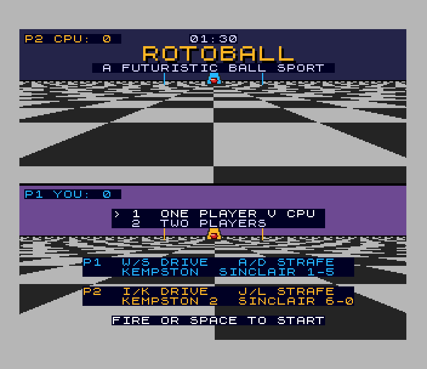
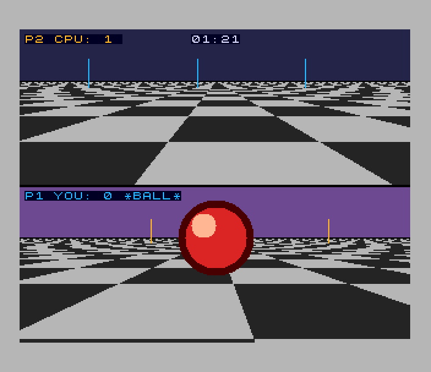
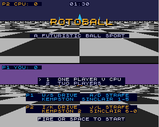

# Rotoball (Spectrum Next)

Port of `amiga_mcp/examples/rotoball` (the original, for the classic Amiga
and AmigaOS 4; the Falcon and 3DO versions are ports of it). It's a
split-screen futuristic ball sport. Two skimmers hover over a chequered
pitch. Grab the ball and carry it over the other goal line before the 90
seconds run out. The top half of the screen is P2's (or the CPU's) view and
the bottom half is P1's.

 

## Controls

| | drive (forward / back) | strafe (left / right) |
|---|---|---|
| P1 (bottom) | W / S | A / D |
| | Sinclair 2 joystick (keys 1-5) or Kempston 1: up / down | left / right |
| P2 (top) | I / K | J / L |
| | Sinclair 1 joystick (keys 6-0) or Kempston 2: up / down | left / right |

On the title, up/left or 1 picks one player against the CPU, down/right or
2 picks two players, and FIRE, SPACE or ENTER starts. Against the CPU, P1
can use either set. At full time, SPACE or fire goes back to the title.
BREAK (CAPS SHIFT + SPACE) leaves a match.

The skimmers always face the other goal, as in the original. "Right" is
right on your own half of the screen.

## What's kept, what changed

Kept from the original:

- The rules (`src/game.c`, from the original's `main.c`): the 90-second
  match, kick-off positions, carrying the ball 2 units ahead, pickup within
  3 units (ties go to P1), tackles on contact with the 60-step cooldown and
  the tackle lock, the kicks after a tackle, and goals with the 1/2/3-point
  ladder. As in the original, the ladder measures from where the carrier
  is when the ball crosses the line, so a goal is worth 1.
- The physics, in the original's 16.16 arithmetic and in the same order:
  acceleration, friction 15/16, the speed cap, the pitch bounds, the bump
  and impulse between skimmers. The truncations are kept too, so the CPU
  is a little faster going "back" than P1 going forward, as in the
  original.
- The CPU player: chase the ball, carry it to P1's goal, with a 1-unit
  deadband.
- The arena and the views. The original's 320 x 256 screen is split into
  two 128-line panes, each with its horizon a third of the way down, the
  same focal length (180), and the chequered floor of 5-unit cells. There
  are three goal posts at each end in the goals' colours, the other skimmer
  (a triangle with a hover skirt) and the three-tone ball. Positions are
  clamped to the pane as in the original, so a ball off to the side sits on
  the edge. The original's palette is used.
- The HUD: "P2 CPU: n", "P1 YOU: n" and "*BALL*" for the carrier, the clock,
  the full-time result ("YOU WIN!", "CPU WINS", "DRAW") and "PRESS SPACE".
- The two effects: CLANG on a goal and PING on a pickup or tackle.

Changed (marked `port:` in the code):

- **Two players.** The original has one player against the CPU. Here P2
  can be a second person (its own keys and joystick, `input2.h`). The title
  (the original's kick-off screen) chooses one or two players.
- **The floor is a palette, not a drawing.** The original computes every
  floor pixel for both cameras each frame. Here the floor is a fixed
  picture and the cameras move it by palette and copper (see below). The
  original's floor uses integer row distances (360 / dy) and whole-unit
  camera positions, so its stripes step in jumps. Here row distances are
  exact and the stripes slide in 1/120 steps of a two-cell period.
- **The projection** uses a reciprocal table and the Z80N's `MUL`, dividing
  by the distance's whole units as the original does. Positions can be a
  pixel off the original's. The original's divide by zero for a point less
  than 1 unit ahead is guarded.
- **Sprite sizes.** The ball's radius tops out at 31 (32 in the original),
  so its image fits 4 x 4 patterns. Skimmers above scale 15 are drawn at
  half or quarter resolution and zoomed by the hardware. A skimmer too tall
  for its pane is cut at the pane's top. The original shortens it instead.
- **The clock** counts logic steps (50 a second) instead of reading the
  real-time clock. The original also steps once per 1/50 s frame.
- **Sound.** TurboSound plays a title tune (the original has no music), a
  full-time jingle, a kick-off whistle and a menu blip, as well as the
  original's two effects (made from its partials). Effects have their own
  chip, so one never cuts the music.
- **Full time** goes back to the title (the original starts the next match
  at once). BREAK leaves a match (the original's ESC quits the program).

## Next features used

What it uses beyond a 48K/128K Spectrum, and why:

| feature | used for | why it's needed |
|---|---|---|
| **Layer 2, 320 x 256 x 8 bpp** | the whole pitch, as one fixed picture loaded straight from the `.nex` (banks 16-20). Each floor pixel's index is its sideways phase: where it falls in a two-cell period across the pitch, relative to the camera (120 indices a pane) | the original's 320 x 256 screen, at its size, with nothing redrawn. The ULA screen has two colours per 8 x 8 cell and a 48K can't redraw a perspective floor 50 times a second |
| **palettes, both Layer 2 palettes** | the cameras' sideways movement. A camera's z picks which of its pane's 120 entries are light and which dark: a rotation of a fixed run, loaded by DMA every frame. The second palette is the first inverted | moving a perspective floor with no pixels touched: about 480 bytes a frame instead of 70,000 pixels |
| **copper** | the cameras' movement down the pitch. For each floor row whose cell along the pitch is odd, the copper switches Layer 2 to its second palette (rows computed by `floor_rows.asm`, about 55 instructions a frame, rebuilt every frame). It also gives each pane **its own sprite clip window** (`nextsplit.h`), so a ball or skimmer in one view never spills into the other | per-row changes with no CPU time, and the split screen's clipping in hardware. The original clips every shape to its pane in software |
| **hardware sprites**, 8-bit patterns, **zoom** and **palette offsets** | the ball (29 sizes, up to 4 x 4 patterns), the other skimmer (35 sizes, up to 3 x 3, zoomed x2 or x4 above scale 15), the goal posts (1-pixel lines zoomed vertically only). P1's and P2's colours are one image with a palette offset. Images are made on the host by the original's drawing code (`tools/gen_gfx.py`) | nothing is drawn by the CPU. Each size is a DMA upload when it changes |
| **DMA (zxnDMA)** | sprite patterns (to port 0x5B), the floor palettes and the copper list (to NextReg 0x44 and 0x60 through port 0x253B) | the whole frame's update fits in the top border (30-60 raster lines) before the top pane's floor starts |
| **tilemap** (40 x 32) | the HUD, the title and the full-time screen in the ROM font on the original's dark boxes, scrolled 4 pixels to sit where the original's text does | text over both views without touching the picture |
| **28 MHz** | the original's 16.16 physics (32-bit arithmetic in zsdcc's library) and the projections of up to 16 points a frame | a frame takes 140-236 of the 312 raster lines at 28 MHz. At 3.5 MHz it would take several frames |
| **Z80N `MUL`** | the projection (`mul16` by a reciprocal table) and the collision's square root (`isqrt32`) | the original divides 32-bit numbers about 30 times a frame. Here that is 16 x 16 multiplies |
| **MMU banking** | the program from 0x6000 (bank 5's second page, free with the ULA off), the sprite images (8 banks) and the sound streams mapped in through slot 2 when needed | 28K at 0x8000 wasn't enough for the code plus tables. 120K of sprite images |
| **TurboSound** (3 AY chips) | the title tune on chips 0 and 1 (lead, bass, drums, arpeggio, pad), effects on chip 2 (`aystream.h` streams made by `tools/gen_sound.py`) | five music voices plus effects. One AY has three channels |
| **raster line** (NextReg 0x1E/0x1F) | the built-in profiler (`roto: perf` lines) | measuring each part of the frame |

## Frame rate

The logic runs at a fixed 50 steps a second (`frame_wait()`, at most 4
steps a frame). The picture is redrawn every frame. In the test (about
5,000 frames: the title, a whole match and a two-player match) no frame is
missed, so it runs at **50 fps**. A frame takes 140-185 of the 312 raster
lines and the slowest takes 236. The frame's update (`view_commit`) takes
30-60 lines and finishes in the top border, before the top pane's floor.

## How it's built

- `tools/gen_gfx.py` makes the Layer 2 picture, the sprite images (with the
  original's `draw_ball_sphere` and `draw_skimmer` in integer arithmetic)
  and the tables (`src/gfx_data.*`). `tools/gen_sound.py` makes the sound
  streams (`src/sound_data.*`). Both outputs are checked in.
- `src/view.c` works out the next picture during the frame
  (`view_prepare`: projections, sprite sizes, palette rotation, copper
  list). Right after the frame interrupt, `view_commit` uploads it, while
  the beam is in the top border.
- `src/game.c` (the rules) also builds on the host
  (`tools/sim.c` -> `build/host/libroto.so`). `tools/botsim.py` plays the
  test's bot against it, which is how the bot's tactic was found: it waits
  3 units to the side of the CPU's path so the tackle is a glancing one,
  and the CPU's own momentum carries it away.

## SDK modules this game added

- `input2.h`: input for two players. Each player has their own key sets
  (QAOP, WASD, IJKL, cursor), Sinclair 1/2 and Kempston 1/2. Works on the
  48K too.
- `nextsplit.h`: split screens with the copper: panes with their own
  clip windows (sprites, Layer 2, tilemap) and row-exact register moves
  (`split_row`).
- `nextspr.h`: `sprg_show_ex` (zoom, palette offset) and `sprg_hide`
  (a range in one OTIR).
- `palfx.h`: `palfx_load_bytes` (raw palette bytes by DMA, for palettes
  rewritten every frame).
- `nextcopper.h`: `copper_end` sends the list by DMA, so lists can be
  rebuilt every frame.

They are tested in `projects/splittest`.

## Test

`./zx test rotoball`:

- The title, the music on two chips, 28 MHz.
- The menu by Kempston and Sinclair 2.
- Recorded from reset: a one-player match. The bot (`tools/bot.py`) reads
  `roto_probe` each frame and plays P1 on the keys. It moves aside so the
  CPU scores, then takes the ball with a tackle and scores, again and
  again, to full time (about 12-1). The test checks the goals, the tackle,
  full time and that the score matches the goals.
- Back to the title, then a two-player match: P1 on W/D and P2 on a
  Sinclair 1 joystick each move only their own skimmer. BREAK goes back to
  the title.
- No frame missed (50 fps).
- The recording is replayed twice and every frame hash matches.

## Known issues

- Kempston 2 (P2's) isn't tested: ZEsarUX's port 0x37 doesn't read the
  emulated joystick.
- `split_row` waits for the horizontal blank before a row, as on the Next.
  ZEsarUX draws a line after that line's copper moves, so in the emulator
  each floor row's palette switch shows one row early.
- The original's quirks are kept: goals always score 1, and the CPU's top
  speed backwards is a little higher than the player's forwards.
- The floor stripes slide smoothly here, where the original's step in whole
  units, so the far rows' aliasing looks a little different.
