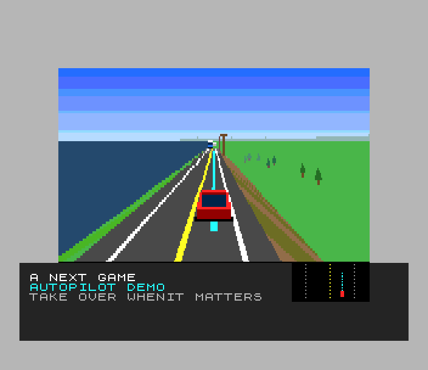
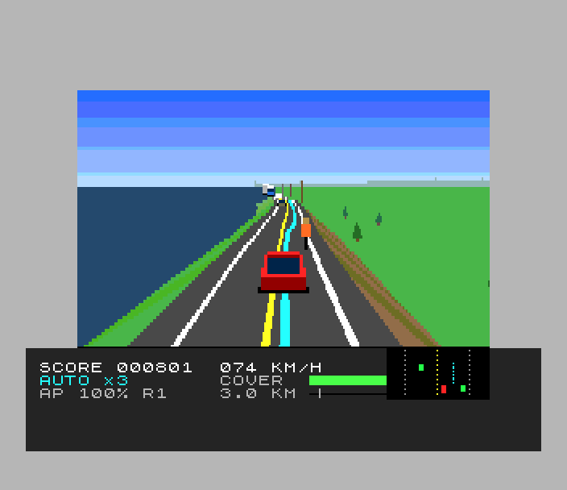
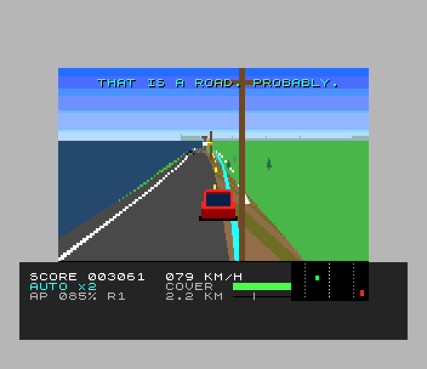
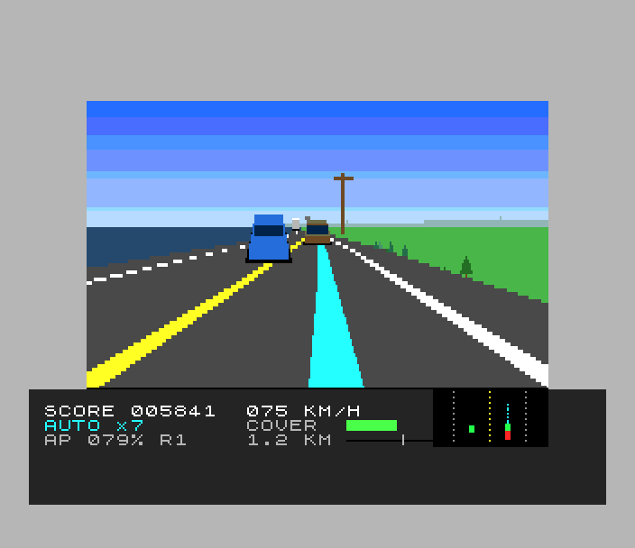
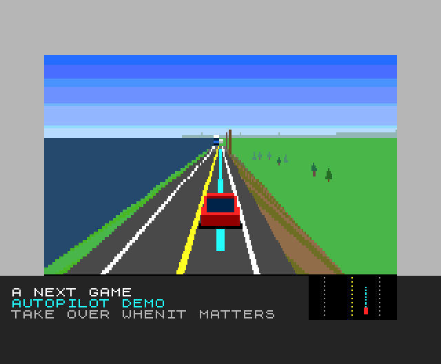

# ScAIry Fun (Spectrum Next)

Port of `amiga_mcp/examples/scairy_fun`, the self-driving car game. You ride
in a car that drives itself. Points come from the distance it drives **on
autopilot**, times how long it has stayed on (up to x8). The autopilot has
blind spots, and the game is learning them: take the wheel just before it
gets something wrong, get through, hand it back. Take over when it was right
all along and it tells you "I had that." Four routes (Levee Road, Rush Hour,
Mountain Pass, Flooded Town), each with a newer autopilot and new blind
spots; damage comes off your insurance cover, and at zero the policy is
cancelled.

 
 

## Controls

| | |
|---|---|
| O / P (cursor 5 / 8, joystick) | steer (takes over) |
| A (cursor 6, joystick down) | brake (takes over) |
| Q (cursor 7, joystick up) | accelerate (when driving yourself) |
| SPACE (M, 0, fire) | autopilot on / off (on only near a lane centre) |
| V | chase / cockpit view |
| S | pause |
| H | the rules (three pages) |
| ENTER / SPACE | start |
| BREAK | back to the title |

Keys, Sinclair and cursor joysticks and a Kempston joystick all work (the
SDK's latched input). There are no warnings: read the road (water over it,
two sets of lane lines, an overpass's shadow, cones, the low sun) and the
autopilot: its plan is the cyan ribbon, and the box at the bottom right is
its view from above.

## How it's built

**The simulation is the original's** (`world.c`, `track.c`: the car, the
autopilot's planning, perception and lane changes, traffic, hazards, damage,
scoring, the route → arrival → software update loop), at the original's
fixed 25 steps a second. Built for the Z80 as it was it is 38K of zsdcc code
in 32 bits, so:

- the values that never need 32 bits are `int16_t` (lateral offsets,
  speeds, steering, the plan), a segment is packed into 10 bytes, and the
  few products that can pass 16 bits are widened (`port:` comments);
- it is split into resident code and two 16K banks mapped at 0x0000-0x7FFF
  for each step (`world_traffic.c`, `world_ai.c`, `world_flow.c`,
  `world_scene.c`, `route.c`);
- its hottest loops (what a car follows, whether a lane is clear, finding
  objects by type, `seg_of`) are Z80N assembly doing exactly what the C did
  (`sim_asm.asm`; the C is in `sim_c.c` for the host).

`tools/check_trace.sh` builds the original's `trace_main.c` on the host and
this port's trace (`make TRACE=1`) on the Next, drives all four routes with
the perfect autopilot at 50% and 100% traffic and diffs every event and the
car every 250 steps: **identical, bit for bit**. (It found two zsdcc
miscompiles on the way, worked round in `world_int.h` / `render.c`.)

**The renderer** (`render.c`) is the original's: the road as 8 m segments
drawn far to near, each with the original's 8-point cross-section (levee
slope and river, embankment and field, rock wall, cliff, median, town,
canal), alternating stripes, lane lines (worn away where the old ones are),
guardrails, flood water, the overpass shadow, the finish line, the
autopilot's planned path, the scenery hashed from the segment number, the
skyline and the low sun. What changed for the Z80 (`port:` comments):

- the camera is road-aligned pseudo-3D: each cross-section shares its depth,
  so an edge costs one division and a MUL per point (sdk `persp`); the turn
  is a shear, the pitch a fixed horizon;
- the flat strips of a segment (shoulders, road, lines, the path, flat sides)
  are one *band*: one row loop for all of them (sdk `l2poly`); sloping
  sides are quads; the far outer strips reach the screen's edge;
- the 3D view is drawn 80 rows high and shown 160: the copper repeats each
  row (Layer 2's Y scroll every other line); text and sprites stay full
  resolution;
- far away two segments are drawn as one, the draw distance is 24 segments
  (the original's tunable `draw_dist`, 32 there), scenery is drawn flat on;
- vehicles, animals, people, debris and cones are hardware sprites
  (`sprites.c`), the original's models drawn on the host at 16 sizes
  (`tools/gen_sprites.py`) and streamed into the pattern memory each frame;
  one behind a hill crest is hidden.

**The front end** (`game.c`): the HUD, the messages, the route boxes, the
title (over the autopilot demo), the rules pages, the software update and
the high scores are on the tilemap, so the 3D view never redraws text. The
AI's view from above is drawn into Layer 2 under a hole in the HUD.

**Sound**: the original's music, "Autopilot Lounge" (`scairy.mod`),
converted by `sdk/tools/mod2ay.py` (`src/music.c`) and played by `modplay`
on TurboSound chips 1 and 2 from the interrupt; the original's effects
(chimes, blips, scrapes, crashes, the splash, the alert, the siren) on chip
0. The AI's voice lines are shown as text (the original's are samples).

**High scores** (new: the original has none): five, with initials, on the
title's cycle.

## Memory

| | sim step | drawing | front end |
|---|---|---|---|
| 0x0000-0x3FFF | bank 16: objects, traffic, the flow | bank 18: the renderer | bank 20: `game.c`, nexttile, hiscore |
| 0x4000-0x5FFF | bank 17: the autopilot, the car, the routes | page 38: sprites, the renderer's variables | |
| 0x6000-0x7FFF | (bank 17) | Layer 2 pages while filling | bank 5 for the tilemap |
| 0x8000-0xEFFF | resident: the World, world.c, track.c, the SDK | | |
| 0xF000-0xFFFF | the IM 2 table, the music (copied to 0xF200 at start), the stack | | |

Banks 40-44 hold the sprites' patterns, page 39 the music and the ROM's
font at start-up, page 42 the copper list's code.

## Next features used

What it uses beyond a 48K/128K Spectrum, and why:

| feature | used for | why it's needed |
|---|---|---|
| **28 MHz** | everything | the simulation alone is about a frame of a 3.5 MHz Spectrum's time per step at 25 steps a second... at 28 MHz it is a sixth of the time; the road is ~150 polygons and bands a frame |
| **MMU paging** (8K slots, `NEXTREG 0x50-0x57`) | three memory maps a frame: the simulation's two code banks, the renderer's bank and page, the front end's bank | 72K of code and 10K of world data; a 64K address space holds a third of it |
| **Layer 2** (256 x 192, 8 bits a pixel, double buffered) | the road, the scenery, the sky, the AI's view | the original's 32 colours per route in any pixel; a 48K's two colours per cell can't draw a road |
| **256-colour palettes** (9-bit) | each route's 32 pens, three copies fading into the haze for far segments, the low sun washing them out | the original's palettes and its glare; the fog is new |
| **copper** | the 3D view's line doubling (Layer 2's Y scroll every other line) and the sky's gradient (the fallback colour line by line), no CPU time | drawing 80 rows instead of 160 roughly halves the filling; the original's sky was a copper gradient too |
| **hardware sprites** (4-bit patterns, palette offsets, 2x-8x scaling) | the cars, trucks, the tractor, the ambulance, cyclists, deer, goats, people, debris, cones, the player's car | drawing them into Layer 2 would cost as much as the road; one model in six body colours by palette offset |
| **zxnDMA** | long spans (sky, ground, road), pattern streaming to port 0x5B, sprite attributes | about 2 T-states a byte against 11-21 for the CPU |
| **tilemap** (40 x 32, 4-bit tiles, over everything) | the HUD, messages, the boxes, title, rules, the update screen, the initials | text never has to be redrawn with the 3D view |
| **TurboSound** (3 AY chips) | the MOD on chips 1 and 2 (four channels), the effects on chip 0 | one AY has three channels |
| **Z80N instructions** | `MUL` (projection, slopes, the simulation's 32-bit products), `NEXTREG`, `ADD rr,A` | the projection is a multiply per point |

## Test

`./zx test scairy_fun` (`test.py`): a bot reads the world from memory and
plays like the original's test drivers: on the Levee Road it takes over
before the first flood, crosses it slowly and hands back (a good catch); it
leaves the old lane lines and the second flood to the autopilot (over the
embankment, into the river, the tow truck) and hands back; it looks through
the cockpit; at the marina it gets the arrival and the software update;
on Rush Hour the autopilot's blind spots take the rest of the cover: game
over, the initials (BOT), the title. It also turns the rules pages and
pauses. The game is recorded from reset and replayed twice with every frame
hash checked. Also: `tools/check_trace.sh` (the simulation against the
original), `projects/geomtest` (l2poly, persp).

Frame rate: see the end of this file.

## Kept, changed, known issues

FRAMERATE_AND_ISSUES
