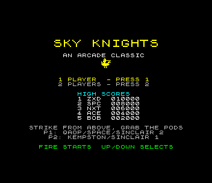
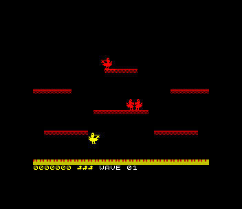
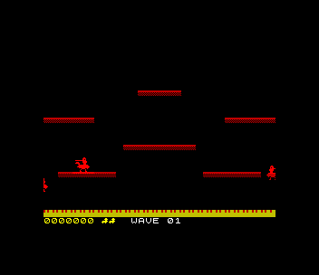

# Sky Knights (ZX Spectrum 48K)

Port of `amiga_mcp/examples/sky_knights`: joust on flying mounts. Flap to
climb, and meet the enemy knights from above: the higher knight wins (level
means both bounce off). A downed enemy drops a pod; catch it before it
cracks open into a stronger enemy. Swoopers wander, raiders and wraiths
hunt the nearest player, and each wave brings one more of them. One or two
players, three lives each.

 

## Controls

| | one player | two players |
|---|---|---|
| left / right | O / P, Sinclair 1 or 2, Kempston | P1: O / P or Sinclair 2 (1 2); P2: Kempston or Sinclair 1 (6 7) |
| flap | Q, SPACE, up or fire on a joystick | P1: Q or SPACE; P2: fire or up |
| start | 1 or 2 on the title; FIRE starts the highlighted choice (UP/DOWN chooses) | |
| initials | type three letters (or UP/DOWN + FIRE) after a high score | |

Scoring is the original's: swooper 500, raider 750, wraith 1000, a pod 250,
a cleared wave 1000 to each player still flying.

Sound: beeper effects on a 48K (a wing beat while flapping, the joust, the
pod, a lost knight, the wave fanfare); on a 128K/+2/+3 the AY plays the
original's melody all the time and the effects on the other two channels.

## What was kept, what changed

`src/game.c` is the original `game.c`: the ledges, flap physics (impulse,
gravity, top speeds, friction), wrapping at the sides, the ceiling, the
ledge undersides, the jousting rule, pods and hatching, the enemy mix of
each wave, the flap timers and the hunting, scoring and lives. The rules run
in the original's 320 x 256 world, so every distance and speed is the
original's; only the drawing is scaled (x 4/5, y 3/4). Changes, marked
`port:` in the source:

- positions and speeds are 16-bit with 1/64 pixel (16.16 in 32 bits was
  too slow); every constant is exact except gravity, 0.3 = 19.2/64, which
  is added as 19 four frames in five and 20 the fifth
- the random numbers are the SDK's xorshift (the original's LCG needs a
  32-bit multiply, and swoopers draw a number every frame)
- the lance and the mount's head point the way the knight flies (the
  original draws them on the left for facing 0, which is right)
- the score line is at the bottom (the original's sits over the top of the
  playfield); high scores, the initials editor and the title's FIRE / 1 / 2
  are new; the title selection moves with UP/DOWN (the original used flap)
- Paula played the flap sample every frame the button was held; the beeper
  gives a short wing beat every 6 frames

zsdcc's C for the per-frame work was 5-10 times too slow (one enemy took
~5000 T-states, a player-enemy pair ~3000), so the loops that run every
frame are in assembly and call back into the original C for what happens
rarely. The C they replace is kept beside them (`PHYS_IN_C`, `DRAW_IN_C`)
and the test checks that both play the same game:

| | |
|---|---|
| `src/phys.asm` | `body_step`: gravity, move, wrap, ceiling, ledge underside, landing, floor; `plat_scan`: the ledge search |
| `src/logic.asm` | every enemy (the flap timer, swoopers turning; `enemy_flap` and `enemy_seek` in C), every pod (falling, hatching and catching in C), every player-enemy pair (`joust()` in C decides) |
| `src/draw.asm` | the sprite pass: where each knight and pod is drawn now, XOR off the old place and onto the new one, then the colours |
| `src/cells.asm` | the colours: a copy of the playfield's attributes; a knight's colour goes into the cells of open sky it covers (the ledges keep theirs), the cells are put back when it moves on; the keyboard scan for the interrupt |

## 48K notes

- **Memory.** About 28K of code and data from 32768 up to 0xEF70, under the
  SDK's interrupt table at 0xF000. Code in 0x4000-0x7FFF runs ~40% slower
  while the screen is drawn (contended RAM), and the first build, started at
  24576, was: the code now starts at 32768 and tables read less often sit at
  0x6000-0x68FF (`src/mem.h`): the world-to-screen tables, the playfield's
  attributes, the input ring, the pod's image. The knights' 8 pre-shifted
  frames (3K) stay in fast RAM: every blit reads them.
- **Sprites.** 16 x 16 1-bit knights in 8 frames (facing, wings, legs; the
  left-facing ones mirrored at start), pre-shifted, XORed by the SDK's
  `sprclip` (signed x: knights slide off both edges, as they wrap). Only
  what moved is redrawn: off its old place, onto the new, one knight at a
  time, so there is no flicker of the whole field.
- **Colour.** Black sky with red ledges; each knight paints its own ink into
  the cells of sky it covers (players yellow and cyan, swoopers red, raiders
  white, wraiths blue, pods green turning magenta before they hatch). Only
  objects that moved to other cells, or that touch the cells those left,
  are repainted. Two knights in one cell share a colour: the last one wins
  (players are painted last).
- **Timing.** The interrupt samples both players' controls every frame into
  a 64-frame ring; the game runs its 50 Hz ticks from it, each with its own
  frame's input, and draws when it can. So the game plays at the original's
  speed whatever the frame rate, a tap is never lost, and a slow screen
  (the playfield redrawn at a new wave) is caught up, not dropped.
- **Frame rate** (the screen; the game always runs 50 ticks a second):

  | | enemies | fps |
  |---|---|---|
  | wave 1 | 3 | 48-50 |
  | wave 3 | 5 | 32-36 |
  | wave 5 | 7 | 19-23 |
  | wave 8+ | 8 | 15-18 |

  At wave 8 a tick takes ~30K T-states of the 70K a frame (the player's C
  ~3K, the enemies ~20K, jousts ~2K); a knight's move costs ~5K (two XORs)
  and the colours ~1-2K per knight that changed cells.

## Test

`./zx test sky_knights` (~4 minutes):

- boots to the title; FIRE starts a one-player game
- a bot reads `gs` (the game's structs) and jousts: it flies above the
  nearest enemy and drops onto it, catches pods; later it drifts under the
  enemies until the game is over; checks jousts won, pods caught, a wave
  cleared, points, lives lost, the game over, the frame rate logged
- the initials editor (BOT) and back to the title
- two players: keys move player 1 only, the Kempston player 2 only
- the recorded game replayed twice: every frame hash matches
- the assembly loops against the original C: the game records the input
  each tick took (a test hook, `tick_rec` / `tick_tape` in `main.c`); a
  build with the C loops (`PHYS_IN_C=1`) and the game play those ticks back
  and must log the same game, joust for joust
- the 128K: the AY is found and plays the melody

`--debug` prints the bot now and then; `--gif` writes
`docs/images/sky_knights.gif`.

## Known issues

- A knight that wraps past the left edge at ground level can drop below
  the ground ledge to the original's floor (as in the original, where it
  falls into the ground band) and is drawn over the score line until it
  flies up.
- Knights in the same cells share a colour (Spectrum attributes).
- The beeper's effects stop the CPU for a moment (up to ~1 frame for the
  wave fanfare); the ticks catch up.
