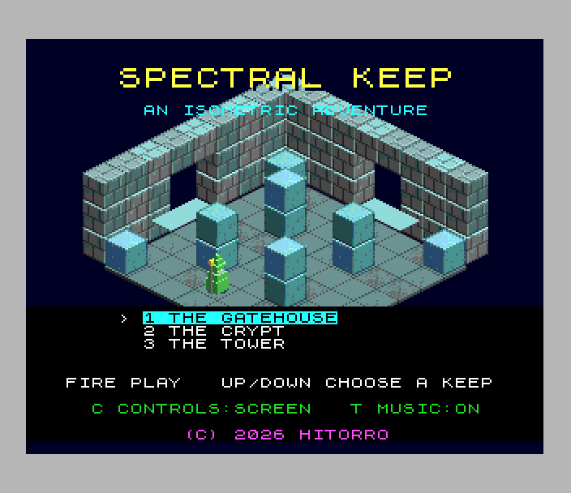
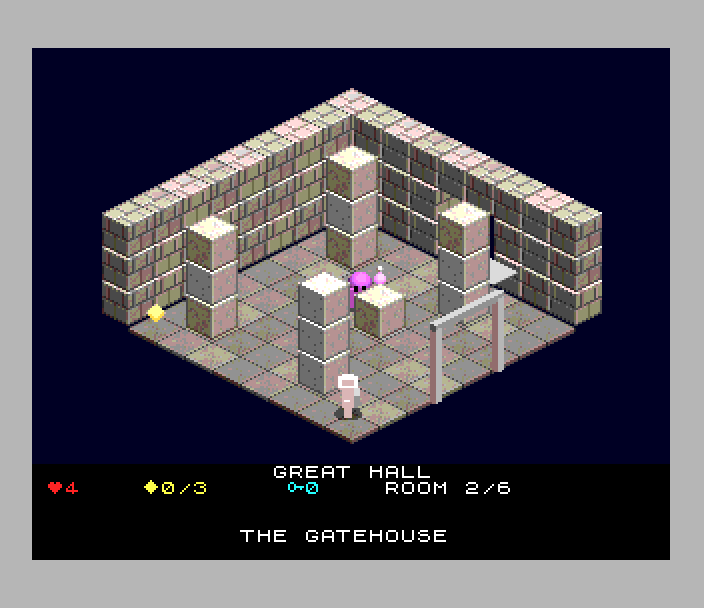
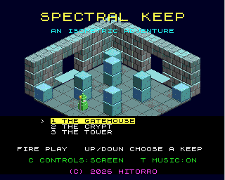

# Spectral Keep (Spectrum Next)

Port of `amiga_mcp/examples/spectral_keep`, an isometric flip-screen
adventure in the style of Knight Lore and Head over Heels (itself the
3DO/Amiga version of the Unity game). There are three keeps and 24 rooms.
Find the relics and carry them to the throne. Keys open the red gates and
potions are extra lives. Guards, hounds, ghosts, bouncers and spikes kill.

 

## Controls

| | |
|---|---|
| walk | Q A O P, cursor keys, Sinclair or Kempston joystick: relative to the screen (C on the title switches to grid directions) |
| jump | SPACE, M, 0, ENTER or fire |
| pause | H |
| title | up / down choose a keep, fire starts, C controls, T music on / off, V a tour of every room of every keep |

port: the original's P (pause), M (music) and Q+E (tour) are taken by
QAOP and fire on the Spectrum, so they are H, T and V here.

## What's kept, what changed

Kept from the original:
- Every room, cell and actor of the three keeps (`src/levels.c` is the original's `levels.c` with the cells packed).
- The rules (`src/game.c`): lives, keys, relics, potions, gates, the throne, the messages, death and respawn, the next keep, victory.
- The room builder, the actors and the physics (`src/room.c`, `src/world.c`, from Actors.cs / Physics.cs): coyote time and jump buffering, pushable crates, lifts carrying riders, the guards' patrols, hounds, ghosts, bouncers, the sages' talk.
- The title with its keep preview and the room tour.
- The HUD and its words, and the game's own font.
- The isometric view at its exact scale, and the original's draw order.
- The music (the original's seeded composer) and the effects (its table).

Changed (marked `port:` in the code):

- **16-bit fixed point.** The original is Q12 in 32-bit longs. zsdcc does
  32-bit arithmetic in library calls, and the physics tests every body
  against the others several times a step. Here positions, sizes and speeds
  are Q11 in 16 bits (`keep.h`), with each constant converted from the
  original's value in tiles and the original's beside it. The walls' height
  is 12 tiles, not 30, which is still above any jump.
  `tools/compare.py` plays the bot's game on both host builds: the same
  events on the same steps, with walking positions within 0.001 tiles.
- **Text on 8-pixel rows.** The HUD is the tilemap, so text sits on its rows
  (the original's y + 8, rounded).
- **The music on three AY chips.** It keeps the melody, bass, arpeggio,
  drums and the pad's root and fifth. The pad's third, the lead's echo and
  vibrato, and the filters are left out. One effect plays at a time.
- **No high-score table.** The original has no score. Game over shows
  relics found and rooms explored, as the original does.
- **Frame rate.** The logic always runs at the original's 50 steps a second
  (fixed timestep). The picture is redrawn at 50 fps most of the time and
  drops to 25 in busy moments (about 80% of frames on time in the test's
  game).

## Next features used

What it uses beyond a 48K/128K Spectrum, and why:

| feature | used for | why it's needed |
|---|---|---|
| **28 MHz** | the physics (every body against every other, three axes, 50 steps a second), drawing a room on entry, the sprite masks | the logic alone takes about a third of a frame at 28 MHz; at 3.5 MHz the game would run at an eighth of its speed |
| **Layer 2, 320 x 256 x 8 bpp** | the room: floor, walls, blocks, spikes, gates, the throne and the front arches, in a palette of its own (up to 127 colours), at the original's scale | the original's 320 x 240 frame fits whole, in colour; the 256 x 192 ULA screen with its two colours per 8 x 8 cell can't show textured, shaded isometric blocks |
| **hardware sprites** (up to 64 patterns, groups of 2 x 2 and 1 x 3) | everything that moves (the explorer, guards, hounds, ghosts, bouncers, sages, crates, lifts, relics, keys, potions), streamed each frame from 140 pre-rendered frames | no software drawing or restoring of the picture behind moving things: the room is drawn once |
| **sprite occlusion by masking** | a sprite behind a block, a gate or an arch has that piece's silhouette cut out of its patterns (`sprg_mask_rle`), using the original's own draw order (`iso_order`) | sprites are always over Layer 2, so this is how a character walks behind a pillar |
| **sprite priority + clip window** | sprites are numbered in the original's back-to-front order (`iso_sort`); the clip window keeps them off the title's bar | depth among moving things without redrawing anything |
| **DMA (zxnDMA)** | each frame's sprite patterns (memory -> port 0x5B), masked frames into the stage page, clearing Layer 2 | about 2 T-states a byte against OTIR's 21: tens of KB a second of patterns |
| **palettes, both of each layer** | a palette per room; its upper half is the lower half at half brightness, so a **shadow** is `OR 0x80` on the picture and leaving is `AND 0x7F`; the status panel's 3/8 shade is the second palette; flashes (relic, death, gate) tint whole palettes | shadows and shading with no pixels read or saved, and a flash in one palette load |
| **copper** | switches Layer 2's and the sprites' palettes to the second ones at the panel's top line (the original's darkened status panel) | a split screen with no CPU time or interrupt |
| **tilemap** (40 x 32, 4 bpp) | the HUD, the title and the end screens in the game's font, 2x drop-shadowed words, highlighted keep names, over everything | text is never drawn into the room's picture, so nothing has to be restored when it changes |
| **MMU banking** | code in three parts mapped in turn (rules in bank 39, the scene in bank 40, the physics and the HUD in pages at 0x6000); each room's data (palette, pieces, draw list) in its own 8K page; 140 sprite frames and 24 rooms in banks 16-33, the sound in 36-38 | zsdcc's code for the original's rules alone is 41K; with the scene, HUD and data it is about 60K, against the 28K free at 0x8000 |
| **TurboSound** (3 AY chips) | music on chips 0 and 1 (six voices), effects on chip 2, played from host-made register streams (`aystream.h`) | the original's music has seven voices plus effects; one AY has three channels |
| **Z80N `MUL`** | the projection of every moving thing (`mul16`) and square roots (`isqrt32`) | fast 16 x 16 multiplies in the per-frame drawing |
| **Z80N instructions** | `add hl,nn` in the asm mask loop | one instruction per pixel step down a pattern column |
| **raster line** (NextReg 0x1E/0x1F) | the built-in profiler (`keep: perf` lines) | measuring each part of the frame in raster lines |

## How it's built

- **Pictures** (`tools/export.c`, `tools/gen_gfx.py`). The original's own
  voxel renderer (`tools/orig/vox.c`) and room builder run on the host.
  They render every model frame (characters in 8 facings and 3 walk frames,
  the spinning relics and keys, lifts, crates) and each room's pieces
  (floor tiles, wall bricks, blocks, steps, arches, spikes, gates, throne).
  The draw list is `scene.c`'s order: the back walls by distance, the floor,
  then the static items in its dependency order, then the front arches.
  Each room gets its own palette (median cut over its picture). Brightness
  variants of a piece are colour tables over one stored base. Pieces are
  column RLE, so drawing a run is a straight copy down a Layer 2 column
  (`l2w_blit_rle`, asm). A room's blob is at most 7.3 KB.
  `test.py` checks the gate room's Layer 2 against the host's picture of it.
- **Rooms on the Next** (`src/scene.c`). On entry: load the palettes, clear
  Layer 2 (DMA), run the draw list (gates only while closed), and list the
  scenery as boxes for occlusion. A gate that opens redraws the room.
- **Each frame**. `scene_prepare()` collects the moving things, sorts them
  (`iso_sort`), finds the scenery in front of each, and gets their patterns:
  unmasked frames straight from their bank, masked ones put together on
  the stage page. It also works out the shadows (the original's ellipse at
  the ground below each actor, cut by scenery in front).
  `scene_commit()`, right after the frame interrupt, uploads the patterns by
  DMA, writes the attributes and changes only the shadow spans that moved.
- **Sound** (`tools/gen_sound.py`). The original's composer (`Music.cs` via
  the 3DO version's `assets.py`, with .NET's `System.Random`, so the
  melodies are the same) gives notes. The envelopes become AY volumes frame
  by frame. `aystream.py` keeps only the changes.
- **Memory map**: see `src/main.c`. `make` checks that bank 40's code ends
  below the scene's tables at 0x2C00.

`sh tools/make_assets.sh` remakes the pictures, levels and sound from
`tools/orig` and builds the host sims. Its outputs (`gfx/`, `sound/`,
`src/gfx_data.*`, `src/sound_data.*`, `src/levels.c`) are checked in.

## SDK modules this game added

All have tests in `projects/nextlibtest` and `sdk/tools/test_tools.py`:

- `l2rle.h`: column-RLE pieces on the 320 x 256 Layer 2, through colour tables; spans for shadows
- `nextspr.h`: sprite groups, DMA upload, masking behind pieces
- `isosort.h`: isometric box order and depth sort
- `nextcopper.h`, `nexttile.h` (tilemap text), `palfx.h` (palette effects)
- `aystream.h` + `tools/aystream.py`: TurboSound register streams
- `zxrle.h` + `tools/zxrle.py`: run-length packing
- `dma_to_port`
- `nextpic.py`'s quantize, column RLE and group patterns

## Test

`./zx test spectral_keep`:

- The gate room's Layer 2 matches the host's picture.
- Title music is on both chips, and T turns it off.
- Kempston up and down choose keeps.
- The bot (`tools/bot.py`, which also plays the host sim) reads
  `keep_probe` each frame and plays with the keys. It starts The Gatehouse,
  goes through the north door into the Great Hall and round its west side
  to the relic, then lets the ghost take all four lives: game over, then
  the title.
- No sprite pattern is dropped.
- The game is recorded and replayed twice, and every frame hash matches.

The title's room tour (V) draws all 24 rooms. `tools/profile.py` samples
the PC at random T-states while the game plays.

On the host: `python3 tools/bot.py` (the bot on the port's logic) and
`python3 tools/compare.py` (the port against the original).

## Known issues

- Busy rooms (13 crates in the Wine Cellar) and moments with several masked
  sprites drop to 25 fps for a while. The logic stays at 50 steps a second.
- Shadows fall only on Layer 2, not on sprites (a crate under a character
  shows no shadow), and are cut by scenery in front of the character, not
  of the shadow.
- One sound effect at a time (a new one replaces the last).
- The test plays The Gatehouse only. The other keeps' rooms are drawn by the
  tour, and their rules are the same code.
