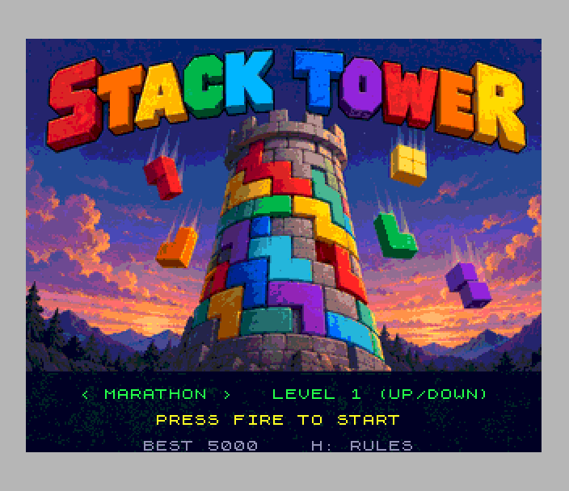
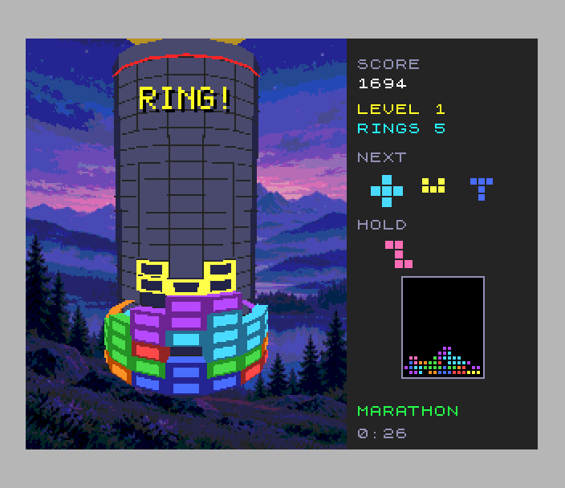
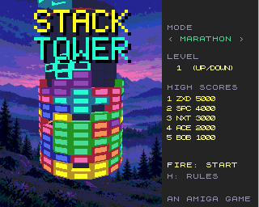

# Stack Tower (Spectrum Next)

Port of `amiga_mcp/examples/stack_tower` (the original, for the classic
Amiga and AmigaOS 4, on the shared `amiga3d` engine; the Atari Falcon and
3DO versions are ports of it). It's a falling-block puzzle wrapped round a
tower. The well is sixteen columns that go all the way round, so there are
no side walls: moving a piece left or right turns the tower under it, and
a ring only clears when the back of the tower is full too. The pieces are
the browser original's eight: a three-square rod and elbow, and six
five-square shapes.

 

## Controls

| keys | Kempston | |
|---|---|---|
| O / P (cursor 5 / 8) | left / right | turn the tower (held: repeats) |
| Q / X (cursor 7) | up | rotate clockwise |
| Z | second button | rotate anticlockwise |
| A (cursor 6) | down | soft drop |
| SPACE (M, 0) | fire | hard drop |
| C | | hold |
| G | | ghost on / off |
| ENTER | | pause |
| H | | the rules and the controls |
| BREAK (CAPS SHIFT + SPACE) | | back to the title |

Sinclair joysticks work too. On the title, left / right choose the mode,
up / down the starting level, and FIRE or ENTER starts. **Marathon** speeds
up every 10 rings; in **Rising** a ring of rubble with a gap or two pushes
up from below every few seconds; **Dig** is ten rings of rubble to clear.
After a game, a score good enough for the mode's table asks for initials
(type them, or up / down and fire).

## What's kept, what changed

Kept from the original:

- **The rules**, `src/st_core.c`: the original's `st_core.c` (the browser
  game's `stack-tower-core.js` in C) line for line: the mulberry32 random
  generator and the seeded bag, so a seed deals the same pieces as the
  Amiga and the browser; the rotation kicks, gravity (0.9 s a row at level
  1, x0.82 a level), the lock delay and its 15 resets, soft and hard drop,
  hold, the three modes, the rubble, and the scoring (100, 300, 600, 1000,
  1500 x level, the combo bonus, 2 a row for a hard drop, 1 for a soft one).
  `tests/host_diff.c` checks it: 300 random games (moves, turns, holds,
  drops, rubble, ticks, and the demo's placements) played by the port and
  by the original, compared after every step (`make -C tests`).
- **The shell**, `src/game.c`: the original's 40 ms steps, the turn's
  auto-repeat (0.28 s, then every step), the view turning a third of the
  way to the piece each step, the title's demo game (the original's
  placement rule and its `a3_hash` tie-breaks), the flash words, the help
  pages, game over.
- **The 3D look**: the original's camera (300 up, 640 back, pitched 900 of
  65536, field 200 on its 200 x 256 view), the tower of radius 140, rows 26
  high, bricks sticking out 22 (the falling piece 28, the ghost 6) with a
  shaded rim round a lit centre, the core's panels and grid, the red line,
  the drop guide, at the original's 320 x 256 pixel for pixel. The pictures
  are drawn on the host from the original's own geometry (`tools/geom.py`:
  `render.c`'s `tower_pt`, `face`, `brick`, the core).
- **The panel**: score, level, rings (or rubble left), the next three
  pieces, the held one, the whole tower unrolled round the piece, the mode
  and the time. The original's palette, and AmigaOS 4's paintings: the
  twilight landscape behind the tower and the title picture, shown in turn
  with the demo game.
- **Sound**: the original's music ("Tower Climb", its MOD) and its effects
  for moving, turning, dropping, locking, holding, rubble, rings, levels,
  winning and losing.

Changed (marked `port:` in the code):

- **The view turns in eighths of a column** (the original turns smoothly):
  everything the view changes is drawn on the host for those 8 steps.
- **Drawing order**: the original sorts every face by depth each frame.
  Here bricks are drawn furthest round first and, in a column, towards the
  eye's height last, which the tower's shape makes right.
- **The drop guide's top and bottom edges are whole lines** (the copper
  draws it, see below); the original's follow the perspective, a pixel or
  two different at the sides.
- **High scores** are new: a table of five for each mode with initials
  (the original keeps its best score a mode).
- **Keys**: the Spectrum's (QAOP, cursor keys, Kempston, Sinclair; ENTER
  pauses because P turns the tower). Help is on H.
- **The title's demo** finds where a placement lands from the columns'
  heights (the original drops each candidate a row at a time).
- The big words (the title, "TOPPED", "RING!") use the SDK's 5 x 7 font
  instead of the original's; the game-over box is narrower (it stays inside
  the part of the view redrawn every frame).

## Next features used

What it uses beyond a 48K/128K Spectrum, and why:

| feature | used for | why it's needed |
|---|---|---|
| **Layer 2, 320 x 256 x 8 bpp, double buffered** (banks 16-20 and 21-25) | the whole picture at the original's 320 x 256 with its palette: the painted backdrop, the tower, the panel | a perspective tower of shaded bricks in 30-odd colours; the ULA has two colours per 8 x 8 cell |
| **pictures drawn on the host, in 1.3 MB of banks** | for each of the 8 view steps, the backdrop with the core, grid and red line (4 pages each, columns 32..159); and every brick at each of 41 positions round the tower and each of 24 rows, in three sets (board, falling piece, ghost): 2,952 images, the left half mirrored from the right (`sdk/include/l2wrun.h`) | the original projects and sorts ~250 polygons a frame; here a brick is a copy of columns of pixels, about 6,000 T-states |
| **zxnDMA** | the base picture into the back buffer (32K), the board as last drawn to and from a cache of 4 pages (`dma_copy_pages`), the copper list | 32K in about 70,000 T-states: a frame where only the piece moved is a DMA copy plus 10 bricks |
| **copper** | the drop guide: each of the core's 16 panels has its own palette entry, and the copper turns those of the piece's columns to the guide's colour on the lines between the ghost and the piece | the guide lies on the core behind the other blocks, as the original draws it first, at no CPU cost and without redrawing the cached board |
| **palette** | the 16 panel pens (above); the ghost drawn as base pen + offset like the other bricks (its own pen pairs); the title painting's own 256 colours | one brick image draws in every piece's colours |
| **hardware sprites**, 8-bit patterns, **zoom** and **palette offsets** | the big words ("STACK TOWER", "TOPPED", "RING!", "LEVEL UP"): the 5 x 7 font as sprite patterns, zoomed x2 or x4 (`sdk/include/sprtext.h`) | words over the view that never have to be drawn into, or erased from, the double-buffered Layer 2 |
| **tilemap** (40 x 32) | the help pages, and the words over the title painting | text over everything without touching the pictures |
| **28 MHz** | the 32-bit random generator and seed hash, drawing ~100 bricks when the board changes | a full redraw takes 1-2 frames at 28 MHz |
| **MMU banking** | the program from 0x6000 (bank 5's second page, free with the ULA off); the brick images mapped over the ROM (slot 0) while they're drawn; Layer 2 through slot 2; the palettes and the music's rows in banks | the code alone fills 0x6000-0xEC00 |
| **TurboSound** (3 AY chips) | the original's MOD on chips 1 and 2 (lead, bass, organ, drums through `modplay`), the effects on chip 0 | four music channels plus effects |

A 2 MB Next (or ZEsarUX's default) is needed: the pictures go up to bank 90.

## Frame rate

The rules run at the original's fixed 25 steps a second (40 ms, every
second frame) however long drawing takes; a frame is drawn after them and
shown at the next vertical blank. A frame where only the piece moved is
the cached board copied back plus the ghost and the piece: **50 fps**. When
the board changes (a piece locks, a ring clears) or the view turns, the
board is redrawn: about 9,000 T-states a brick, 1-2 frames for a
well-filled tower.

Measured in the test (`perf` lines every 100 frames, a game of 47 pieces):
**38 fps on average while playing**, 50 fps between pieces, dips to 14-25
fps in seconds where the board changes on most steps (pieces locking
quickly on a tall tower, the view turning). The title's demo game, which
stacks a tall tower and turns to every piece, runs at 10-15 fps. The rules
always run their 25 steps a second (the test checks steps against frames).

## How it's built

- `tools/gen_gfx.py` draws everything the view needs (`tools/geom.py` is
  the original's camera and faces) into `gfx/` and writes `src/gfx_data.*`.
  `tools/make_music.py` converts the MOD (`assets/stack_tower.mod`) with
  `sdk/tools/mod2ay.py`. Both outputs are checked in.
  `tools/preview.py` draws a frame on the host the way the Next does.
- `src/tower.c` draws the tower, `src/panel.c` the panel and the words,
  `src/screen.c` sets up Layer 2, the painting and the tilemap,
  `src/sound.c` the music and the effects, `src/game.c` is the game.
- `tools/profile.py` samples where the time goes.

## Testing

`./zx test stack_tower` (`test.py`) first runs the rules as zsdcc
compiles them (`tests/z80`) through the original's four games played by the
browser's own engine (its `tests/vectors.h`): each must end with the
browser's pieces, score, board, queue and held piece. Then it boots the
game to the title (28 MHz, the
painting, the demo, the music on chips 1 and 2), turns the help pages and
picks the mode and level on the keys and the Kempston. Then, recorded from
reset: a game where `tools/bot.py` plays from the game's probe with the
keys (turning, rotating both ways, holding, pausing are each checked),
stacks 40 pieces and clears rings, then drops pieces where they are until
the tower tops out; game over, initials typed into the table, back to the
title. The recording is replayed twice and every frame's hash must match.
`make -C tests` checks the rules against the original's.
`tools/make_gif.py` makes the GIF above.

## Known issues

- It needs a 2 MB Next (ZEsarUX's default): the pictures fill banks up to
  90. A 1 MB machine would need fewer view steps or no painted backdrop.
- Redrawing the board costs about 9,000 T-states a brick, so a tall tower
  that changes on most steps (the title's demo, a fast game near the top)
  runs at 10-25 fps. The rules keep their pace; a key pressed during a slow
  frame is latched and handled in the next one.
