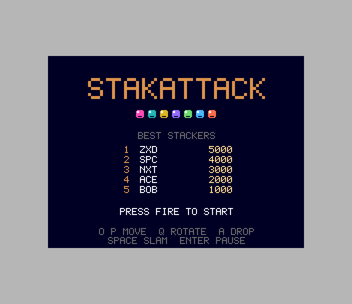
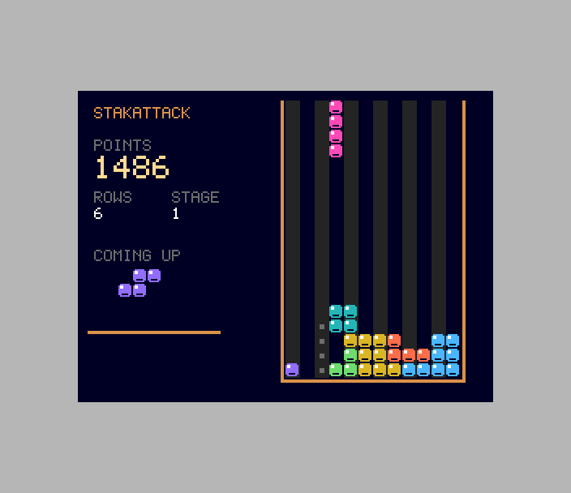
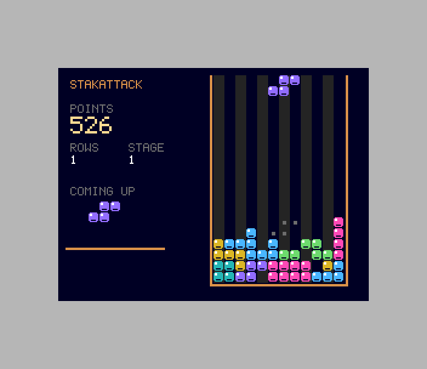

# StakAttack (Spectrum Next)

Port of `amiga_mcp/examples/stakattack`: seven gem pieces fall into a 12x19
well; rotate and slide them to complete rows. 100/300/500/800 points times
the stage for 1-4 rows, 1 a row for soft drop, 2 a row for a slam; every 10
rows the stage goes up and pieces fall faster. The game ends when a new
piece can't enter the well.

 

## Controls

| | |
|---|---|
| move | O / P, Sinclair, Kempston (hold: auto-repeat after 10 frames, as the original) |
| rotate | Q (up), or Z |
| soft drop | A (down) |
| slam (hard drop) | SPACE / fire |
| pause | ENTER |
| start | fire on the title |

## What's where

`src/game.c` is the original's logic: pieces, rotation with wall kicks,
delayed auto-shift, lock delay, line clear animation, scoring, stages, the
LCG for the piece sequence. Only `piece_fits()` is rewritten (same test,
pointer walks; the original is kept under `#if 0`). Port changes are marked
`port:`.

`src/main.c` is the Next front end:

- **Layer 2** (256x192, 8 bpp, double buffered) for the well, the HUD and the
  screens, in the original's 16 colours and 5x7 font (`src/font.c`). The
  12-pixel cells become 9-pixel gems. Each buffer remembers what it shows,
  so a frame redraws only the cells that changed.
- **Hardware sprites** for the falling piece, its landing marks and the next
  piece (12 sprites, 8 patterns).
- **TurboSound**: the original's ProTracker MOD (`tools/stakattack.mod`,
  converted by `tools/mod2ay.py` into `src/music.c`) on two AY chips: lead
  and bass on AY 0, drums (tone-sweep kick, noise snare and hat) and the
  stab/bell channel on AY 1; the drop/lock/clear effects on AY 0's third
  channel.
- **28 MHz**, 50 Hz logic as on the Amiga (one `game_update` per frame).

Additions: a high-score table on the title and initials entry after a game
(SDK `hs_*`), Z as a second rotate key. The pause and game-over boxes
cover the well, as in the original; the pieces are sprites, so they're
hidden while paused.

## Test

`./zx test stakattack`: a bot reads `gs` from memory and places each piece
with a classic stacking heuristic (holes, height, bumpiness, rows), steering
with the keys. It clears 10+ rows (stage 2), pauses and resumes once, then
slams pieces into the middle until the stack tops out (the original has no
lives: topping out is the game's only way to lose). It enters BOT in the
high-score table and returns to the title. The game is recorded and replayed
twice, every frame hash checked. `--debug` prints the bot's plans.
