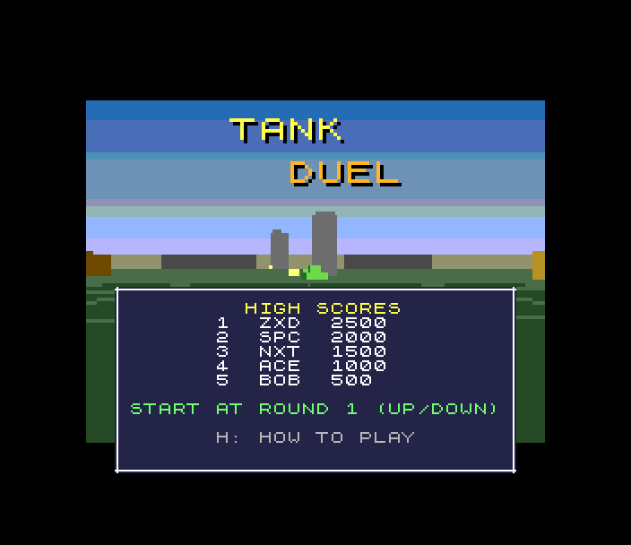
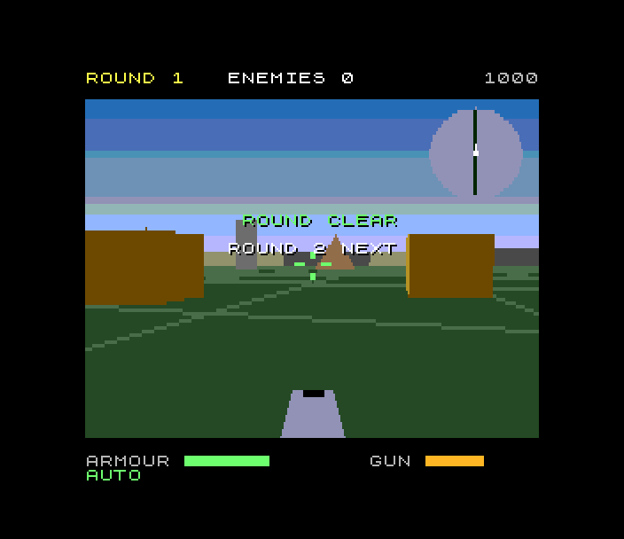
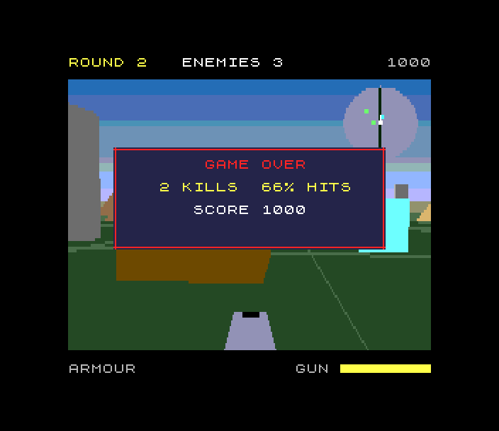

# Tank Duel (Spectrum Next)

Port of `amiga_mcp/examples/tank_duel`: a tank fight in a walled arena, seen
from the turret. Destroy every enemy tank: **scouts** circle and snipe,
**mortars** lob shells at where you will be (a red ring shows where they
land), **bulwarks** carry a shield across their front that shots glance off.
Shells bounce once off the walls, so a shot can be banked round cover;
crates break. Eight rounds, from two scouts to six tanks with three
bulwarks; +30 armour between rounds.

 
 

## Controls

| | |
|---|---|
| Q / A (cursor up / down, joystick) | forward / back |
| O / P (cursor left / right, joystick) | turn |
| SPACE (M, 0, joystick fire) | fire |
| S | pause |
| B | autopilot on / off (it also fights behind the title) |
| H | the rules and the controls (two pages) |
| BREAK | back to the title |
| title: up / down | the round to start at |

Keys, Sinclair and cursor joysticks and a Kempston all work (the SDK's
latched input). port: the original's keys are W/S/A/D and P pauses (P is
"right" in the Spectrum's QAOP); ESC is BREAK.

## How it's built

**The rules are the original's** (`td_core.c`, `td_ai.c`, from its
`td_core.c`): driving and collisions, shells banked once off the walls,
the bulwark's shield, mortar rounds and their splash, crates, the three
enemies' minds, the rounds, the scoring and the autopilot, in the
original's 16.16 fixed point at its 25 ticks a second. The amiga3d maths
they use (sine table, atan2, square roots, `FMUL`/`FDIV`) is ported in
`td_fix.c`. Port changes (`port:` in the source) keep the results the same:
values that need more than zsdcc's 16-bit `int` are `int32_t`, the
obstacle loops ask an assembly test for the obstacles within reach first
(`td_obs.asm`, re-asked after every push, so the order of the pushes is the
original's), and `fdiv` and `fhypot` are assembly doing the C's sums.

**Checked bit for bit**: `make TRACE=1` builds the original's long
autopilot fight (seed 1234, 9000 ticks); the Next ends it in round 2 with
1300 points, 4 kills and 40 armour, state hash `7CFAB335`, the original's
on the host and the Amiga (`tests/vectors.h` there). `tools/host_check.c`
runs the same files on the host. The check found a bug in the SDK's
`isqrt32` (roots of 32768 and more), also found by Marble Tilt and fixed on
main.

**The renderer** (`render.c`, `xf.asm`) is the original's picture from the
turret: the floor and its grid, the walls, the pillars, pyramids and
crates, the three tanks as the original's models (built on the host by
`tools/gen_models.py` with amiga3d's own `mdl_box` / `mdl_prism` /
`mdl_pyramid` rules: the same vertices, faces and lit/shaded pens), shells,
mortar rounds on their arcs with their rings, explosions, the gun, the
sight and the radar; everything sorted far to near, models' faces far
first, polygons clipped at the near plane, as amiga3d does. port:

- 256 x 192 at 0.8 scale; the original's 32 pens in a Layer 2 palette;
  the camera in eighths of a unit (16-bit sums over the whole arena)
- the view is drawn **96 rows high** and shown 192: the copper moves
  Layer 2's Y scroll every other line, so each row is shown twice
- the sky is the original's copper gradient: its pen is transparent and
  the copper sets the fallback colour line by line
- faces are culled in each model's own frame (the eye turned into it,
  against planes worked out on the host) before any vertex is touched;
  the transform, projection, culling and model vertices are Z80N
  assembly with `MUL` (`xf.asm`; a reciprocal table for the division)
- the walls' and the grid's corners are built from a lattice of
  camera-space steps; the grid's lines are a pixel wide (sdk `l2line`)
- tanks farther than 450 units are their hull and turret only (LOD)
- objects are sorted as objects, not polygons

**The front end** (`front.c`, `shell.c`): the title with the autopilot
fighting behind it, the HUD (round, enemies, score, the armour and gun
bars), the messages, the help pages, game over and the high scores are on
the tilemap, so the 3D view never redraws text; the radar's disc is drawn
with the view and its blips are hardware sprites. Sound: the original
synthesises its effects (it has no music); here they are TurboSound
effects in the same spirit (noise bursts for shots and explosions, a
whistle for a lob, a ring for a glance, the round-clear arpeggio, the
falling tone of defeat). High scores (new: the original keeps the best
score only): five, with initials.

## Frame rate

The rules run at the original's 25 ticks a second whatever the picture
does (fixed timestep, catching up to 12 frames). The picture, measured by
the test while the autopilot fights round 1 and 2 (`td: fps=` in the log):
**5 to 11 fps, about 8 on average**; fastest with a few objects in view,
slowest with tanks and cover close by. The rules take about a third of a
frame per tick (the original's 32-bit sums in C), and a polygon about
20,000 T-states (most of it the transform, projection and C around them,
a third the fill). This is below the 12 fps aimed for; the simplifications
above (half-height view, LOD, 1-pixel grid) took it from about 2 fps.

## Memory

| | rules | drawing | front end |
|---|---|---|---|
| 0x0000-0x3FFF | bank 16: `td_core.c` | bank 18: `render.c`, the models | bank 19: `front.c` |
| 0x4000-0x7FFF | bank 17: `td_ai.c`, `td_fix.c` | page 40 (the renderer's variables), Layer 2 pages at 0x6000 while filling | bank 5 (the tilemap) |
| 0x8000-0xE45C | resident: the game state, `shell.c`, `main.c`, `xf.asm`, `td_obs.asm`, the SDK | | |
| 0xF000- | the IM 2 table, the stack | | |

Page 41 holds the ROM's font for the tilemap at start-up.

## Next features used

What it uses beyond a 48K/128K Spectrum, and why:

| feature | used for | why it's needed |
|---|---|---|
| **28 MHz** | everything | a tick of the rules is ~190,000 T-states and a picture ~2 million: a 3.5 MHz Z80 has 70,000 a frame |
| **Z80N `MUL`** | the camera transform, projection, model vertices, face culling (`xf.asm`), `muldiv16` | every vertex is several 16 x 16 products |
| **MMU paging** | four memory maps: the rules (two banks), the renderer (a bank and a page), the front end | 50K of code; a 64K address space holds a third of it |
| **Layer 2** (256 x 192, 8 bits, double buffered) | the 3D view | flat-shaded polygons in the original's 32 colours |
| **copper** | the line doubling (Layer 2's Y scroll every other line) and the sky's gradient (the fallback colour per line) | half the rows to fill, and the original's copper sky, with no CPU time |
| **tilemap** | the HUD, messages, title, help, initials | text never redrawn with the view |
| **hardware sprites** | the radar's blips | moved without touching Layer 2 |
| **zxnDMA** | long spans (sky, floor), via `l2poly` | ~2 T-states a byte |
| **TurboSound** | the effects | three channels of effects at once |

## Files

| | |
|---|---|
| `src/td.h`, `td_core.c`, `td_ai.c`, `td_int.h` | the original's rules (port changes marked) |
| `src/td_fix.c`, `td_fix.h`, `td_obs.asm` | amiga3d's fixed point; the obstacle test, `fdiv`, `fhypot` in asm |
| `src/render.c`, `xf.asm`, `models.c` / `models.h` | the picture; `models.c` from `tools/gen_models.py` |
| `src/front.c`, `shell.c`, `main.c` | the front end, the game flow, start-up and the frame loop |
| `tools/host_check.c` | the rules on the host against the original's hash |
| `tools/make_gif.py` | `docs/images/tank_duel.gif` |

## Test

`./zx test tank_duel`: builds the trace and checks the original's result
and state hash on the Next; then boots, shows the help pages, starts round
1, pauses, lets the game's own autopilot (B) fight (kills, round 1 cleared,
round bonus, TurboSound effects heard), turns it off and waits while the
enemies destroy the idle tank, game over, enters BOT in the high-score
table, back to the title; the Kempston starts a game and turns the tank.
The game is recorded from reset and replayed twice with every frame hash
checked.
