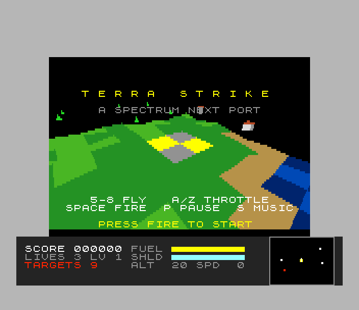
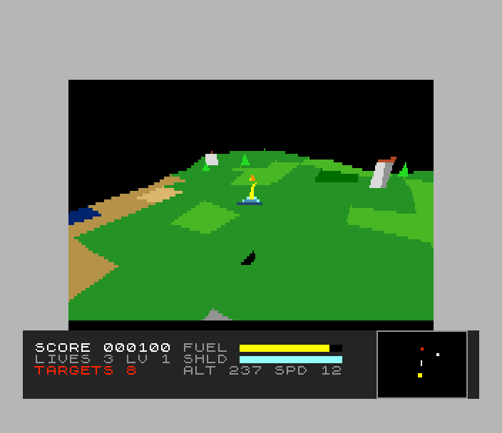
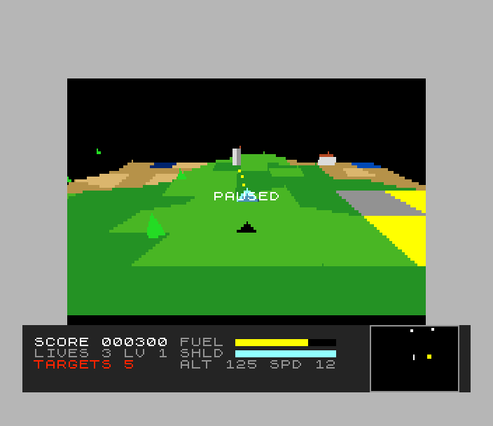
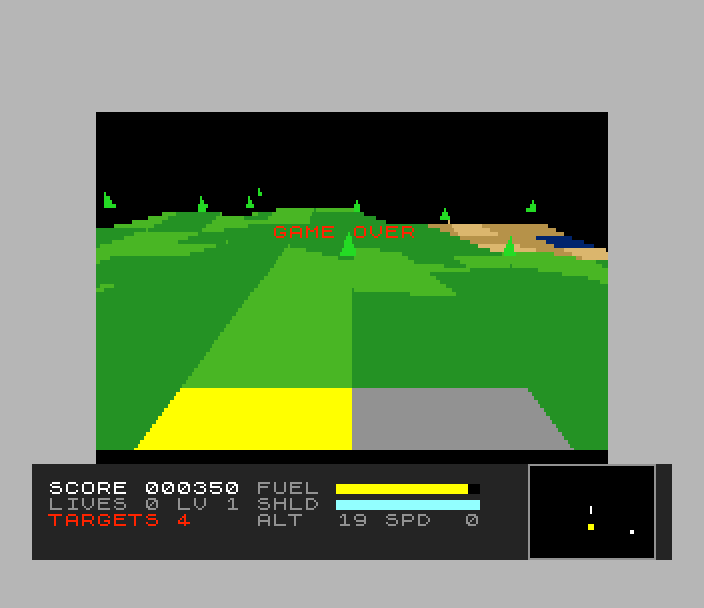
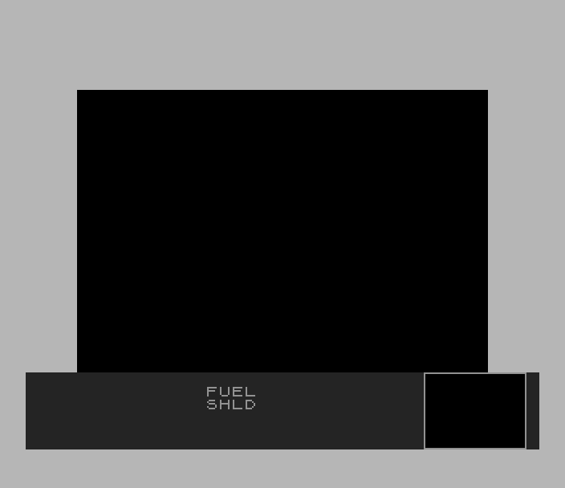

# Terra Strike (Spectrum Next)

Port of `amiga_mcp/examples/terra_strike`, a Zarch / Carrier Command style
landscape shooter: lift off from the landing pad, fly over a wrapping
fractal island and destroy the tanks, buildings and ships. Tanks and ships
shoot back. Land on the pad again to refuel and repair your shield. Clear
every target to reach the next level, which has more of them.

 
 



## Controls

| | |
|---|---|
| 5 / 8 (cursor left / right, Kempston) | turn |
| 7 / 6 (cursor up / down, Kempston) | climb (lift off from the pad) / dive; let go and the craft hovers |
| A / Z | throttle up / down |
| SPACE (0, Kempston fire) | cannon: it aims itself at a target within ~22 degrees of the nose |
| P | pause |
| S | music off / on |
| ENTER or fire | start, and back to the title after game over |
| BREAK (CAPS + SPACE) | back to the title |

The keys are the original's (its arrow keys are the Spectrum's cursor keys
5-8); its Esc is BREAK. A tap of fire or ENTER shorter than a frame is
latched by the interrupt, so it isn't lost while a slow frame is drawn.

## Build, run, test

```sh
./zx build terra_strike          # build/terra_strike.nex
./zx run terra_strike            # in a window
./zx test terra_strike           # test.py, about a minute
.venv/bin/python projects/terra_strike/tools/make_gif.py   # docs/images/terra_strike.gif
projects/terra_strike/tools/build_data.sh                  # the island, models and song (checked in)
```

`test.py` checks, on the host: the original's 67 unit tests
(`tests/test_cases.c`) against the port's simulation, and that the island,
the models and the song made again from the original's code and MOD are
the files checked in. On the Next: the title at 28 MHz with the music
playing (and S turning it off and on), a short tap starting the game, then
**the simulation tick for tick against the same C built for the host**:
at each `world_update()` the Z80's `World` and input go to
`tools/hoststep.c`, and the next tick's `World` must be the host's, over
900 ticks of flying, turning, climbing, diving and firing. Then
`tools/tsbot.py` (a pilot that reads the world and presses the keys) lifts
off and destroys targets, the frame rate is read from the game's `ts:
perf` log lines, P pauses, BREAK returns to the title, three dives into
the ground end the game, and the simulation's code pages must be unchanged
at the end.

## How it's built

**The simulation is the original's** (`world.c`, `world_setup.c`,
`terrain.c`, `ts_math.c`, the original's `world.c` split in two to fit):
the craft, its fuel and shield, the auto-aimed cannon, tanks and ships
that roam and shoot, the levels, the scoring, at the original's fixed
25 Hz whatever the picture does. Port changes are marked `port:`: a
32-bit level bonus, the event queue copied field by field, an expression
zsdcc made an invalid instruction of. The island is the original's
`terrain_generate(1987)` run on the host (`tools/gen_terrain.c`) into an
8K page of its own, the models are the original's `models_init()` written
out as tables (`tools/gen_models.c`).

**The renderer** (`render.c`, `tgrid.asm`) is the original's: the terrain
tiles around the camera and the models put into camera space, culled,
clipped at the near plane and dropped into depth buckets drawn far to near
(a painter's algorithm, as Zarch), models keyed to the depth of the tile
they stand on. port:

- 256 x 192 Layer 2, double buffered; the original's 320 x 212 view at
  0.8 (256 x 170), drawn **85 rows high and shown 170**: the copper moves
  Layer 2's Y scroll back a row every other line
- 11 x 11 tiles around the view (the original's 15 x 15)
- terrain points in camera space by sums: a grid point is the first plus
  steps across and along, only its height costs multiplies (Z80N `MUL`,
  `tgrid.asm`); 1/z from a table
- back faces culled by their winding on screen; polygons filled by the
  SDK's `l2poly`
- shots, shells and explosion particles are hardware sprites over the
  polygons (the original draws small squares, depth sorted)

**The front end**: the HUD (score, lives, level, targets, altitude, speed,
the fuel and shield bars) and the messages are on the tilemap, so the 3D
view never draws text; the radar's frame is tiles and its dots are
sprites. The title is the original's 3D flyover with the controls over it
(the original alternates it with a painted title picture, not ported).
**Sound**: the original's MOD ("patrol drive") converted for TurboSound
chips 1 and 2 by the SDK's `mod2ay.py` (`tools/make_music.py`) and played
all the time as in the original; its synthesised effects (gunfire,
explosions, hits, the crash, take-off and landing, low fuel) are AY
effects on chip 0.

## What differs from the original

- the view: 256 x 170 at half vertical resolution, 11 x 11 tiles, about
  4 frames a second where the original draws 25 (below)
- no painted title picture; the AmigaBridge variables and hooks (scenes,
  tunables, self-test) aren't there
- S turns the music off and on (new)

## Frame rate

The simulation runs at the original's 25 ticks a second whatever the
picture does (fixed timestep, catching up to 4 steps a frame). The
picture, measured by the test while its pilot fights (`ts: perf fps10=` in
the log): **3 to 6 fps, about 4 on average** (the title's flyover about 5).
Per picture, filling the polygons takes about 2 frames' time, the
simulation's 32-bit C about one frame for its 6 ticks, the HUD and radar
most of another.

## Bugs found on the way

- The WIP's profiling block in `main.c` reset `render.c`'s clip counters
  (bank 24 variables at 0x0CDE) while the simulation's bank was mapped
  there: it wrote zeros into `aim_target`'s code, the cannon's shots then
  went wild and nothing could be hit. The tick-for-tick check against the
  host build found the difference, a write watchpoint the culprit; the
  test now also compares the simulation's code pages before and after play.
- A tap of fire shorter than a slow frame was lost at the title (the keys
  were read raw once a frame): fire and ENTER are now also taken from the
  SDK's latched presses.

## Memory

| | simulation | drawing | HUD and sound |
|---|---|---|---|
| 0x0000-0x3FFF | bank 22: `world.c` (14.1K) | bank 24: `render.c`, the models (15.6K) | bank 26: `hud.c`, `sound.c`, the song, `modplay` (8.8K) |
| 0x4000-0x5FFF | page 46: `world_setup.c` (4.7K) | page 50: the draw list | |
| 0x6000-0x7FFF | page 60: the island's 64 x 64 heights (Layer 2 there while `l2poly` fills) | | |
| 0x8000-0xEC7F | resident: `main.c`, `terrain.c`, `ts_math.c`, `tgrid.asm`, `points.c`, the world, the SDK | | |
| 0xF000- | the IM 2 table, the stack | | |

Page 54 holds the ROM's font for the tilemap at start-up; banks 9-14 are
Layer 2's two buffers. Main memory has about 900 bytes to spare.

## Next features used

| feature | used for |
|---|---|
| 28 MHz | everything: a picture is ~4 frames of work at 28 MHz |
| Z80N `MUL` | the terrain's camera-space heights, the models' vertices, the projection |
| Layer 2 256 x 192, double buffered | the 3D view |
| copper | line doubling of the 85-row view |
| tilemap | HUD, messages, the radar's frame |
| hardware sprites | shots, shells, particles, the radar's dots |
| MMU banking | the simulation, the renderer and the HUD each over the ROM in turn |
| TurboSound (3 AYs) | the MOD on chips 1-2, effects on chip 0 |
