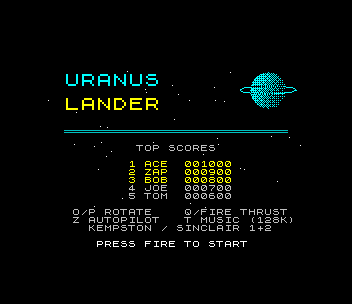
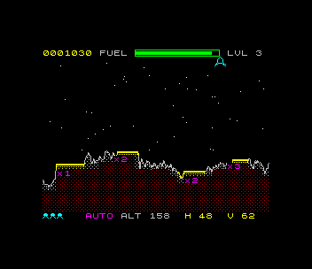
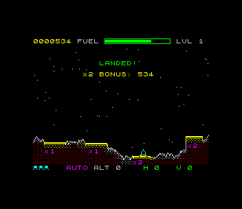
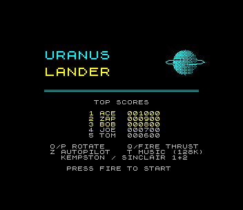

# Uranus Lander (ZX Spectrum 48K)

Port of `amiga_mcp/examples/uranus_lander`: land on the pads of Uranus. Rotate,
thrust gently against the gravity and touch down upright and slowly on a pad
before the fuel runs out; narrow pads pay more (x1, x2, x3, x5). Each level
has rougher ground, stronger gravity and less fuel. Press Z and the
autopilot flies for you.

  

## Controls

| | |
|---|---|
| rotate | O / P, Sinclair 1 (6/7), Sinclair 2 (1/2), Kempston left/right |
| thrust | Q, SPACE, M, 0, 5 or joystick fire / up |
| autopilot | Z (on/off while flying; AUTO in the bottom line) |
| music | T (128K) |
| start | fire on the title screen |
| initials | type three letters (or UP/DOWN + FIRE) after a high score |

## What was kept, what changed

`src/game.c` is the original game: the terrain generator (its random number
generator and seeds, so every level's ground and pads are the Amiga's; the
test checks them against a Python copy of the original), the 320x256 world,
the 16.16 fixed-point physics (gravity, thrust, the fuel tank), the landing
rules (on a pad, falling no faster than 55000/65536 px a frame, sideways less
than 35000, within 14/256 of a turn of upright), the bonus (multiplier x 50 +
the fuel left), lives, the respawn grace period, the explosion, and the
difficulty per level. Changes are marked `port:` in the source:

- thrust uses a Q14 sine (`fix_sin14`) and the SDK's 16 x 16 multiply
  (`fixmath.h`) instead of a 16.16 table: the same values to within 1/65536
- two zsdcc bugs worked around (see CLAUDE.md): `long + 0x8000` came out
  unsigned (so a ship just above the top of the screen "fell off the bottom")
  and a pointer-returning search picked the wrong pad
- the star scroll, the particle update and the explosion are the same
  arithmetic in assembly (`src/stars.asm`, `src/particles.asm`); zsdcc's
  32-bit C took more than a frame for 32 particles
- the high-score table and the initials are the SDK's (5 entries; the
  original's top five defaults, ACE 1000 ... TOM 600)
- the autopilot (`src/autopilot.c`) is the Atari ST port's `autopilot.py`,
  which flew the game from the host, moved into the game in fixed point:
  aim for the best-multiplier pad, tilt to get a sideways speed towards its
  centre, keep a descent speed that shrinks with altitude and 35 px of
  clearance until over the pad, upright for the touchdown. It lands every
  level the test has tried (1-5)
- the ship is drawn in 64 directions (the logic keeps 256)

`src/view.c` draws the world scaled to 256x192 (x 0.8, y 0.75); `src/main.c`
is the loop, sound and screens.

## Drawing it on a 48K

- **terrain**: drawn once per level from a 256-column heightmap (SDK
  `hmap48`): the surface line, the original's highlight line (dotted), a
  dithered brown body; cells are coloured sky / surface / ground
  (`hmap_colour`), pads bright yellow with their multiplier in magenta
- **the ship**: rotated and scaled (SDK `rot2d`), drawn with lines (SDK
  `bitline`) into a 32 x 24 image once per angle and flame state, then
  shifted into position (SDK `spr32_shift`) and XORed onto the screen. A
  move costs a shift and two XOR blits; only turning redraws lines
- **stars** (60, three parallax speeds) and **sparks** are XORed points;
  a star only shows in open-sky cells, half of them are looked at each
  frame
- **colour**: the ship tints the open-sky cells it is in cyan, the sparks
  red/yellow (SDK `attrtint`); cells with terrain keep the terrain's colours
  (no attribute clash on the scenery)
- **HUD**: rows 0 and 23 (nothing that moves goes there): score, the fuel
  gauge in the original's colours (SDK `gauge48`), level, lives, altitude
  and the sideways/vertical speeds coloured safe/marginal/fatal; one of the
  instruments is refreshed each frame, only the characters that changed
- **logic at a fixed 50 Hz**: `frame_wait()` says how many frames passed
  and the logic runs that many times, so the game runs at the Amiga's speed
  whatever the drawing costs. Measured by the test: **~26 fps while
  flying** (fewer in frames where the ship turns and is redrawn), logic
  50.0 Hz; a new level's screen takes ~0.5 s to draw, while the game waits

## 48K notes

How the game fits a 48K Spectrum:

- **memory**: ~31 KB of code and tables plus ~5.2 KB of variables. That is
  more than 0x8000-0xF000 (the SDK's IM 2 table sits at 0xF000), so the
  variables (BSS) go at 0x5D80, just past the BASIC loader, and the code
  starts at 0x7200 (`zpragma.inc`, `Makefile`); the game's own C is built
  with `--opt-code-size`. The world is kept as the original's: 640 bytes of terrain,
  32 particles in 16.16, 60 stars. The attribute "plain cell" map is a 96-byte
  bitmap, not a 768-byte copy
- **3.5 MHz**: the original's 16.16 physics is a handful of 32-bit adds a
  frame and stays as is; everything per object or per pixel was moved to
  assembly or to tables: stars, particles, lines (~45 T-states a pixel),
  the image shift, the terrain fill. Nothing is redrawn that didn't change
  (XOR on/off), the terrain never. Data below 0x8000 is contended memory
  (the ULA steals cycles while it draws the screen), which slows the
  memory-heavy loops by up to 2x; the hot code sits above 0x8000
- **1 bit a pixel + attributes**: the Amiga's 16 colours become ink per 8x8
  cell: the scenery's colours are fixed per cell (sky / surface / ground /
  pads / labels), and moving things borrow the colour of the sky cells they
  cross, so they never repaint the terrain. The terrain's brown is a red
  dither
- **beeper**: short blocking sounds only (a noise burst a frame while
  thrusting, the crash, a rising sweep on landing, the low-fuel beep), each
  under a third of a frame so the 50 Hz logic keeps up

What the **128K** adds: the AY plays the thrust rumble (noise), the crash,
the landing sweep and the low-fuel beep without stopping the CPU, and a slow
arpeggio in place of the original's MOD (T switches it off). The game itself
is the same 48K program.

## Test

`./zx test uranus_lander`: boots, starts, switches the autopilot on, which
lands on levels 1 and 2; then switches it off on level 3: the ship falls and
crashes three times; game over, fire, enters BOT in the high-score table,
back to the title. Checks: the terrain and pads of levels 1-3 against the
original's generator, the bonus rule, lives, the score, level 2's gravity and
fuel, the logic at 50 Hz, the frame rate (>= 20 fps). The whole game is
recorded and replayed twice with every frame hash checked. A 128K run checks
the AY (thrust noise on channel A) and a landing. Screenshots:
`screenshots/`; the GIF: `tools/make_gif.py`.
