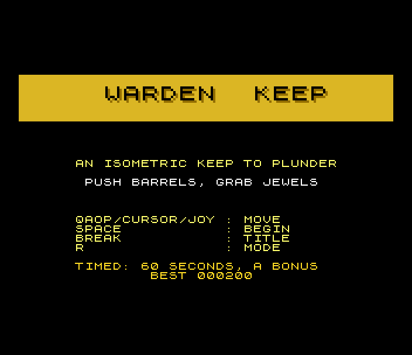
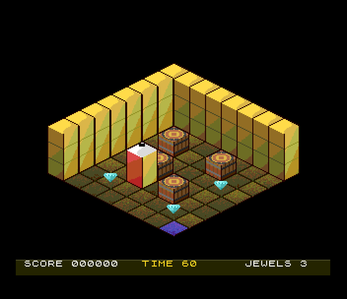
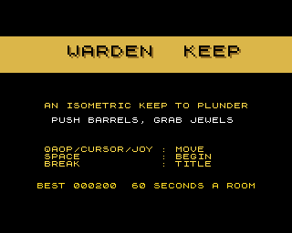

# Warden Keep (Spectrum Next)

Port of `amiga_mcp/examples/warden_keep` (also on the 3DO and the Atari
Falcon), a Filmation-style isometric room in the manner of Knight Lore and
Fairlight. Walk the keep's stone floor one tile at a time, push the barrels
out of the way and take the three jewels.

 

## Controls

| | |
|---|---|
| step | Q A O P, cursor keys, Sinclair or Kempston joystick: up is north (up-right on the screen), down south, left west, right east. One tile a press; held, it repeats after 12 frames and then every 6 (the original's) |
| start / return | SPACE, ENTER or fire |
| mode (title) | R: the timed game (the port's clock and bonus) or the relaxed one (the original: no clock) |
| back to the title | BREAK (CAPS SHIFT + SPACE) |

port: the original's Esc quits; on the Spectrum BREAK goes back to the title.

## What's kept, what changed

Kept from the original:

- **The rules**: `src/wk_core.c` is `game.cpp`, with WardenGame's
  methods as `wk_*` functions over the same state. That covers the room
  (an 8 x 8 floor, the north and west walls, the door marker), the four
  barrels and three jewels where `load_room` puts them, and the
  start at 3,6. Movement is tile-locked; facing changes even when a step
  fails. A barrel is pushed if the tile beyond is free. Walking over a
  jewel takes it (100 points), and taking all three wins. The win screen
  waits 200 frames before SPACE returns.
- **The input**: one step per press, then the original's auto-repeat
  (`main.cpp`: 12 frames, then every 6), at 50 frames a second.
- **The picture**: the original's projection
  (`sx = (wx - wy) * 16 + 160`, `sy = (wx + wy) * 8 - wz * 16 + 96`).
  Its 32 x 16 tiles, its cubes (top, left and right faces, outline),
  walls three cubes high, the player two cubes high with a notch for its
  facing, and the door's blue tile. Its painter's order: objects by
  `wx + wy`, the player before the first object further forward.
- The screens: the title's gold bar and lines, the gold "EVERY JEWEL
  CLAIMED" end screen with the final score, and the HUD bar with SCORE and
  JEWELS.

Changed (marked `port:` in the code):

- **A clock and a time bonus.** The original has no way to lose and
  every win scores 300. In the timed game (the default) a room has 60
  seconds. Running out ends the game (TIME UP, red bar), and a won room
  adds 10 points for each second left (a best of 890). The clock is in the
  HUD, red in its last 10 seconds. R on the title switches to the
  **relaxed** game: the original as it was, with no clock and no bonus.
  Relaxed games don't go in the high-score table.
- **High scores**: the SDK's five-entry table with initials (timed games),
  shown on the title in turn with the instructions.
- **Sound**: the original has none (its README lists "Real audio" as
  follow-up work). There is a slow tune in A minor on two AY chips
  (title, and quieter in play), and effects on the third: step, push,
  bump, jewel, win, time up.
- **The art is redrawn for 256 colours**: the same shapes, shaded. The
  stone floor has mortar lines and texture, the walls are lit from the
  left with courses of stone, the barrels are wood with iron bands, the
  jewels are cut gems. The original's 8 flat pens are the middles of
  these ramps. Its diamonds are drawn as diamonds: the original fills
  them as hourglasses (`ORIGINAL_BUGS.md`).
- Text is the Spectrum's ROM font on the tilemap, at the original's
  places in 8-pixel rows.

## Frame rate

50 frames a second throughout (measured in the test while the clock runs
down). Each frame the program reads the keys, steps the rules and updates
the HUD. It moves the sprites only when something moved; nothing is
redrawn on Layer 2.

## Next features used

What it uses beyond a 48K/128K Spectrum, and why:

| feature | used for | why it's needed |
|---|---|---|
| **Layer 2, 320 x 256 x 8 bpp** | the room: shaded floor, walls and door, and the HUD bar, made on the host and loaded straight into banks 30-34 by the .nex | the original's 320 x 256 isometric picture fits whole at its own scale, in 38 colours; the ULA's two colours per 8 x 8 cell would turn shaded cubes into attribute clash |
| **hardware sprites, groups** | the four barrels (2 x 2 patterns), the three jewels, the player (2 x 3, a pattern set per facing) | nothing that moves is ever drawn into the room, so nothing has to be restored behind it |
| **sprite priority** | sprite numbers follow the original's painter's order (`wx + wy`), so a barrel in front of the player covers it and one behind is covered | depth sorting with no drawing; nothing can stand behind the back walls, so the room needs no masks |
| **palettes** (9-bit) | Layer 2's 38 shades and the sprites' 41 | the shaded art; the sprites have their own palette |
| **tilemap** (40 x 32) | the HUD, the title, the end screens, the initials: ROM font text and 2x letters drawn with the bars' colour behind them | text over the picture without touching it |
| **TurboSound** (3 AY chips) | the tune on chips 0 and 1, the effects on chip 2 (host-made register streams, `aystream.h`) | music and effects at once |
| **fallback colour** | the border is the transparent colour, so it shows the fallback colour (black) under the title | a clean black screen around the tilemap with Layer 2 off |

This game doesn't need the Next's speed or memory: the rules take a
fraction of a frame and the program ends at 0xC800 with no banked code.

## How it's built

- `src/wk.h`, `src/wk_core.c`: the rules (see above).
- `src/main.c`: start-up, the 50 Hz loop with the original's
  auto-repeat, the sprites in painter's order, the HUD, the screens and
  the high scores.
- `src/sound.c`: the aystream player calls.
- `tools/gen_gfx.py`: the room picture and the sprite patterns from the
  original's geometry (`render.cpp`'s shapes in Python, with the
  shading). It writes `gfx/`, `src/gfx_data.*` and `build/preview.png`.
- `tools/gen_sound.py`: the tune and the effects (`sound/`,
  `src/sound_data.*`).
- `tools/make_gif.py`: the GIF. `tools/orig/`: the original's sources.

The generated files are checked in. Remake them with
`python3 tools/gen_gfx.py` and `python3 tools/gen_sound.py`.

## Test

`./zx test warden_keep` plays two games, recorded from reset:

- The title, with the music on two TurboSound chips.
- Game 1:
  - Kempston fire starts it.
  - A barrel is pushed (3,5 to 3,4).
  - A Kempston step takes the first jewel.
  - Holding P gives exactly the original's auto-repeat (four steps in 27
    frames) to the second jewel.
  - The last jewel wins the room: 300 plus the time bonus.
  - The initials ACE go in the table, and it's back to the title.
- Game 2: one jewel, then nothing. The clock runs out (time up), the
  initials BOB go in, and it's back to the title.
- Game 3: R picks the relaxed game. 64 seconds pass with no time up, and
  BREAK goes back to the title.
- 50 frames a second while playing.
- The session is replayed twice: every frame hash matches, and the two
  replays are identical.

Screenshots: `screenshots/` (title, play, win, initials, hiscores, clock,
gameover, relaxed).

`tools/softlock.c` shows the original's softlock on the host (below).

## Known issues

- One room, as in the original (its README lists more rooms, stairs,
  guards and sprite art as follow-up work).
- The original's softlock is kept (`ORIGINAL_BUGS.md`, shown by
  `tools/softlock.c`). Four barrels pushed into a 2 x 2 block can never
  move again, and if the block covers a jewel the room can't be won. The
  timed game's clock ends it; in the relaxed game, BREAK.
